# Лабораторна робота 1. Проєктування і розгортання CRUD-сервісу

КПІ ім. Ігоря Сікорського, ФБМІ, кафедра біомедичної кібернетики
Дисципліна «Високопродуктивні розподілені обчислювальні системи»

Виконала: студентка гр. ЗК-61мп Бойко Я. Л.
Перевірив: ст. викл. БМК Матвійчук О. В.

Київ, 2026

## Запуск стенду

```powershell
copy .env.example .env      # один раз: вписати свій пароль у .env
docker compose up -d --build                # один вебінстанс
docker compose up -d --build --scale web=2  # два вебінстанси
```

Файл `.env` у репозиторій не комітиться, шаблон лежить у `.env.example`. Після цього стенд піднімається однією командою на порожній машині (без образів, томів і бази).

## Завдання для варіанта №4

| Параметр | Значення |
|---|---|
| Сутність і шлях ресурсу | Результат лабораторного аналізу, `/lab-results` |
| Обовʼязкові поля | код пацієнта, код показника, значення, одиниці, референсний інтервал, дата проби |
| Фільтр у переліку | за кодом показника |
| Правило валідації | значення числове; референсний інтервал має нижню межу меншу за верхню |
| Базовий образ фінальної стадії | python:3.12-slim або аналог вашої мови |
| Ліміти на контейнер сервісу | 1 CPU, 768 МБ |
| Додаткова вимога до розгортання | Healthcheck сервісу працює без curl і wget: жодного з них в образі немає |

## Етап 1. Проєктування

### Таблиця `lab_results` (файл `db/schema.sql`)

| Поле | Тип | Обовʼязкове | Чому такий тип |
|---|---|---|---|
| id | BIGINT GENERATED ALWAYS AS IDENTITY, PK | так | номер запису видає база; BIGINT не переповниться |
| patient_code | VARCHAR(32) | так | код пацієнта може містити літери (P-0001) |
| test_code | VARCHAR(32) | так | код показника (GLU), поле фільтра |
| value | NUMERIC(14,4) | так | точне десяткове число без похибки float |
| unit | VARCHAR(20) | так | одиниці виміру (mmol/L, g/L, %) |
| ref_low | NUMERIC(14,4) | так | нижня межа норми, окремою колонкою, щоб база могла перевірити ref_low < ref_high |
| ref_high | NUMERIC(14,4) | так | верхня межа норми |
| sample_date | DATE | так | дата проби, час не потрібен |

Усі поля `NOT NULL`. Обмеження: `CHECK (ref_low < ref_high)` — друга лінія захисту після валідації в сервісі.

Індекси: первинний ключ за `id` (пошук за номером, саме його читає навантаження) і `idx_lab_results_test_code` за `test_code` (фільтр у переліку).

```sql
CREATE TABLE IF NOT EXISTS lab_results (
    id           BIGINT GENERATED ALWAYS AS IDENTITY PRIMARY KEY,
    patient_code VARCHAR(32)    NOT NULL,
    test_code    VARCHAR(32)    NOT NULL,
    value        NUMERIC(14, 4) NOT NULL,
    unit         VARCHAR(20)    NOT NULL,
    ref_low      NUMERIC(14, 4) NOT NULL,
    ref_high     NUMERIC(14, 4) NOT NULL,
    sample_date  DATE           NOT NULL,
    CONSTRAINT ref_range_valid CHECK (ref_low < ref_high)
);

CREATE INDEX IF NOT EXISTS idx_lab_results_test_code ON lab_results (test_code);
```

### API

**Тіло запису** однакове для POST і PUT. Усі поля обовʼязкові, `id` передавати не можна (зайві поля дають 400):

```json
{"patient_code": "P-0001", "test_code": "GLU", "value": 5.4, "unit": "mmol/L",
 "ref_low": 3.9, "ref_high": 6.1, "sample_date": "2026-10-01"}
```

**Запис у відповіді** — те саме плюс `id`:

```json
{"id": 1, "patient_code": "P-0001", "test_code": "GLU", "value": 5.4, "unit": "mmol/L",
 "ref_low": 3.9, "ref_high": 6.1, "sample_date": "2026-10-01"}
```

**Відповідь переліку** — обʼєкт, а не голий масив:

```json
{"items": [ {...запис...}, ... ], "total": 2, "limit": 20, "offset": 0}
```

**Помилка 400** (вказано поле і причину):

```json
{"detail": "validation error", "errors": [{"field": "ref_high", "error": "ref_low (7.0) must be less than ref_high (6.1)"}]}
```

**Помилка 404:** `{"detail": "lab result 20 not found"}`

**/healthz:** `{"status": "ok", "db": "up"}` (200) або `{"status": "unavailable", "db": "down"}` (503).

| Метод і шлях | Призначення | Тіло запиту | Тіло відповіді | Коди |
|---|---|---|---|---|
| POST /lab-results | створення | запис | запис з id | 201 створено; 400 невалідні дані, відсутнє поле, зайве поле (зокрема `id`), некоректний JSON |
| GET /lab-results | перелік: `limit`, `offset`, фільтр `test_code` | немає | `{items, total, limit, offset}` | 200; 400 якщо limit поза 1..100, offset < 0 або порожній test_code |
| GET /lab-results/{id} | один запис | немає | запис | 200; 404 не знайдено; 400 якщо id не ціле число ≥ 1 |
| PUT /lab-results/{id} | повна заміна | повний запис | оновлений запис | 200; 404 не знайдено; 400 невалідні дані або id |
| DELETE /lab-results/{id} | видалення | немає | порожнє | 204; 404 не знайдено (зокрема повторне видалення); 400 некоректний id |
| GET /healthz | готовність (перевіряє базу через `SELECT 1`) | немає | стан бази | 200 база доступна; 503 база недоступна |

**Пагінація:** `limit` за замовчуванням 20, максимум 100; `offset` від 0. Без фільтра повертаються всі записи з урахуванням пагінації.

**Валідація (400):** `value`, `ref_low`, `ref_high` — тільки числа (рядок `"5.4"` не приймається, NaN/Infinity теж); `ref_low < ref_high`; текстові поля не порожні; дата у форматі РРРР-ММ-ДД. Стандартну відповідь FastAPI 422 замінено власним обробником на 400.

## Етап 2. Сервіс

Сервіс написано на Python 3.12 + FastAPI + psycopg 3 (файл `app/main.py`). Ідентифікатор генерує база. Стану в памʼяті процесу немає, усе лежить у PostgreSQL. `/healthz` перевіряє саму базу (`SELECT 1`) і повертає 503, якщо вона недоступна.

Для перевірки база запущена в контейнері (таблиця створилась автоматично з `db/schema.sql`), сервіс запущено локально:

```powershell
docker run -d --name lab-db -e POSTGRES_DB=labdb -e POSTGRES_USER=lab -e POSTGRES_PASSWORD=secret -p 5432:5432 -v "${PWD}/db:/docker-entrypoint-initdb.d" postgres:16
pip install -r requirements.txt
$env:DB_PASSWORD="secret"
uvicorn app.main:app --port 8000
```

Запити перевірялись через сторінку `http://localhost:8000/docs`, яку FastAPI створює автоматично.

Таблиця 1 – Підсумок локальної перевірки

| № | Запит | Код | Відповідь сервісу |
|---|---|---|---|
| 1 | GET /healthz | 200 | `{"status":"ok","db":"up"}` |
| 2 | POST /lab-results (GLU, value 5.4) | 201 | запис з id = 1 |
| 3 | POST /lab-results (HGB, value 135) | 201 | запис з id = 2 |
| 4 | POST, value = "5.4" (текст) | 400 | поле value: Input should be a valid number |
| 5 | POST, ref_low = 7, ref_high = 6.1 | 400 | поле ref_high: ref_low must be less than ref_high |
| 6 | GET /lab-results | 200 | 2 записи, total = 2 |
| 7 | GET /lab-results?test_code=GLU | 200 | 1 запис, total = 1 |
| 8 | GET /lab-results?limit=1000 (curl.exe) | 400 | поле limit: less than or equal to 100 |
| 9 | GET /lab-results/1 | 200 | запис з id = 1 |
| 10 | GET /lab-results/20 | 404 | lab result 20 not found |
| 11 | PUT /lab-results/1 (value 7.2) | 200 | value = 7.2, sample_date = 2026-10-03, id той самий |
| 12 | PUT /lab-results/20 | 404 | lab result 20 not found |
| 13 | DELETE /lab-results/1 | 204 | без тіла |
| 14 | DELETE /lab-results/1 (повторно) | 404 | lab result 1 not found |
| 15 | GET /healthz після `docker stop lab-db` | 503 | `{"status":"unavailable","db":"down"}` |
| 16 | GET /healthz після `docker start lab-db` | 200 | сервіс перепідключився сам, без перезапуску |

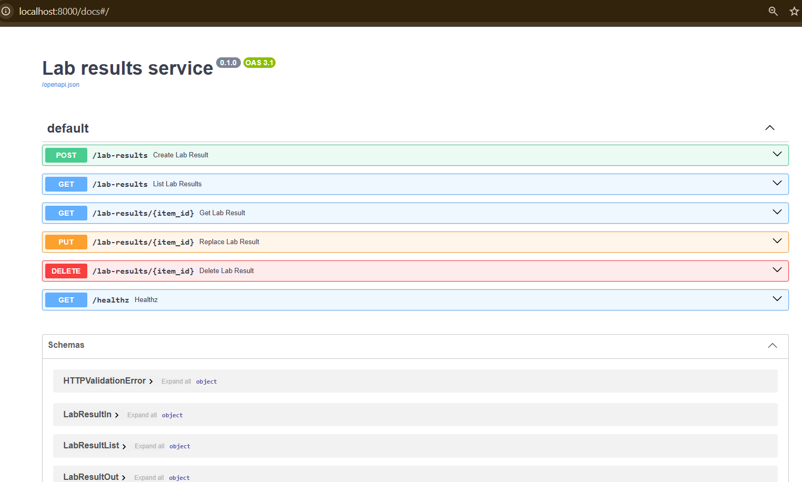
*Рисунок 1 – Сторінка /docs: шість ендпоінтів сервісу*

### Створення записів (POST)

Сервіс повертає 201 і створений запис з id, який видала база (клієнт id не передає).


*Рисунок 2 – POST /lab-results: тіло першого запису*

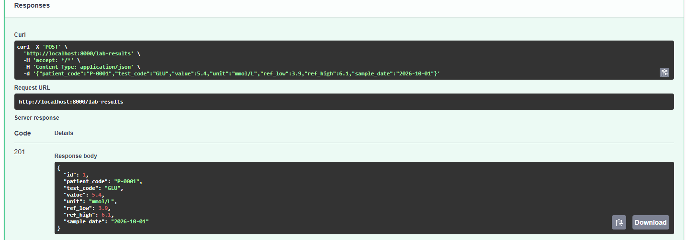
*Рисунок 3 – Відповідь 201: запис створено, id = 1*


*Рисунок 4 – POST /lab-results: тіло другого запису*


*Рисунок 5 – Відповідь 201: id = 2*

### Валідація

На невалідні дані сервіс повертає 400 і називає поле з помилкою.

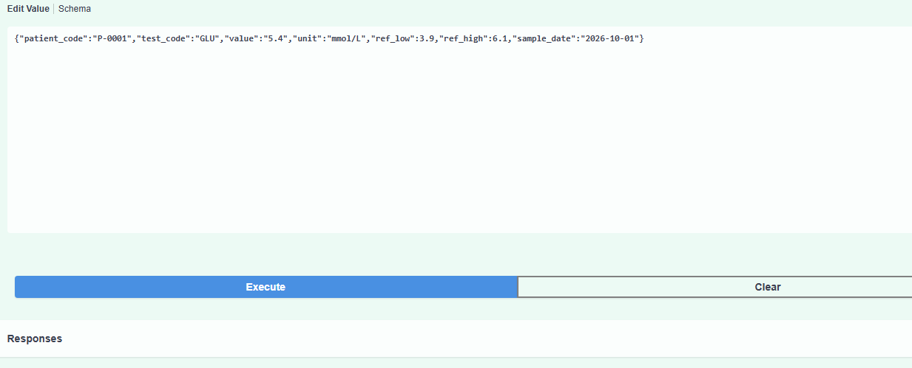
*Рисунок 6 – value передано текстом "5.4" (у лапках): відповідь 400, поле value*


*Рисунок 7 – POST з ref_low = 7 більшим за ref_high = 6.1*


*Рисунок 8 – Відповідь 400, поле ref_high*

### Перелік (GET /lab-results)

Перелік повертає обʼєкт із масивом записів і загальною кількістю `total`. Значення limit понад 100 сторінка /docs не відправляє, тому цей запит надіслано через curl.exe.

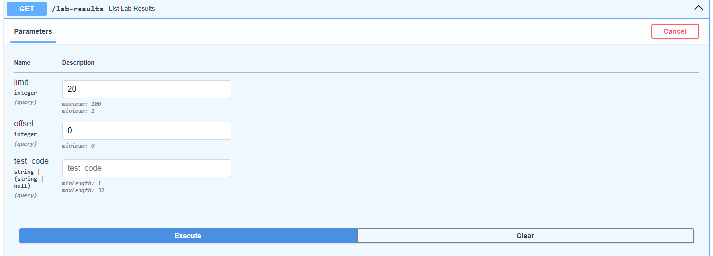
*Рисунок 9 – GET /lab-results без фільтра*

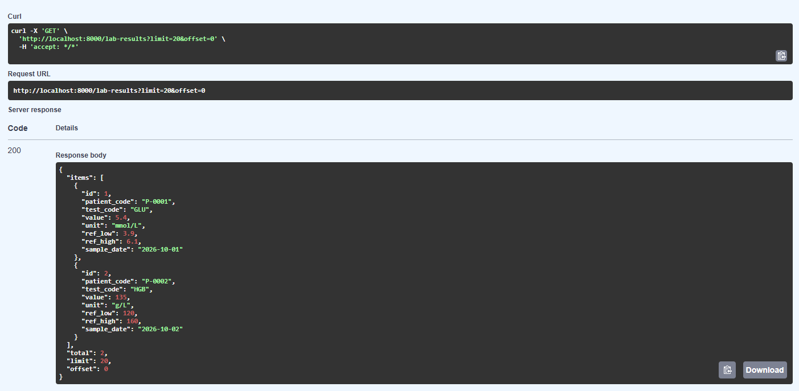
*Рисунок 10 – Відповідь 200: два записи, total = 2*


*Рисунок 11 – GET /lab-results з фільтром test_code = GLU*

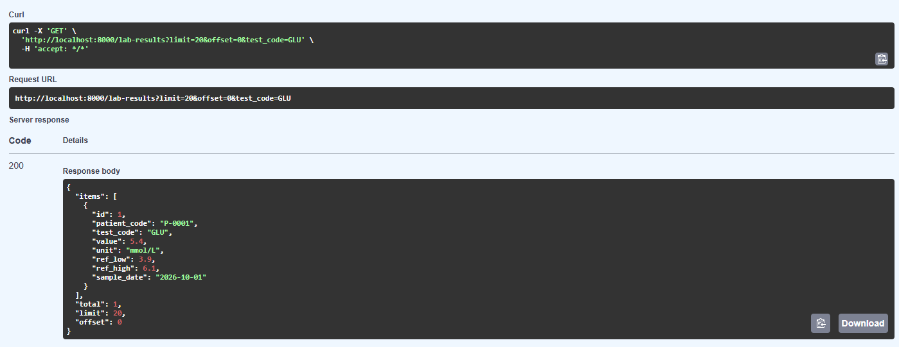
*Рисунок 12 – Відповідь 200: один запис, total = 1*

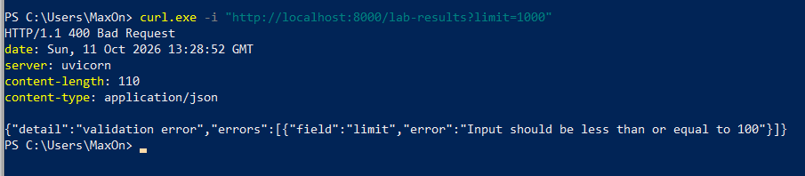
*Рисунок 13 – limit = 1000 через curl.exe: відповідь 400, поле limit*

### Один запис (GET /lab-results/{id})


*Рисунок 14 – GET /lab-results/1*


*Рисунок 15 – Відповідь 200: запис з id = 1*

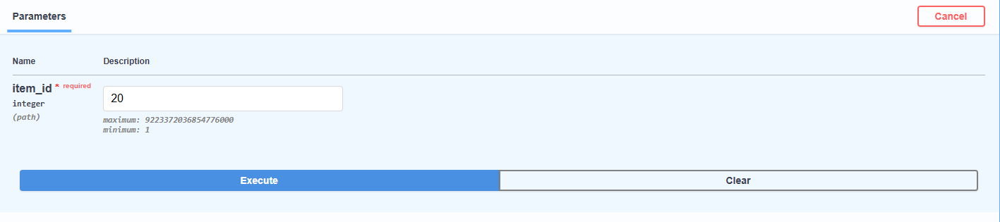
*Рисунок 16 – GET /lab-results/20: відповідь 404, запис не знайдено*

### Заміна запису (PUT)

PUT замінює запис повністю: змінилися value і sample_date, id залишився той самий.

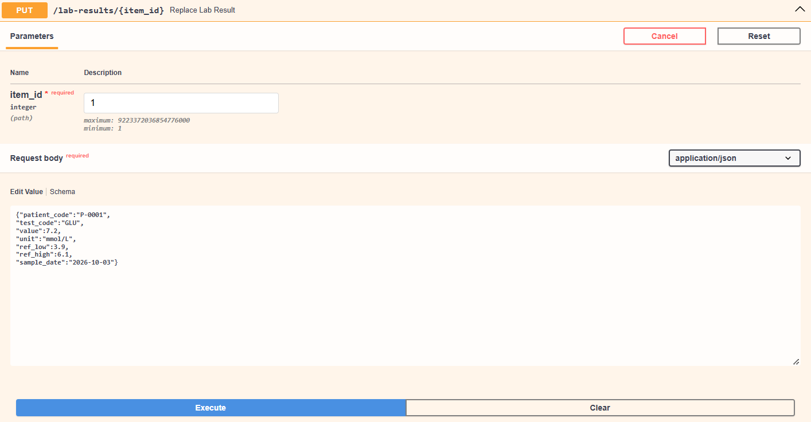
*Рисунок 17 – PUT /lab-results/1: нові значення запису*


*Рисунок 18 – Відповідь 200: value = 7.2, sample_date = 2026-10-03, id той самий*

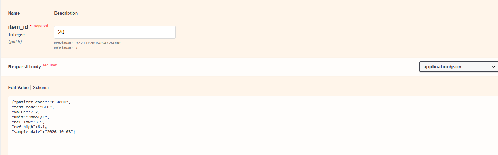
*Рисунок 19 – PUT /lab-results/20*

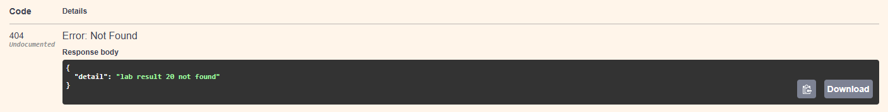
*Рисунок 20 – Відповідь 404: запис не знайдено*

### Видалення (DELETE)

Перше видалення повертає 204 без тіла, повторне — 404.


*Рисунок 21 – DELETE /lab-results/1*


*Рисунок 22 – Відповідь 204: запис видалено, тіла немає*


*Рисунок 23 – Повторний DELETE /lab-results/1: відповідь 404*

### Готовність (GET /healthz)

Після `docker stop lab-db` сервіс продовжує працювати, але /healthz повертає 503. Після `docker start lab-db` знову 200, без перезапуску сервісу.

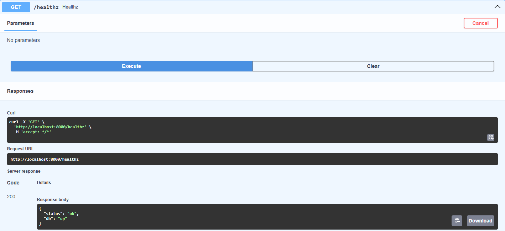
*Рисунок 24 – GET /healthz: 200, база доступна*


*Рисунок 25 – Зупинка бази: docker stop lab-db*

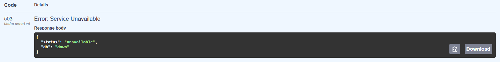
*Рисунок 26 – GET /healthz: 503, база недоступна*

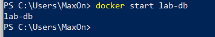
*Рисунок 27 – Запуск бази: docker start lab-db*


*Рисунок 28 – GET /healthz: 200, сервіс перепідключився сам*

## Етап 3. Образ

Збірка багатоетапна. Стадія `builder` на python:3.12-slim створює віртуальне середовище `/opt/venv`, ставить у нього залежності з `requirements.txt` і видаляє pip. Фінальна стадія на базовому образі за варіантом (python:3.12-slim) отримує тільки готове `/opt/venv` і теку `app`; pip з неї теж видалено. Компіляторів і засобів встановлення пакетів у фінальному образі немає, під час старту контейнера нічого не встановлюється.

`requirements.txt` копіюється окремо від коду: поки залежності не змінились, цей шар береться з кешу. Healthcheck образу запускає `app/healthcheck.py` на стандартній бібліотеці Python.

**Пароль не потрапляє в образ:** у Dockerfile немає `ARG`/`ENV` з паролем, `.env` виключено через `.dockerignore`, пароль передається контейнеру лише під час запуску змінною середовища з `.env`. Перевірити можна командою `docker history --no-trunc lab1-web | Select-String PASSWORD` (порожній вивід).

### Dockerfile

```dockerfile
FROM python:3.12-slim AS builder

ENV PIP_NO_CACHE_DIR=1 \
    PIP_DISABLE_PIP_VERSION_CHECK=1

RUN python -m venv /opt/venv
ENV PATH="/opt/venv/bin:$PATH"

COPY requirements.txt .
RUN pip install -r requirements.txt \
    && pip uninstall -y pip setuptools wheel

FROM python:3.12-slim AS final

ENV PATH="/opt/venv/bin:$PATH" \
    PYTHONDONTWRITEBYTECODE=1 \
    PYTHONUNBUFFERED=1

RUN python -m pip uninstall -y pip setuptools wheel || true

WORKDIR /srv
COPY --from=builder /opt/venv /opt/venv
COPY app ./app

EXPOSE 8000

HEALTHCHECK --interval=5s --timeout=4s --start-period=5s --retries=3 \
    CMD ["python", "/srv/app/healthcheck.py"]

CMD ["uvicorn", "app.main:app", "--host", "0.0.0.0", "--port", "8000"]
```

### .dockerignore

```
.git
.gitignore
.idea
.venv
__pycache__
*.pyc
.env
.env.*
Dockerfile
.dockerignore
docker-compose.yml
README.md
*.md
*.docx
results
loadgen
docs
```

Команди збірки і перевірки образу:

```powershell
docker build -t lab1-web .
docker images lab1-web
docker run --rm lab1-web python -c "import shutil; print(shutil.which('curl'), shutil.which('wget'), shutil.which('pip'), shutil.which('gcc'))"
```

**Розмір фінального образу: 219 МБ** (53.6 МБ у стиснутому вигляді).

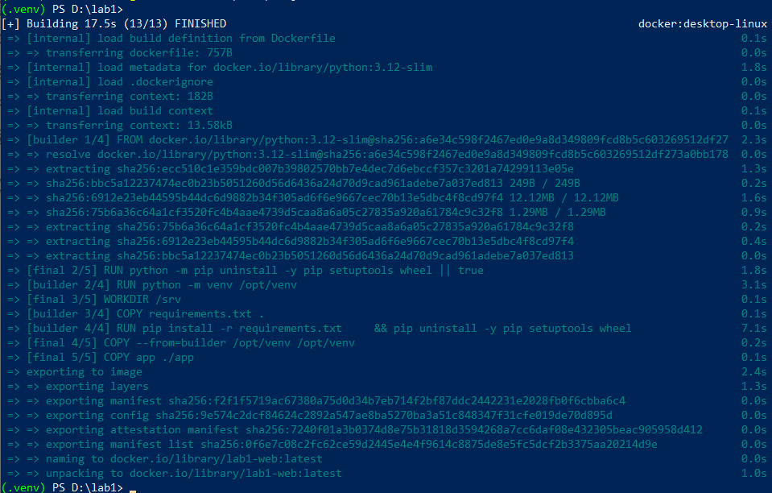
*Рисунок 29 – Збірка образу: дві стадії (builder і final) завершені без помилок*


*Рисунок 30 – Розмір образу lab1-web: 219 МБ*

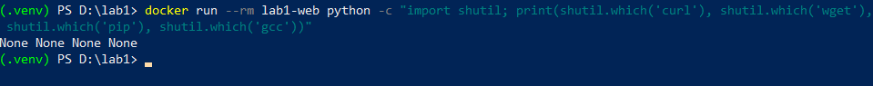
*Рисунок 31 – В образі немає curl, wget, pip і компілятора gcc*

## Етап 4. Стенд

Три сервіси у спільній мережі `backend`:

- **db**: PostgreSQL 16; дані в томі `pgdata`; схема накочується автоматично з `db/schema.sql`; healthcheck через `pg_isready`;
- **web**: образ з етапу 3; стартує після того, як db стала healthy (`condition: service_healthy`); звертається до бази за іменем `db`; ліміти за варіантом 1 CPU і 768 МБ; портів на хост не публікує;
- **lb**: nginx, єдиний сервіс з портом на хост (8000); стартує, коли web healthy, і розподіляє запити між вебінстансами.

Пароль бази не записаний ні в образі, ні в `docker-compose.yml`: значення береться з `.env`. Кількість вебінстансів задається параметром `--scale web=N` без правок у файлах.

### docker-compose.yml

```yaml
# Стенд: база, вебінстанс і балансувальник.
# Запуск з одним вебінстансом:  docker compose up -d --build
# Запуск з двома вебінстансами: docker compose up -d --build --scale web=2

services:
  db:
    image: postgres:16
    environment:
      POSTGRES_DB: ${DB_NAME}
      POSTGRES_USER: ${DB_USER}
      POSTGRES_PASSWORD: ${DB_PASSWORD}
    volumes:
      - pgdata:/var/lib/postgresql/data
      - ./db/schema.sql:/docker-entrypoint-initdb.d/schema.sql:ro
    healthcheck:
      test: ["CMD-SHELL", "pg_isready -U $${POSTGRES_USER} -d $${POSTGRES_DB}"]
      interval: 2s
      timeout: 3s
      retries: 15
    networks: [backend]

  web:
    build: .
    image: lab1-web
    environment:
      DB_HOST: db
      DB_PORT: "5432"
      DB_NAME: ${DB_NAME}
      DB_USER: ${DB_USER}
      DB_PASSWORD: ${DB_PASSWORD}
    depends_on:
      db:
        condition: service_healthy
    healthcheck:
      test: ["CMD", "python", "/srv/app/healthcheck.py"]   # без curl і wget
      interval: 3s
      timeout: 4s
      retries: 10
      start_period: 3s
    deploy:
      resources:
        limits:
          cpus: "1"                     # ліміти за варіантом
          memory: 768M
    networks: [backend]

  lb:
    image: nginx:1.27-alpine
    volumes:
      - ./lb/nginx.conf:/etc/nginx/nginx.conf:ro
    ports:
      - "8000:80"
    depends_on:
      web:
        condition: service_healthy
    networks: [backend]

volumes:
  pgdata:

networks:
  backend:
```

### lb/nginx.conf

```nginx
worker_processes auto;
events {
    worker_connections 4096;
}

http {
    # У лог пишемо адресу вебінстансу, який обробив запит
    log_format balanced '$remote_addr "$request" $status upstream=$upstream_addr time=$request_time';
    access_log /var/log/nginx/access.log balanced;

    upstream web_backend {
        server web:8000;
        keepalive 32;
    }

    server {
        listen 80;
        # Ендпоінт, який нічого не робить, для перевірки самого генератора навантаження.
        location = /noop {
            access_log off;
            return 204;
        }

        location / {
            proxy_pass http://web_backend;
            proxy_http_version 1.1;
            proxy_set_header Connection "";
            proxy_set_header Host $host;
        }
    }
}
```

Запуск і перевірка стенду:

```powershell
copy .env.example .env   # вписати свій пароль
docker compose up -d --build
docker compose ps
docker compose up -d --scale web=2
docker compose up -d --scale web=1
```

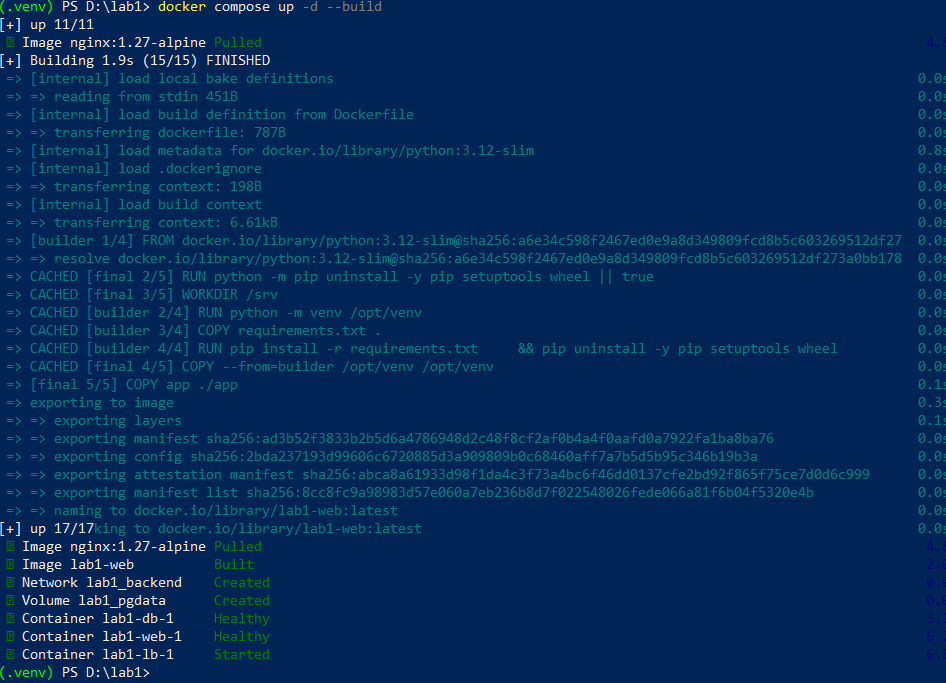
*Рисунок 32 – docker compose up: створено мережу і том, db і web стали healthy, lb запущено*

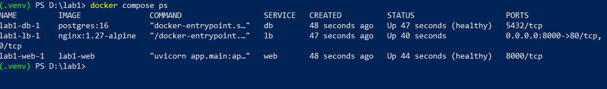
*Рисунок 33 – docker compose ps: db і web healthy, порт на хост (0.0.0.0:8000) публікує тільки lb*

`5432/tcp` і `8000/tcp` у db і web — внутрішні порти контейнерів, доступні лише в мережі Compose; на хост вони не опубліковані.

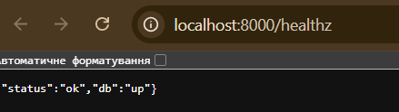
*Рисунок 34 – GET /healthz через балансувальник: база доступна*


*Рисунок 35 – Запуск з двома вебінстансами: --scale web=2, обидва healthy*


*Рисунок 36 – Повернення до одного вебінстансу: --scale web=1*

## Етап 5. Навантаження

Генератор `loadgen/loadgen.py` написано на Python без сторонніх бібліотек. Він працює у відкритому контурі:

- задана інтенсивність ділиться між процесами за кількістю ядер (8 процесів);
- кожен процес наперед обчислює моменти відправки своїх запитів від початку прогону (`t = offset + i / λ`) і в потрібний момент віддає запит пулу потоків (200 потоків на процес), не чекаючи на відповідь;
- для кожного запиту записуються запланований момент (`scheduled`), момент відправки (`sent`), момент відповіді (`done`) і код;
- **затримка рахується від запланованого моменту** (`done − scheduled`), тому в неї входить і час, який запит чекав вільного потоку в генераторі;
- тайм-аут запиту 10 с; після помилки або тайм-ауту генератор один раз повторює запит, тож запит може тривати до ~20 с і отримує код 0, якщо обидві спроби невдалі;
- **досягнута інтенсивність** = кількість запитів, що завершились (з будь-яким кодом, включно з 0) у 30-секундному вікні вимірювання, поділена на 30 с. Окремо скриптом `scripts/analyze_raw.py` пораховано **goodput** — лише відповіді 2xx за секунду;
- прогрів 10 с у результат не входить, вимірювання 30 с; кожен рівень повторюється 3 рази; у таблицю йде медіана **кожного стовпця окремо** (тобто числа в одному рядку можуть походити з різних повторів); сирі дані — у `results/raw`, підсумки прогонів — у `results/runs.jsonl`.

Вимірюється `GET /lab-results/{id}`; перед серією в базу заносяться 100 записів, id для кожного запиту береться випадково з них. Команди:

```powershell
python loadgen\loadgen.py seed                  # 100 записів у базі
python loadgen\loadgen.py check                 # перевірка генератора на /noop
python loadgen\loadgen.py series --instances 1  # серія 10/100/500, по 3 повтори
python scripts\analyze_raw.py                   # goodput, розклад затримки, закон Літтла
```

Генератор і стенд працюють на одному ноутбуці (4 ядра, 8 потоків, 16 ГБ), тому на рівні 500 запитів/с вони конкурують за ядра.

### Перевірка генератора

Генератор перевірено на `/noop`: цей ендпоінт балансувальник обробляє сам (`return 204`), без сервісу і бази.

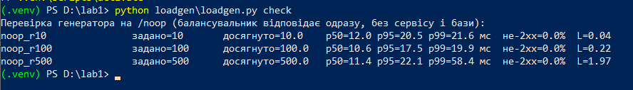
*Рисунок 37 – Перевірка генератора на /noop*

Таблиця 2 – Перевірка генератора на /noop

| Задано, запитів/с | Досягнуто, запитів/с | p50, мс | p95, мс | p99, мс | Не-2xx, % |
|---|---|---|---|---|---|
| 10 | 10.0 | 11.0 | 19.3 | 24.1 | 0 |
| 100 | 100.0 | 10.4 | 17.6 | 18.6 | 0 |
| 500 | 499.9 | 11.0 | 18.6 | 31.6 | 0 |

На всіх рівнях досягнута інтенсивність дорівнює заданій, отже генератор здатен видати 500 запитів/с, і межу в серії задає не генератор.

Розклад затримки на /noop (`scripts/analyze_raw.py`): із ~11 мс близько **8 мс — це затримка самого генератора** між запланованим моментом і фактичною відправкою (точність таймера `time.sleep` у Windows і передача запиту в пул потоків), і лише **~2.5 мс — шлях мережа Docker Desktop → nginx → відповідь**. Ці ~8 мс присутні в усіх подальших вимірюваннях як постійна добавка.

### Серія на одному вебінстансі

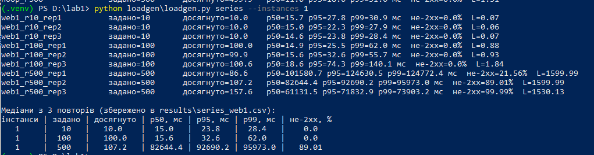
*Рисунок 38 – Серія на одному вебінстансі: 9 прогонів і медіани*

Таблиця 3 – Серія на одному вебінстансі (медіана з 3 повторів)

| Інстанси | Задано | Досягнуто | p50, мс | p95, мс | p99, мс | Не-2xx, % |
|---|---|---|---|---|---|---|
| 1 | 10 | 10.0 | 15.0 | 23.8 | 28.4 | 0 |
| 1 | 100 | 100.0 | 15.6 | 32.6 | 62.0 | 0 |
| 1 | 500 | 107.2 | 82 644 | 92 690 | 95 973 | 89.0 |

На рівнях 10 і 100 сервіс тримає задану інтенсивність: досягнуто = задано, затримка близько 15 мс (з них ~8 мс — генератор), помилок немає.

**На рівні 500 сервіс перестав встигати.** Це видно за числами: досягнуто 107 замість 500 запитів/с, goodput (відповіді 200) ще менший — 58 запитів/с, p50 близько 83 с, 89% відповідей не 2xx. Жодної відповіді 5xx не було: усі не-2xx — це код 0, тобто тайм-аут генератора.

**Чому p50 = 83 с при тайм-ауті 10 с.** Тайм-аут обмежує лише час від відправки до відповіді (максимум ~20 с з урахуванням повтору). Але генератор має 8 × 200 = 1600 потоків, і всі вони були зайняті запитами, що чекали відповіді: виміряна середня кількість відправлених незавершених запитів L = 1600.0. Решта запланованих запитів стояла в черзі пулу потоків генератора і чекала вільного потоку. Розклад медіанної затримки для прогону `web1_r500_rep2`:

Таблиця 3а – Розклад затримки на рівні 500, один інстанс (`results/analysis.csv`)

| Прогін | Досягнуто, /с | Goodput 2xx, /с | Тайм-аути, % | Очікування в генераторі, p50, мс | Від відправки до відповіді, p50, мс | Повна затримка, p50, мс |
|---|---|---|---|---|---|---|
| web1_r500_rep1 | 86.6 | 77.0 | 21.6 | 91 594 | 9 085 | 101 581 |
| web1_r500_rep2 | 107.2 | 58.2 | 89.0 | 78 315 | 3 200 | 82 644 |
| web1_r500_rep3 | 157.6 | 5.6 | 99.99 | 43 769 | 2 219 | 61 132 |

Отже, більша частина затримки — це очікування в черзі генератора, яке і є чергою, що виникла через повільний сервіс: запит мав бути відправлений, а не міг. Саме так і має поводитись відкритий контур — затримка рахується від моменту, коли клієнт хотів надіслати запит.

Повтори на 500 сильно відрізняються: goodput падав від повтору до повтору (77 → 58 → 5.6 запитів/с). Найімовірніша причина — сервіс продовжував обробляти запити, які генератор уже покинув за тайм-аутом (і повторив), а прогони йшли один за одним без паузи, тож кожен наступний повтор стартував з уже перевантаженим сервісом.

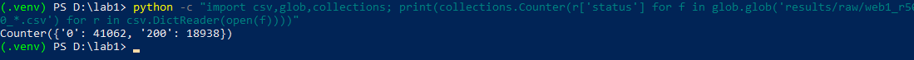
*Рисунок 39 – Коди відповідей на рівні 500 (3 прогони): 0 — тайм-аут, 200 — успіх*

Перша серія показала 58% помилок на рівні 500 через стандартне налаштування nginx (512 зʼєднань на worker): у лозі балансувальника були повідомлення «512 worker_connections are not enough». Після встановлення `worker_processes auto` і `worker_connections 4096` серію знято повторно; у таблиці наведено повторні результати.

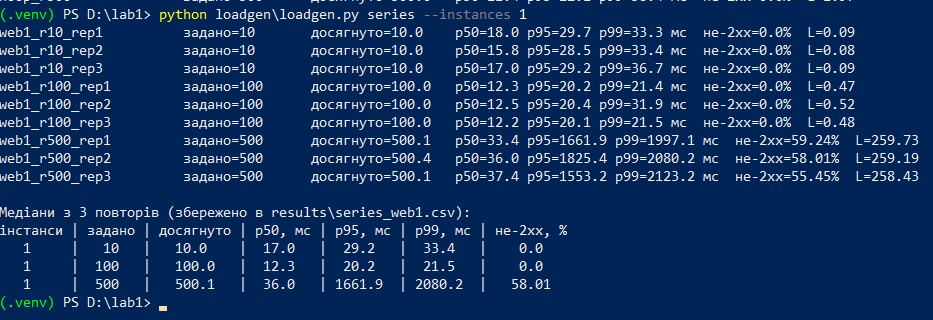
*Рисунок 40 – Перша серія (до виправлення nginx): 58% помилок на рівні 500 через ліміт зʼєднань балансувальника*

## Етап 6. Дві репліки

Стенд піднято з двома вебінстансами тим самим параметром запуску; балансувальник перестворено, бо nginx визначає адреси `web` під час старту і інакше не побачив би другого інстансу. Серію повторено:

```powershell
docker compose up -d --scale web=2
docker compose up -d --force-recreate --no-deps lb
python loadgen\loadgen.py series --instances 2
```

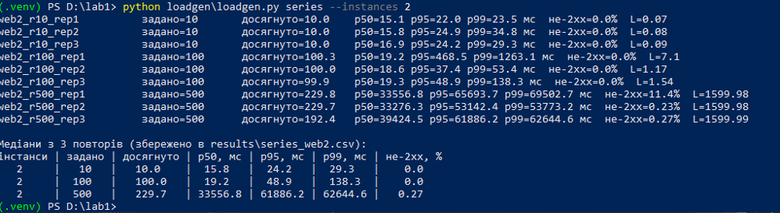
*Рисунок 41 – Серія з двома вебінстансами: 9 прогонів і медіани*

Таблиця 4 – Серія з двома вебінстансами (медіана з 3 повторів)

| Інстанси | Задано | Досягнуто | p50, мс | p95, мс | p99, мс | Не-2xx, % |
|---|---|---|---|---|---|---|
| 2 | 10 | 10.0 | 15.8 | 24.2 | 29.3 | 0 |
| 2 | 100 | 100.0 | 19.2 | 48.9 | 138.3 | 0 |
| 2 | 500 | 229.7 | 33 557 | 61 886 | 62 645 | 0.27 |

На 500 у двох інстансів goodput дорівнює досягнутій інтенсивності (229.7 запитів/с у медіанному прогоні), черга в генераторі теж утворилась (L = 1600, очікування в генераторі p50 ≈ 27 с).

### Зведена таблиця шести конфігурацій

| Інстанси | Задано | Досягнуто | p50, мс | p95, мс | p99, мс | Не-2xx, % |
|---|---|---|---|---|---|---|
| 1 | 10 | 10.0 | 15.0 | 23.8 | 28.4 | 0 |
| 1 | 100 | 100.0 | 15.6 | 32.6 | 62.0 | 0 |
| 1 | 500 | 107.2 | 82 644 | 92 690 | 95 973 | 89.0 |
| 2 | 10 | 10.0 | 15.8 | 24.2 | 29.3 | 0 |
| 2 | 100 | 100.0 | 19.2 | 48.9 | 138.3 | 0 |
| 2 | 500 | 229.7 | 33 557 | 61 886 | 62 645 | 0.27 |

### Розподіл запитів між інстансами

Підтверджено логом балансувальника: nginx записує для кожного запиту адресу інстансу (`upstream=...`).

```powershell
docker compose logs lb | Select-String -Pattern "upstream=([\d\.]+)" | ForEach-Object { $_.Matches[0].Groups[1].Value } | Group-Object | Select-Object Name, Count
docker inspect -f "{{.Name}} {{range .NetworkSettings.Networks}}{{.IPAddress}}{{end}}" lab1-web-1 lab1-web-2
```

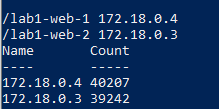
*Рисунок 42 – Розподіл запитів між інстансами за логом балансувальника*

web-1 (172.18.0.4) обробив 40 207 запитів, web-2 (172.18.0.3) — 39 242 (50.6% і 49.4%). Запити розподілено майже порівну (round-robin).

### Висновок

- На рівнях 10 і 100 другий інстанс нічого не змінив: один інстанс і так встигав.
- Рівень, на якому один інстанс перестав тримати задану інтенсивність, — **500 запитів/с** (досягнуто 107, goodput 58, p50 83 с, 89% тайм-аутів).
- З двома інстансами на 500 досягнута інтенсивність зросла з 107 до 230 запитів/с, частка помилок впала з 89% до 0.27%, p50 — з 83 до 34 с. Але 500 запитів/с не досягнуто.
- **Чому не подвоїлось і що спільне.** Порівняння з закритим контуром (етап 7.3) показує, що один інстанс при тих самих 1600 одночасних запитах без тайм-аутів обробляє 264 запити/с. Два інстанси дали 230 — не більше. Тобто другий інстанс не додав пропускної здатності, а лише прибрав колапс через тайм-аути. Межу ~230–260 запитів/с задає складова, спільна для обох інстансів: одна база PostgreSQL, один балансувальник nginx і процесор одного ноутбука, на якому одночасно працюють Docker Desktop і генератор (8 процесів × 200 потоків). Розділити внесок цих складових без вимірювання завантаження процесора кожного контейнера (`docker stats`) неможливо; найімовірніший кандидат — спільний процесор ноутбука, а серед контейнерів — база.

## Етап 7. Розрахунки

### 1. Прискорення і метрика Карпа-Флатта

Прискорення S = X₂ / X₁, де X — досягнута інтенсивність на тому самому рівні. Метрика Карпа-Флатта:
e = (1/S − 1/N) / (1 − 1/N), для N = 2: e = (1/S − 0.5) / 0.5.

**Рівень 500 запитів/с:**
S = 229.7 / 107.2 = 2.14;
e = (1/2.14 − 0.5) / 0.5 = (0.467 − 0.5) / 0.5 = **−0.07**.

Рівні 10 і 100: S = 10.0 / 10.0 = 1.00 і S = 100.0 / 100.0 = 1.00. Тут сервіс не насичений, досягнута інтенсивність дорівнює заданій, тому метрика для цих рівнів не інформативна.

**Що означає e < 0.** S > 2 неможливе при «чесному» розпаралелюванні. Воно виникло тому, що один інстанс на 500 працював у режимі колапсу: запити, що не встигали за 10 с, генератор покидав і повторював, а сервіс уже витратив на них процесорний час (goodput лише 58 запитів/с). Два інстанси встигали відповідати швидше за тайм-аут, тож колапсу не було. Тобто S = 2.14 порівнює не дві пропускні здатності, а «колапс» і «не колапс».

**Оцінка за реальною пропускною здатністю.** Якщо як X₁ взяти пропускну здатність одного інстансу без тайм-аутів — 263.9 запитів/с із закритого контуру при тих самих 1600 одночасних запитах (етап 7.3), то:
S = 229.7 / 263.9 = 0.87; e = (1/0.87 − 0.5) / 0.5 = (1.149 − 0.5) / 0.5 = **1.30**.
e ≥ 1 означає, що виграшу від другого інстансу немає взагалі: пропускна здатність обмежена спільною складовою стенду — однією базою PostgreSQL, балансувальником і процесором ноутбука, який стенд ділить з генератором.

### 2. Перевірка закону Літтла

L = λ · W. Рівень 100 запитів/с, один інстанс, прогін з медіанним W (`web1_r100_rep2`).

- λ — кількість запитів, відправлених за секунду вікна вимірювання;
- W — середній час від відправки до відповіді;
- L (виміряне) — середня за прогін кількість відправлених, але ще не завершених запитів (різниця між відправленими і завершеними, усереднена за часом).

λ = 100.00 запитів/с; W = 0.00931 с;
λ · W = 100.00 · 0.00931 = **0.9306**;
виміряне L = **0.9304**;
розбіжність = |0.9304 − 0.9306| / 0.9306 · 100% = **0.02%**.

Закон виконується: в середньому в системі перебуває менше одного запиту, бо кожен обробляється приблизно за 9 мс, а нові надходять кожні 10 мс.

W = 9.3 мс менше за p50 = 15.6 мс у таблиці 3, бо p50 рахується від запланованого моменту і містить ~8 мс затримки генератора до відправки, а W — від фактичної відправки (лише час, коли запит справді перебував у системі).

### 3. Порівняння з закритим контуром

Рівень, де сервіс не тримає задану інтенсивність: 500 запитів/с, один інстанс. У відкритому контурі в системі одночасно перебувало 1600 запитів (виміряне L = 1600.0), тому закритий контур запущено з такою самою кількістю одночасних запитів:

```powershell
python loadgen\loadgen.py closed --instances 1 --rate 500 --concurrency 1600
```

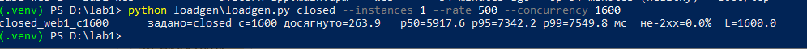
*Рисунок 43 – Прогін у закритому контурі: 1600 одночасних запитів, один інстанс*

Таблиця 5 – Відкритий і закритий контур, один інстанс

| Контур | Досягнуто, запитів/с | p95, мс |
|---|---|---|
| Відкритий (задано 500) | 107.2 | 92 690 |
| Закритий (1600 одночасних) | 263.9 | 7 342 |

Закритий контур показує меншу затримку (p95 7.3 с проти 92.7 с) і більшу досягнуту інтенсивність без жодної помилки.

**Чому.** У закритому контурі наступний запит відправляється лише після відповіді на попередній, тому генератор сам сповільнюється до швидкості сервісу: черга не росте понад 1600 запитів, а час, який запит мав би чекати до відправки, у вимірювання не потрапляє (затримка рахується від моменту фактичної відправки). Перевірка: за законом Літтла W = L / λ = 1600 / 263.9 = 6.06 с — це і є затримка, яку бачить закритий контур, вона менша за тайм-аут 10 с, тому помилок немає.

У відкритому контурі запити надходять за розкладом (500 за секунду) незалежно від відповідей. Ті, що не можуть бути відправлені, чекають у черзі, і це очікування входить у затримку (у медіані ~78 с з 83 с). Крім того, запити, що чекали відповіді понад 10 с, відпадають за тайм-аутом і повторюються після того, як сервіс уже витратив на них час, тому корисна пропускна здатність падає до 58–107 запитів/с. Тож закритий контур на тому самому сервісі приховує реальне перевантаження, яке бачив би клієнт.

## Етап 8. Додаткова вимога

**Вимога:** healthcheck сервісу працює без curl і wget: жодного з них в образі немає.

**Як виконано.** Перевірку стану контейнера робить скрипт `app/healthcheck.py` на стандартній бібліотеці Python (urllib). Він звертається до `http://127.0.0.1:8000/healthz` усередині контейнера і завершується з кодом 0, якщо відповідь 200, або з кодом 1 в іншому разі. Скрипт підключено в Dockerfile (`HEALTHCHECK`) і в docker-compose.yml (healthcheck сервісу web). Оскільки /healthz перевіряє саму базу, healthcheck показує готовність сервісу разом з базою.

```python
import sys
import urllib.request

try:
    with urllib.request.urlopen("http://127.0.0.1:8000/healthz", timeout=3) as resp:
        sys.exit(0 if resp.status == 200 else 1)
except Exception:
    sys.exit(1)
```

**1. Healthcheck виконується скриптом Python**

```powershell
docker inspect lab1-web-1 --format "{{json .Config.Healthcheck.Test}}"
```

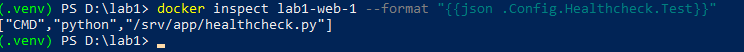
*Рисунок 44 – Команда healthcheck контейнера: python /srv/app/healthcheck.py*

**2. Healthcheck працює: контейнер healthy**

```powershell
docker compose ps
docker inspect lab1-web-1 --format "{{.State.Health.Status}} {{range .State.Health.Log}}| exit={{.ExitCode}} {{end}}"
```

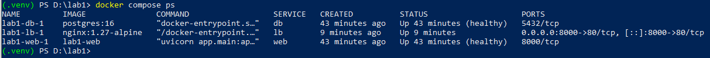
*Рисунок 45 – docker compose ps: web-1 у стані healthy*


*Рисунок 46 – Останні 5 перевірок healthcheck: exit=0, статус healthy*

**3. curl і wget в образі немає**

```powershell
docker compose exec web curl --version
docker compose exec web wget --version
docker compose exec web python -c "import shutil; print(shutil.which('curl'), shutil.which('wget'))"
```

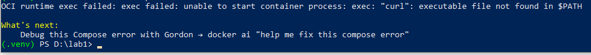
*Рисунок 47 – Спроба запустити curl у контейнері: executable file not found*

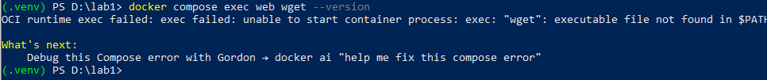
*Рисунок 48 – Спроба запустити wget у контейнері: executable file not found*


*Рисунок 49 – Пошук curl і wget у контейнері: None None*

**4. Healthcheck реагує на недоступність бази**

Щоб показати, що healthcheck не «завжди зелений», базу зупинено. Сервіс продовжує працювати, але /healthz повертає 503, скрипт завершується з кодом 1, і після кількох невдалих перевірок поспіль Docker позначає контейнер unhealthy.

```powershell
docker compose stop db
docker compose ps -a
curl.exe -i http://127.0.0.1:8000/healthz
docker compose logs web --tail 5
docker inspect lab1-web-1 --format "{{.State.Health.Status}} {{range .State.Health.Log}}| exit={{.ExitCode}} {{end}}"
docker compose start db
```


*Рисунок 50 – База зупинена: web-1 у стані unhealthy*

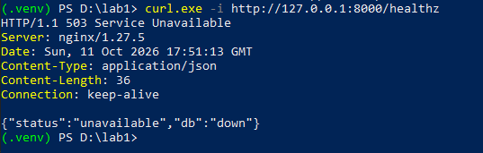
*Рисунок 51 – GET /healthz при зупиненій базі: 503, db down*

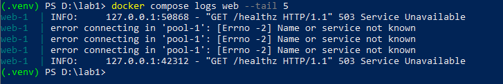
*Рисунок 52 – Лог сервісу: запити healthcheck (127.0.0.1) отримують 503*

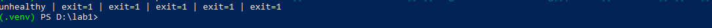
*Рисунок 53 – Останні 5 перевірок healthcheck: exit=1, статус unhealthy*

Після `docker compose start db` сервіс сам перепідключився до бази, /healthz знову повертає 200, і контейнер повертається в стан healthy.

**Висновок.** Вимога виконана: healthcheck працює (контейнер healthy, перевірки з кодом 0), реалізований скриптом на Python без сторонніх утиліт, curl і wget в образі відсутні (підтверджено трьома способами), а при недоступності бази healthcheck переводить контейнер у стан unhealthy.

## Етап 9. Перевірка

Перевірка виконана на повному стенді через балансувальник (порт 8000), так само, як сервісом користувався б зовнішній клієнт.

### 1. Повний цикл запитів

Цикл виконує скрипт `scripts/cycle_check.py`: він надсилає запити по черзі і друкує журнал «запит → код → відповідь». Для запису використано код показника CYCLE, щоб у переліку був лише він.

```powershell
python scripts\cycle_check.py
```

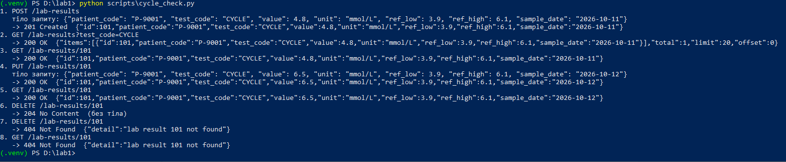
*Рисунок 54 – Журнал повного циклу: створення, перелік, читання, заміна, видалення, повторне видалення*

Таблиця 6 – Журнал перевірки повного циклу

| № | Запит | Код | Що повернув сервіс |
|---|---|---|---|
| 1 | POST /lab-results (P-9001, CYCLE, value 4.8) | 201 | створений запис, id = 101 |
| 2 | GET /lab-results?test_code=CYCLE | 200 | items: [запис 101], total = 1 |
| 3 | GET /lab-results/101 | 200 | запис 101, value = 4.8 |
| 4 | PUT /lab-results/101 (value 6.5, дата 2026-10-12) | 200 | запис 101 з value = 6.5, sample_date = 2026-10-12 |
| 5 | GET /lab-results/101 | 200 | заміна збереглась: value = 6.5 |
| 6 | DELETE /lab-results/101 | 204 | без тіла |
| 7 | DELETE /lab-results/101 (повторно) | 404 | `{"detail":"lab result 101 not found"}` |
| 8 | GET /lab-results/101 | 404 | запису більше немає |

Усі коди збігаються зі спроєктованим API, повторне видалення того самого id — 404, а не 204.

### 2. Дані після docker compose down

Перед зупинкою в базі 100 записів (занесені для вимірювань). `docker compose down` видаляє контейнери і мережу, але не том `pgdata`. Після повторного up усі 100 записів на місці.

```powershell
curl.exe -s "http://127.0.0.1:8000/lab-results?limit=1"
docker compose down
docker compose up -d
curl.exe -s "http://127.0.0.1:8000/lab-results?limit=1"
```


*Рисунок 55 – До зупинки: total = 100*


*Рисунок 56 – docker compose down: видалено контейнери і мережу, том залишився*

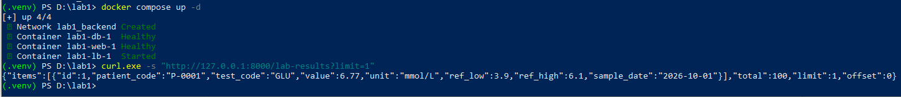
*Рисунок 57 – Після повторного up: total = 100, записи на місці*

### 3. Дані після docker compose down -v

`docker compose down -v` видаляє також том `lab1_pgdata`. Після up том створюється заново порожнім, схема накочується автоматично, стенд піднімається без помилок, у таблиці 0 записів.

```powershell
docker compose down -v
docker compose up -d
docker compose ps
curl.exe -s "http://127.0.0.1:8000/lab-results?limit=1"
```


*Рисунок 58 – docker compose down -v: видалено і том lab1_pgdata*

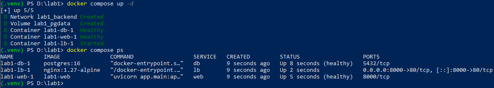
*Рисунок 59 – Повторний up: том створено заново, db і web healthy, стенд без помилок*

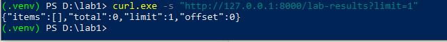
*Рисунок 60 – Після down -v база порожня: total = 0*

Таблиця 7 – Збереження даних між запусками

| Дія | Том pgdata | Записів після up |
|---|---|---|
| docker compose down → up | залишається | 100 (на місці) |
| docker compose down -v → up | видаляється | 0 (база порожня) |

## Вимірювання

**1. Розмір фінального образу сервісу: 219 МБ** (рисунок 30).

**2. Час від `docker compose up` до першої відповіді 200 на /healthz** — на машині, де образ уже зібраний; перед кожним повтором томи видалено (`docker compose down -v`), тобто база ініціалізується з нуля:

```powershell
docker compose down -v
$t = Get-Date
docker compose up -d
do { try { $c = (Invoke-WebRequest -UseBasicParsing -TimeoutSec 2 http://127.0.0.1:8000/healthz).StatusCode } catch { $c = 0; Start-Sleep -Milliseconds 200 } } until ($c -eq 200)
"Час до першої 200: {0:N1} с" -f ((Get-Date) - $t).TotalSeconds
```


*Рисунок 61 – Повтор 1: 7.5 с*


*Рисунок 62 – Повтор 2: 7.3 с*


*Рисунок 63 – Повтор 3: 7.5 с*

Таблиця 8 – Час до першої відповіді 200 на /healthz

| Повтор | Час до першої 200, с |
|---|---|
| 1 | 7.5 |
| 2 | 7.3 |
| 3 | 7.5 |
| **Медіана** | **7.5** |

Більшу частину часу займає ініціалізація порожньої бази (initdb і накочування схеми); web стартує лише після того, як db стала healthy, а балансувальник — після того, як web став healthy. Тому запит, що приходить одразу після завершення `docker compose up`, отримує відповідь, а не помилку підключення.

**3. Робота під навантаженням** — таблиці 3, 4 і зведена таблиця на етапі 6.

**4. Три розрахунки** — етап 7.

## Висновки

Сервіс з шістьма ендпоінтами над таблицею `lab_results` реалізовано на FastAPI і PostgreSQL; валідація за варіантом повертає 400 з назвою поля, /healthz перевіряє саму базу. Образ зібрано багатоетапно на python:3.12-slim (219 МБ), без компіляторів, pip, curl і wget. Стенд з бази, вебінстансу і балансувальника піднімається однією командою за 7.5 с, кількість вебінстансів задається параметром `--scale`.

На одному вебінстансі (1 CPU) сервіс тримає 10 і 100 запитів/с із затримкою близько 15 мс (з них ~8 мс — сам генератор). На рівні 500 запитів/с сервіс перестав встигати: досягнуто 107 запитів/с (goodput 58), p50 близько 83 с, 89% запитів відпали за тайм-аутом. Другий вебінстанс підняв досягнуту інтенсивність до 230 запитів/с і зменшив частку помилок до 0.27%, але 500 запитів/с не досягнуто: закритий контур показав, що один інстанс без тайм-аутів дає 264 запити/с, тобто межу задає спільна для обох інстансів складова — база PostgreSQL, балансувальник і процесор ноутбука, який стенд ділить з генератором.

Закон Літтла на рівні 100 запитів/с виконується з розбіжністю 0.02%. Порівняння з закритим контуром показало, що генератор з фіксованою кількістю одночасних запитів приховує перевантаження: p95 7.3 с замість 92.7 с у відкритому контурі на тому самому сервісі.

## Відкинуті рішення

1. **Стандартне налаштування nginx** (порожній блок events, 512 зʼєднань на worker). Відкинуто, бо балансувальник став вузьким місцем: на 500 запитах/с він відкидав запити («512 worker_connections are not enough»), і серія показувала 58% помилок, які не стосувались сервісу. Замінено на `worker_processes auto` і `worker_connections 4096`.
2. **Healthcheck через curl** (`CMD curl -f http://localhost:8000/healthz`). Відкинуто, бо варіант вимагає, щоб curl і wget в образі не було. Замінено скриптом `app/healthcheck.py` на стандартній бібліотеці Python.
3. **Одноетапна збірка** (pip install прямо у фінальному образі). Відкинуто, бо у фінальному образі лишалися б pip і засоби встановлення пакетів, а умова вимагає багатоетапної збірки без засобів збірки у фінальній стадії.
4. **Готові інструменти навантаження з фіксованою кількістю віртуальних користувачів** (ab, locust у режимі users). Відкинуто, бо умова вимагає власний генератор з фіксованою швидкістю надходження; закритий контур приховує затримку під перевантаженням, що підтвердило порівняння на етапі 7.
5. **Референсний інтервал одним рядком «3.9–6.1» і тип float для значень.** Відкинуто: рядок не дозволяє перевірити ref_low < ref_high і порівнювати значення, а float дає похибку округлення. Обрано дві колонки NUMERIC(14,4).
6. **Стандартна відповідь FastAPI 422 на помилки валідації.** Відкинуто, бо умова вимагає 400 з поясненням поля; додано власний обробник `RequestValidationError`.

## Використання генеративних моделей

Під час роботи використано генеративну модель Claude (Anthropic). Модель застосована для: написання коду сервісу (`app/main.py`, `app/healthcheck.py`), схеми `db/schema.sql`, Dockerfile, .dockerignore, docker-compose.yml, `lb/nginx.conf`, генератора навантаження `loadgen/loadgen.py`, скриптів `scripts/cycle_check.py` і `scripts/analyze_raw.py`; пояснення кроків виконання; діагностики проблем (ліміт зʼєднань nginx, невідповідність пароля бази після зміни .env, помилка в закритому контурі після редагування коду); рецензії звіту на відповідність умові (розклад затримки, визначення досягнутої інтенсивності, точна розбіжність закону Літтла); оформлення звіту і розрахунків.

Що перевірено після моделі: усі ендпоінти вручну через /docs і curl.exe з очікуваними кодами (етап 2); збірку образу і відсутність curl, wget, pip і gcc (етапи 3, 8); запуск стенду з одним і двома інстансами (етап 4); генератор на /noop — досягнута інтенсивність дорівнює заданій (етап 5); розподіл запитів між інстансами за логом nginx (етап 6); повний цикл CRUD і поведінку даних після down і down -v (етап 9). Числа в таблицях звірено з файлами `results/series_web1.csv`, `results/series_web2.csv`, `results/runs.jsonl` і `results/analysis.csv`, формули Карпа-Флатта і закону Літтла перераховано вручну.

## Контрольні питання

**1. Чому PUT у цій роботі замінює запис повністю і чим би відрізнявся PATCH.**

PUT замінює запис повністю: клієнт надсилає всі поля, і сервіс перезаписує їх усі (UPDATE усіх колонок). Якщо якогось поля немає, це 400, бо всі поля обовʼязкові. PUT ідемпотентний: повтор того самого запиту дає той самий стан запису. PATCH змінював би лише передані поля, наприклад тільки value; тіло запиту було б частковим, і валідація перевіряла б лише присутні поля (але правило ref_low < ref_high довелося б перевіряти разом зі збереженим значенням іншої межі).

**2. Який код відповіді має повернути створення запису з ідентифікатором, який уже існує, і чому.**

409 Conflict: запит коректний за формою, але конфліктує з поточним станом ресурсу. 201 неправильний, бо нічого не створено, а 400 — бо дані синтаксично правильні. У цій роботі ідентифікатор генерує база, тому клієнт id не передає взагалі: якщо в тілі POST передати поле id, сервіс відповідає 400, бо зайві поля не приймаються.

**3. Що зберігається в шарі образу і чому порядок інструкцій у Dockerfile впливає на час перезбірки.**

Шар образу — незмінний набір змін файлової системи, який створює одна інструкція Dockerfile (RUN, COPY). Docker кешує шари: якщо інструкція і файли, які вона копіює, не змінились, шар береться з кешу, а зміна будь-якого шару скасовує кеш для нього і всіх наступних. Тому спочатку копіюється requirements.txt і ставляться залежності, а код (`COPY app`) копіюється останнім: при зміні коду перезбирається лише маленький останній шар (на рисунку 32 усі кроки до `COPY requirements.txt` і `pip install` включно позначені CACHED, а заново виконано лише `COPY app ./app`).

**4. Що станеться з даними бази після docker compose down, після docker compose down -v і після видалення контейнера бази вручну.**

Після `down` видаляються контейнери і мережа, але іменований том `pgdata` залишається — дані на місці (етап 9: total = 100). Після `down -v` видаляється і том, база стає порожньою, при наступному up схема накочується заново (total = 0). Після видалення контейнера бази вручну (`docker rm`) дані теж не зникнуть: вони в іменованому томі, і новий контейнер підключить той самий том. Втратилися б вони лише тоді, якби зберігалися у файловій системі самого контейнера без тому.

**5. Чому depends_on без умови за станом не гарантує, що база готова приймати підключення.**

depends_on без умови чекає лише, поки контейнер бази запуститься, тобто поки стартує процес. Але PostgreSQL на порожньому томі ще кілька секунд ініціалізується: створює кластер, накочує схему з `docker-entrypoint-initdb.d` і перезапускається. У цей час підключення відхиляються. `condition: service_healthy` чекає, поки healthcheck бази (`pg_isready`) стане успішним, і лише тоді запускає web. Додатково сервіс сам перепідключається до бази (пул зʼєднань), тому не падає, навіть якщо база стане недоступною пізніше (етап 2, рисунки 25–28).

**6. Чим відрізняється EXPOSE від публікації порту і як сервіс дістається бази без публікації її порту на хост.**

EXPOSE лише документує в образі, який порт слухає застосунок; назовні він нічого не відкриває. Публікація порту (`ports: "8000:80"` у lb) прокидає порт контейнера на хост. Сервіс дістається бази через спільну мережу Compose `backend`: вбудований DNS Docker перетворює імʼя сервісу `db` на адресу контейнера бази, тож web підключається до `db:5432` без публікації порту на хост. У `docker compose ps` у db видно `5432/tcp` без `0.0.0.0`.

**7. Чим відрізняється генератор із фіксованою швидкістю надходження від генератора з фіксованою кількістю віртуальних користувачів і чому другий приховує затримку під перевантаженням.**

Генератор з фіксованою швидкістю (відкритий контур) надсилає запити за розкладом незалежно від відповідей. Під перевантаженням запити накопичуються в черзі, і цей час очікування входить у затримку. Генератор з фіксованою кількістю віртуальних користувачів (закритий контур) відправляє наступний запит лише після відповіді, тож при уповільненні сервісу сам сповільнюється: запити, які мали б надійти, просто не надсилаються, і час їх очікування не вимірюється. У нашій роботі на тому самому сервісі відкритий контур показав p95 92.7 с, а закритий — 7.3 с.

**8. Що змінилось у вашій серії після додавання другого вебінстансу і яка складова стенду лишилась спільною для обох.**

На 10 і 100 запитах/с нічого суттєво не змінилось. На 500 досягнута інтенсивність зросла з 107 до 230 запитів/с, частка помилок впала з 89% до 0.27%, p50 — з 83 до 34 с. Але один інстанс без тайм-аутів (закритий контур) дає 264 запити/с, тож другий інстанс прибрав колапс, а не додав пропускної здатності. Спільними лишились база PostgreSQL, балансувальник і процесор ноутбука, на якому працює і генератор.

**9. Що означає отримане вами значення метрики Карпа-Флатта і як воно змінилось би, якби база була не одна на два інстанси.**

За досягнутою інтенсивністю e = −0.07 (S = 2.14). Відʼємне e (S > 2) означає, що порівнюються колапс одного інстансу (тайм-аути і повтори, goodput 58) і нормальна робота двох, а не дві пропускні здатності. Якщо взяти реальну пропускну здатність одного інстансу з закритого контуру (264), S = 0.87 і e = 1.30: виграшу від другого інстансу немає, усю пропускну здатність задає спільна частина. Якби база не була спільною (окрема база або репліки для читання на кожен інстанс), спільна частина зменшилась би, e зменшилось би, а S наблизилось би до 2 — за умови, що генератор і стенд працюють на окремих машинах, бо інакше межею лишиться процесор ноутбука.

**10. Чому час відповіді зростає швидше за інтенсивність, коли сервіс наближається до межі пропускної здатності.**

З теорії черг середній час перебування W ≈ Tₛ / (1 − ρ), де Tₛ — час обслуговування, а ρ = λ / μ — завантаження сервісу. Коли інтенсивність наближається до пропускної здатності (ρ → 1), знаменник прямує до нуля, і затримка зростає нелінійно. Коли λ > μ, черга росте весь прогін без обмеження. У нашій серії: на 10 і 100 запитах/с — близько 15 мс, а на 500, вище межі одного інстансу, p50 становить 83 с.
