# Лабораторна робота № 1

**Дисципліна:** «Високопродуктивні розподілені обчислювальні системи»  
**Тема:** «Проєктування і розгортання CRUD-сервісу»

КПІ ім. Ігоря Сікорського, факультет біомедичної інженерії, кафедра біомедичної кібернетики

**Виконала:** студентка гр. ЗК-61мп Бойко Я. Л.  
**Перевірив:** старший викладач БМК Матвійчук О. В.

Київ, 2026

## Завдання для варіанта №4

| **Параметр**                    | **Значення**                                                                     |
|---------------------------------|----------------------------------------------------------------------------------|
| Сутність і шлях ресурсу         | Результат лабораторного аналізу, /lab-results                                    |
| Обовʼязкові поля                | код пацієнта, код показника, значення, одиниці, референсний інтервал, дата проби |
| Фільтр у переліку               | за кодом показника                                                               |
| Правило валідації               | значення числове; референсний інтервал має нижню межу меншу за верхню            |
| Базовий образ фінальної стадії  | python:3.12-slim або аналог вашої мови                                           |
| Ліміти на контейнер сервісу     | 1 CPU, 768 МБ                                                                    |
| Додаткова вимога до розгортання | Healthcheck сервісу працює без curl і wget: жодного з них в образі немає         |

## Етап 1. Проєктування

Таблиця 1 – Схема таблиці lab_results (файл db/schema.sql)

| **Поле**     | **Тип**                                 | **Пояснення**                            |
|--------------|-----------------------------------------|------------------------------------------|
| id           | BIGINT GENERATED ALWAYS AS IDENTITY, PK | номер запису, видає база                 |
| patient_code | VARCHAR(32)                             | код пацієнта, може містити літери        |
| test_code    | VARCHAR(32)                             | код показника, поле фільтра              |
| value        | NUMERIC(14,4)                           | результат; точне число без похибки float |
| unit         | VARCHAR(20)                             | одиниці виміру (mmol/L, g/L, %)          |
| ref_low      | NUMERIC(14,4)                           | нижня межа норми                         |
| ref_high     | NUMERIC(14,4)                           | верхня межа норми                        |
| sample_date  | DATE                                    | дата проби, без часу                     |

Усі поля обовʼязкові (NOT NULL). Обмеження: CHECK (ref_low \< ref_high).

Індекси: первинний ключ за id (пошук за номером) і idx_lab_results_test_code за test_code фільтр у переліку.

**API.** Тіло запису однакове для POST і PUT, усі поля обовʼязкові, id передавати не можна. У відповіді повертається той самий запис плюс id.

Таблиця 2 – Ендпоінти API сервісу /lab-results

| **Метод і шлях**         | **Призначення**                          | **Тіло запиту** | **Відповідь**               | **Коди**      |
|--------------------------|------------------------------------------|-----------------|-----------------------------|---------------|
| POST /lab-results        | створення                                | запис           | запис з id                  | 201; 400      |
| GET /lab-results         | перелік, limit, offset, фільтр test_code | немає           | записи і загальна кількість | 200           |
| GET /lab-results/{id}    | один запис                               | немає           | запис                       | 200; 404      |
| PUT /lab-results/{id}    | повна заміна                             | повний запис    | оновлений запис             | 200; 404; 400 |
| DELETE /lab-results/{id} | видалення                                | немає           | порожня                     | 204; 404      |
| GET /healthz             | готовність сервісу                       | немає           | стан бази                   | 200; 503      |

Пагінація: limit за замовчуванням 20, максимум 100; offset від 0. Без фільтра повертаються всі записи. Валідація (400): value, ref_low, ref_high тільки числа (не рядки), не більше 14 значущих цифр і не більше 4 знаків після коми, тобто в межах колонок NUMERIC(14,4); ref_low менше за ref_high; рядкові поля patient_code, test_code і unit не містять керівних символів (зокрема \u0000), яких не приймає база. У відповіді вказано поле і причину помилки.

## Етап 2. Сервіс

Сервіс написано на Python 3.12 + FastAPI (файл app/main.py). Ідентифікатор генерує база. Помилки валідації повертаються з кодом 400 і назвою поля. /healthz перевіряє саму базу (SELECT 1) і повертає 503, якщо вона недоступна. Для перевірки база запущена в контейнері (таблиця створилась автоматично з db/schema.sql), сервіс запущено локально:

```powershell
docker run -d --name lab-db -e POSTGRES_DB=labdb -e POSTGRES_USER=lab -e POSTGRES_PASSWORD=secret -p 5432:5432 -v "${PWD}/db:/docker-entrypoint-initdb.d" postgres:16
pip install -r requirements.txt
$env:DB_PASSWORD="secret"
uvicorn app.main:app --port 8000
```

Запити перевірялись через сторінку http://localhost:8000/docs, яку FastAPI створює автоматично. Далі наведені скріншоти локальної перевірки для кожного запиту.


Рисунок 1 – Сторінка /docs: шість ендпоінтів сервісу

### Створення записів (POST)

Створено два записи. Сервіс повертає 201 і створений запис з id, який видала база (клієнт id не передає).

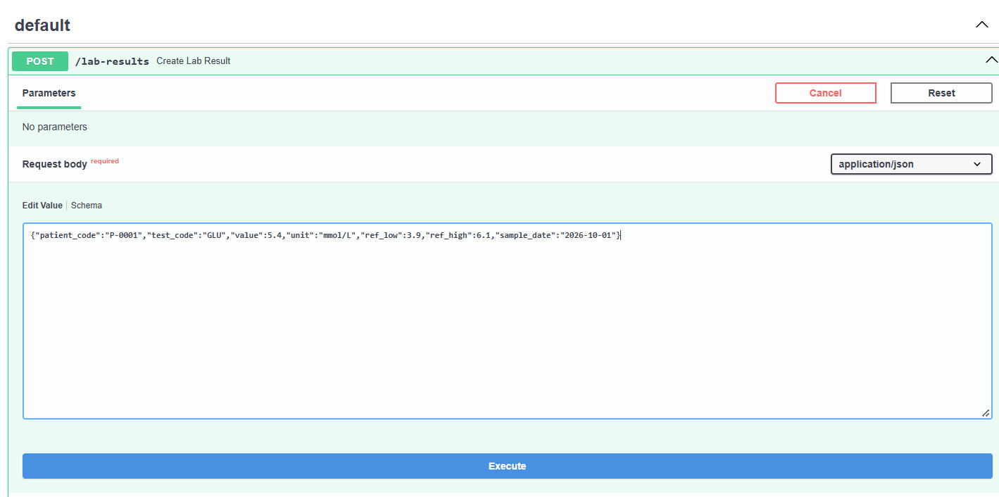

Рисунок 2 – POST /lab-results: тіло першого запису


Рисунок 3 – Відповідь 201: запис створено, id = 1

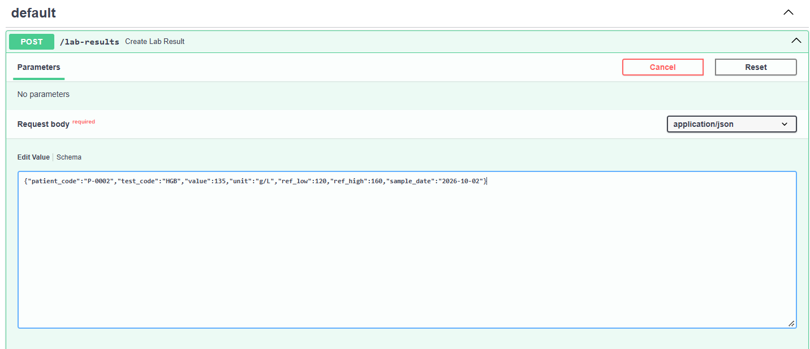

Рисунок 4 – POST /lab-results: тіло другого запису

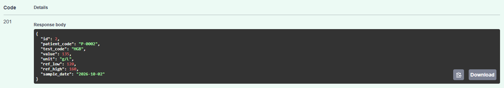

Рисунок 5 – Відповідь 201: id = 2

### Валідація

Перевірка правила варіанта: значення числове, нижня межа інтервалу менша за верхню. На невалідні дані сервіс повертає 400 і називає поле з помилкою.

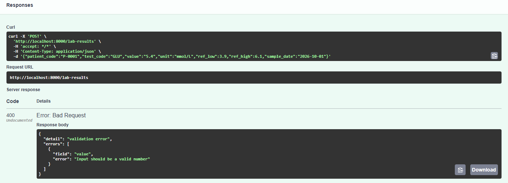

Рисунок 6 – value передано текстом "5.4" (у лапках): відповідь 400, поле value

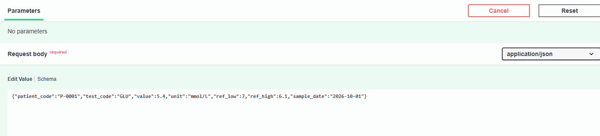

Рисунок 7 – POST з ref_low = 7 більшим за ref_high = 6.1

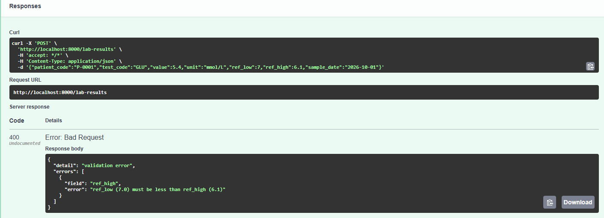

Рисунок 8 – Відповідь 400, поле ref_high

Поля value, ref_low і ref_high переведено з float на Decimal з обмеженнями max_digits=14 і decimal_places=4, відповідно до NUMERIC(14,4) у БД. Це запобігає помилкам через округлення та переповнення, які раніше спричиняли відповідь 500. Тепер некоректні значення повертають 400 із назвою поля та причиною помилки, а коректний запит, як і раніше, повертає 201.

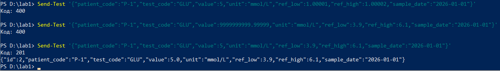

Рисунок 9 – POST з ref_low = 1.00001 і ref_high = 1.00002 (код 400), з value = 9999999999.99999 (код 400) і коректний запит (код 201)

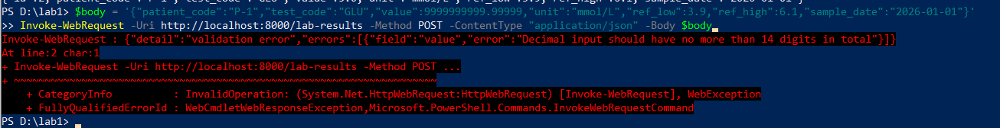

Рисунок 10 – Відповідь 400 на value = 9999999999.99999: поле value, не більше 14 цифр

Поля patient_code, test_code, unit і параметр фільтра test_code перевіряються на керівні символи (коди менше 32 і 127). Раніше символ \u0000 спричиняв помилку DataError і відповідь 500. Тепер такі запити відхиляються під час валідації з кодом 400 і назвою поля.

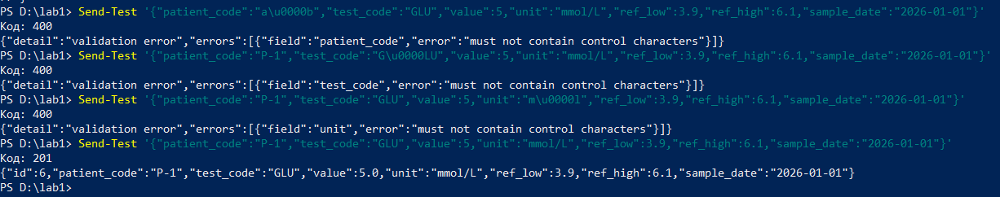

Рисунок 11 – Символ \u0000 у patient_code, test_code і unit: відповідь 400 з назвою поля; коректний запит: 201


Рисунок 12 – GET /lab-results?test_code=a%00b: відповідь 400, поле test_code

### Перелік (GET /lab-results)

Перелік повертає обʼєкт із масивом записів і загальною кількістю total. Фільтр test_code залишає лише записи з цим кодом показника. Значення limit понад 100 сторінка /docs не відправляє, тому цей запит надіслано через curl.exe.


Рисунок 13 – GET /lab-results без фільтра


Рисунок 14 – Відповідь 200: два записи, total = 2

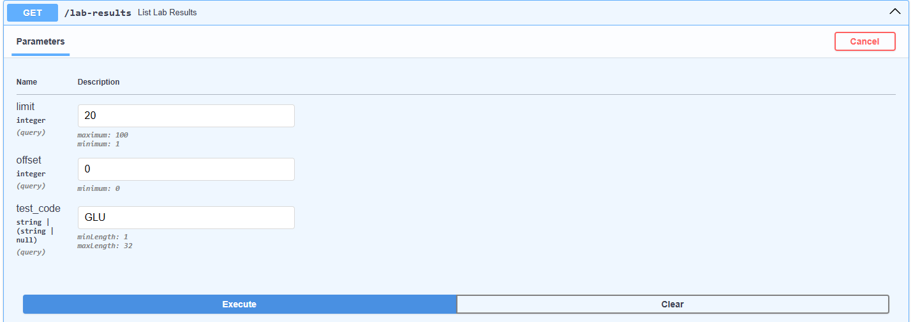

Рисунок 15 – GET /lab-results з фільтром test_code = GLU


Рисунок 16 – Відповідь 200: один запис, total = 1

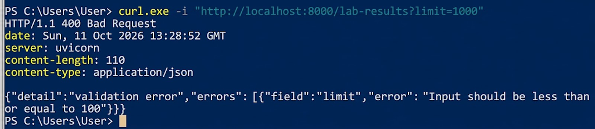

Рисунок 17 – limit = 1000 через curl.exe: відповідь 400, поле limit

### Один запис (GET /lab-results/{id})

Для існуючого id сервіс повертає 200 і запис, для неіснуючого (id = 20) повертає 404.

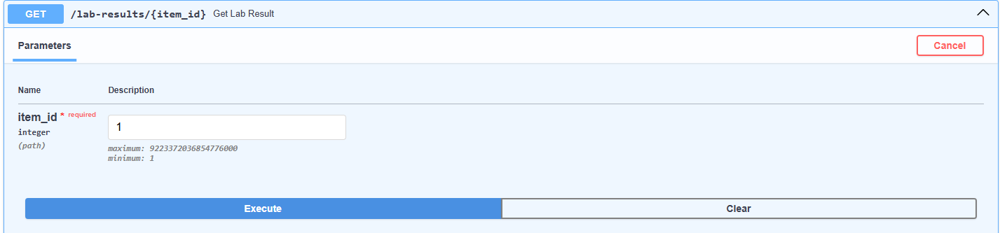

Рисунок 18 – GET /lab-results/1

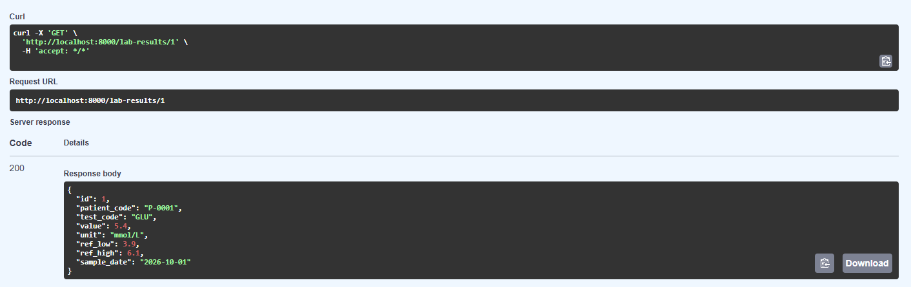

Рисунок 19 – Відповідь 200: запис з id = 1

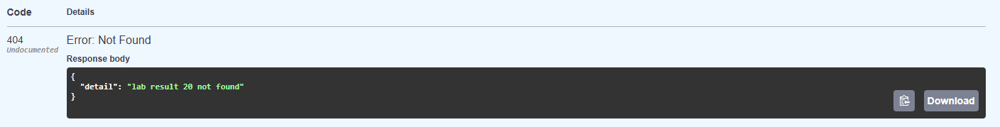

Рисунок 20 – GET /lab-results/20: відповідь 404, запис не знайдено

### Заміна запису (PUT)

PUT замінює запис повністю: змінилися value і sample_date, id залишився той самий. Для неіснуючого id відповідь 404.


Рисунок 21 – PUT /lab-results/1: нові значення запису

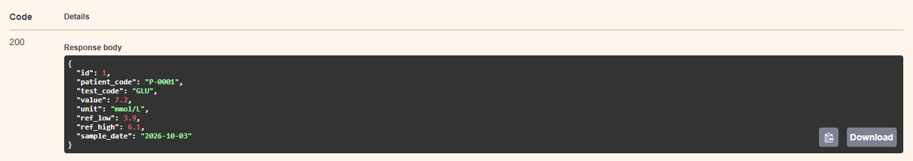

Рисунок 22 – Відповідь 200: value = 7.2, sample_date = 2026-10-03, id той самий


Рисунок 23 – PUT /lab-results/20


Рисунок 24 – Відповідь 404: запис не знайдено

### Видалення (DELETE)

Перше видалення повертає 204 без тіла. Повторне видалення того самого id повертає 404, як вимагає умова.

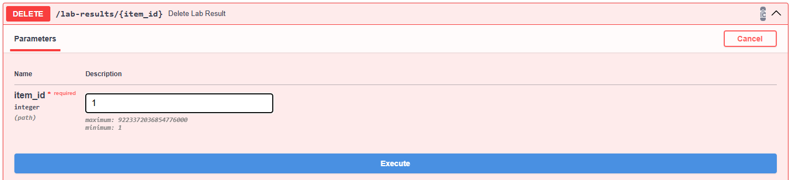

Рисунок 25 – DELETE /lab-results/1

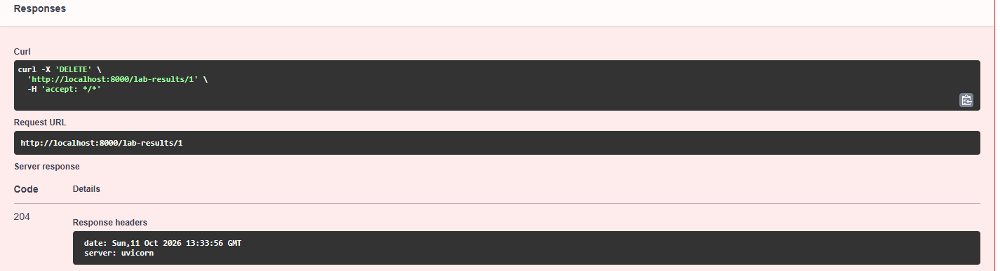

Рисунок 26 – Відповідь 204: запис видалено, тіла немає

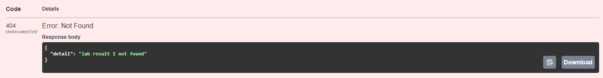

Рисунок 27 – Повторний DELETE /lab-results/1: відповідь 404

### Готовність (GET /healthz)

/healthz перевіряє саму базу. Після docker stop lab-db сервіс продовжує працювати, але /healthz повертає 503. Після docker start lab-db знову 200, без перезапуску сервісу.


Рисунок 28 – GET /healthz: 200, база доступна

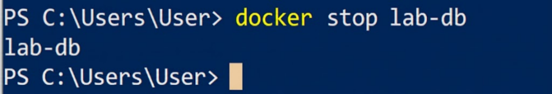

Рисунок 29 – Зупинка бази: docker stop lab-db


Рисунок 30 – GET /healthz: 503, база недоступна

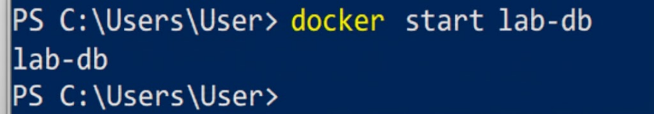

Рисунок 31 – Запуск бази: docker start lab-db

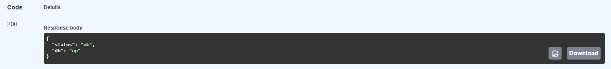

Рисунок 32 – GET /healthz: 200, сервіс перепідключився сам

## Етап 3. Образ

Збірка багатоетапна. Стадія builder на python:3.12-slim створює віртуальне середовище /opt/venv, ставить у нього залежності з requirements.txt і видаляє pip. Фінальна стадія на базовому образі за варіантом отримує тільки готове /opt/venv і папку app з кодом; pip з неї теж видалено. Компіляторів і засобів встановлення пакетів у фінальному образі немає, тому під час старту контейнера нічого не встановлюється.

requirements.txt копіюється окремо від коду: поки залежності не змінились, цей шар береться з кешу. Healthcheck образу запускає app/healthcheck.py на стандартній бібліотеці Python, бо curl і wget в образі немає. .dockerignore не пускає в образ .venv, .git, файл .env з паролем і службові файли.

**Dockerfile**

```dockerfile
FROM python:3.12-slim AS builder

ENV PIP_NO_CACHE_DIR=1 \
    PIP_DISABLE_PIP_VERSION_CHECK=1

RUN python -m venv /opt/venv
ENV PATH="/opt/venv/bin:$PATH"

COPY requirements.txt .
RUN pip install -r requirements.txt \
    && pip uninstall -y pip setuptools wheel

FROM python:3.12-slim AS final

ENV PATH="/opt/venv/bin:$PATH" \
    PYTHONDONTWRITEBYTECODE=1 \
    PYTHONUNBUFFERED=1

RUN python -m pip uninstall -y pip setuptools wheel || true

WORKDIR /srv
COPY --from=builder /opt/venv /opt/venv
COPY app ./app

EXPOSE 8000

HEALTHCHECK --interval=5s --timeout=4s --start-period=5s --retries=3 \
    CMD ["python", "/srv/app/healthcheck.py"]

CMD ["uvicorn", "app.main:app", "--host", "0.0.0.0", "--port", "8000"]
```

**.dockerignore**

```text
.git
.gitignore
.idea
.venv
__pycache__
*.pyc
.env
.env.*
Dockerfile
.dockerignore
docker-compose.yml
README.md
*.md
*.docx
results
loadgen
```

Команди збірки і перевірки образу:

```powershell
docker build -t lab1-web .
docker images lab1-web
docker run --rm lab1-web python -c "import shutil; print(shutil.which('curl'), shutil.which('wget'), shutil.which('pip'), shutil.which('gcc'))"
```

Розмір фінального образу: 219 МБ (53.6 МБ у стиснутому вигляді).


Рисунок 33 – Збірка образу: дві стадії (builder і final) завершені без помилок

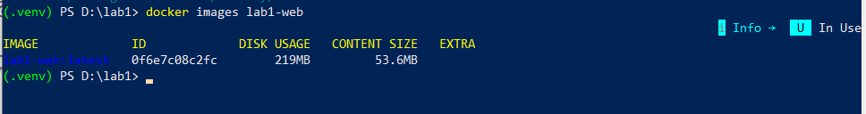

Рисунок 34 – Розмір образу lab1-web: 219 МБ


Рисунок 35 – В образі немає curl, wget, pip і компілятора gcc

## Етап 4. Стенд

Стенд описано в docker-compose.yml. Три сервіси у спільній мережі backend:

- db: PostgreSQL 16, дані в томі pgdata, схема накочується автоматично з db/schema.sql, healthcheck через pg_isready;

- web: образ з етапу 3, стартує після того, як db стала healthy (condition: service_healthy) звертається до бази за іменем db; ліміти 1 CPU і 768 МБ; портів на хост не публікує;

- lb: балансувальник nginx, єдиний сервіс з портом на хост (8000); стартує, коли web healthy, і розподіляє запити між вебінстансами.

Пароль бази не записаний ні в образі, ні в docker-compose.yml: значення береться з файлу .env (шаблон .env.example лежить у репозиторії, сам .env не комітиться). Кількість вебінстансів задається параметром --scale web=N без правок у файлах.

**docker-compose.yml**

```yaml
# Стенд: база, вебінстанс і балансувальник.
# Запуск з одним вебінстансом:  docker compose up -d --build
# Запуск з двома вебінстансами: docker compose up -d --build --scale web=2

services:
  db:
    image: postgres:16
    environment:
      POSTGRES_DB: ${DB_NAME}
      POSTGRES_USER: ${DB_USER}
      POSTGRES_PASSWORD: ${DB_PASSWORD}
    volumes:
      - pgdata:/var/lib/postgresql/data
      - ./db/schema.sql:/docker-entrypoint-initdb.d/schema.sql:ro
    healthcheck:
      test: ["CMD-SHELL", "pg_isready -U $${POSTGRES_USER} -d $${POSTGRES_DB}"]
      interval: 2s
      timeout: 3s
      retries: 15
    networks: [backend]

  web:
    build: .
    image: lab1-web
    environment:
      DB_HOST: db
      DB_PORT: "5432"
      DB_NAME: ${DB_NAME}
      DB_USER: ${DB_USER}
      DB_PASSWORD: ${DB_PASSWORD}
    depends_on:
      db:
        condition: service_healthy
    healthcheck:
      test: ["CMD", "python", "/srv/app/healthcheck.py"]   # без curl і wget
      interval: 3s
      timeout: 4s
      retries: 10
      start_period: 3s
    deploy:
      resources:
        limits:
          cpus: "1"                     # ліміти за варіантом
          memory: 768M
    networks: [backend]

  lb:
    image: nginx:1.27-alpine
    volumes:
      - ./lb/nginx.conf:/etc/nginx/nginx.conf:ro
    ports:
      - "8000:80"
    depends_on:
      web:
        condition: service_healthy
    networks: [backend]

volumes:
  pgdata:

networks:
  backend:
```

**lb/nginx.conf**

```nginx
worker_processes auto;
events {
    worker_connections 4096;
}

http {
    # У лог пишемо адресу вебінстансу, який обробив запит
    log_format balanced '$remote_addr "$request" $status upstream=$upstream_addr time=$request_time';
    access_log /var/log/nginx/access.log balanced;
    
    upstream web_backend {
        server web:8000;
        keepalive 32;
    }

    server {
        listen 80;
        # Ендпоінт, який нічого не робить просто для перевірки самого генератора навантаження.
        location = /noop {
            access_log off;
            return 204;
        }

        location / {
            proxy_pass http://web_backend;
            proxy_http_version 1.1;
            proxy_set_header Connection "";
            proxy_set_header Host $host;
        }
    }
}
```

Запуск і перевірка стенду:

```powershell
copy .env.example .env
docker compose up -d --build
docker compose ps
docker compose up -d --scale web=2
docker compose up -d --scale web=1
```


Рисунок 36 – docker compose up: створено мережу і том, db і web стали healthy, lb запущено


Рисунок 37 – docker compose ps: db і web healthy, порт на хост (0.0.0.0:8000) публікує тільки lb

5432/tcp і 8000/tcp у db і web — внутрішні порти контейнерів, доступні лише в мережі Compose, на хост вони не опубліковані.


Рисунок 38 – GET /healthz через балансувальник: база доступна

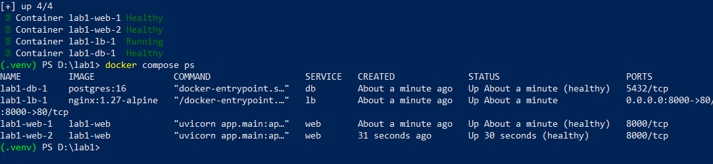

Рисунок 39 – Запуск з двома вебінстансами: --scale web=2, обидва healthy

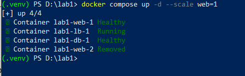

Рисунок 40 – Повернення до одного вебінстансу: --scale web=1

## Етап 5. Навантаження

Генератор навантаження loadgen/loadgen.py написано на Python без сторонніх бібліотек. Він працює у відкритому контурі:

- задана інтенсивність ділиться між процесами за кількістю ядер;

- кожен процес наперед обчислює моменти відправки своїх запитів від початку прогону і в потрібний момент віддає запит пулу потоків, не чекаючи на відповідь;

- для кожного запиту записується запланований момент, момент відправки, момент відповіді і код; затримка рахується від запланованого моменту;

- прогрів 10 с у результат не входить, вимірювання 30 с; кожен рівень повторюється 3 рази, у таблицю йде медіана; сирі дані зберігаються в results/raw.

- кожен процес має пул на 200 потоків, тобто одночасно генератор може мати не більше 8 × 200 = 1600 відправлених і ще не завершених запитів; запити понад цю кількість чекають у черзі генератора, і цей час входить у затримку, бо вона рахується від запланованого моменту;

- на помилку з'єднання або тайм-аут (10 с) запит повторюється один раз, тож невдалий запит може тривати до 20 с; код 0 означає будь-яку помилку на боці клієнта (тайм-аут або обрив з'єднання);

- досягнута інтенсивність рахується лише за відповідями 2xx, завершеними у вікні вимірювання; обриви з'єднання, тайм-аути (код 0) і відповіді 4xx/5xx у неї не входять, але входять у частку не-2xx;

- Середня кількість запитів у системі (L) вимірюється окремим потоком, який кожні 5–15 мс (у середньому 10 мс) фіксує різницю між кількістю відправлених і завершених запитів. Значення усереднюються за час вимірювання та сумуються для всіх процесів. Результати зберігаються в results/inflight.

- на початку кожного процесу на Windows запитується крок таймера 1 мс (timeBeginPeriod(1)), бо за замовчуванням time.sleep прокидається лише на межах тіків близько 15.6 мс (виміряно: sleep(1 мс) триває 15.4 мс), і це спотворює і моменти відправки, і вибірку L.

Вимірюється GET /lab-results/{id}; перед серією в базу заносяться 100 записів, id для кожного запиту береться випадково з них. Команди:

```powershell
python loadgen\loadgen.py seed                     # 100 записів у базі
python loadgen\loadgen.py check                    # перевірка генератора на /noop
python loadgen\loadgen.py series --instances 1     # серія 10/100/500, по 3 повтори
```

Генератор і сервіс працюють на одному ноутбуці (4 ядра, 8 потоків, 16 ГБ), тому на рівні 500 запитів/с вони конкурують за ядра.

### Перевірка генератора

Генератор перевірено на /noop: цей ендпоінт балансувальник обробляє сам (return 204), без сервісу і бази.

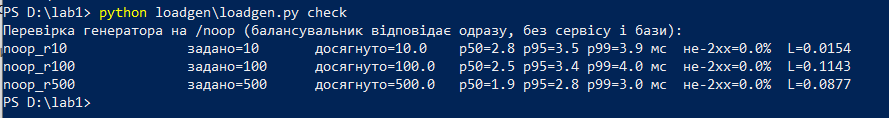

Рисунок 41 – Перевірка генератора на /noop

Таблиця 3 – Перевірка генератора на /noop (повторний запуск, збережений у results/runs.jsonl)

| **Задано, запитів/с** | **Досягнуто, запитів/с** | **p50, мс** | **p95, мс** | **p99, мс** | **Не-2xx, %** |
|-----------------------|--------------------------|-------------|-------------|-------------|---------------|
| 10                    | 10.0                     | 2.8         | 3.5         | 3.9         | 0             |
| 100                   | 100.0                    | 2.5         | 3.4         | 4.0         | 0             |
| 500                   | 500.0                    | 1.9         | 2.8         | 3.0         | 0             |

На всіх рівнях досягнута інтенсивність дорівнює заданій, а p99 не перевищує 4 мс, отже генератор здатен видати 500 запитів/с і межу в серії задає сервіс, а не генератор. У попередній версії генератора медіанна затримка на /noop була близько 10 мс, з яких майже 8 мс припадало на затримку самого генератора між запланованим моментом і відправкою: на Windows time.sleep має крок таймера близько 15.6 мс. Після запиту кроку таймера 1 мс медіанна затримка на /noop зменшилась до 1.9-2.8 мс.

### Серія на одному вебінстансі

Перша серія показала 58% помилок на рівні 500 через стандартне налаштування nginx (512 з'єднань на worker): у лозі балансувальника були повідомлення «512 worker_connections are not enough» (рисунок 42).


Рисунок 42 – Перша серія (до виправлення nginx): 58% помилок на рівні 500 через ліміт з'єднань балансувальника

Початкові результати (500 запитів/с, p50 36 мс) не відображали реальну продуктивність сервісу: 58% запитів балансувальник відхиляв через ліміт з’єднань. Після збільшення лімітів (worker_processes auto, worker_connections 4096) серію повторено. Після цього генератор виправлено (досягнута інтенсивність рахується лише за відповідями 2xx, L вимірюється вибіркою, крок таймера 1 мс) і серію знято ще раз остаточною версією генератора. Саме ці результати наведено на рисунку 43 і в таблиці 4 та використано в подальших розрахунках.

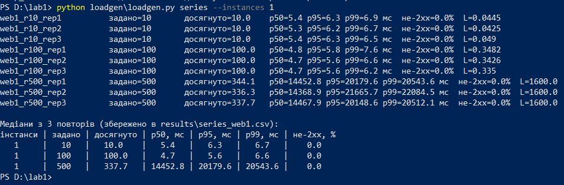

Рисунок 43 – Серія на одному вебінстансі (остаточна версія генератора): 9 прогонів і медіани

Таблиця 4 – Серія на одному вебінстансі (медіана з 3 повторів)

| **Інстанси** | **Задано** | **Досягнуто** | **p50, мс** | **p95, мс** | **p99, мс** | **Не-2xx, %** |
|--------------|------------|---------------|-------------|-------------|-------------|---------------|
| 1            | 10         | 10.0          | 5.4         | 6.3         | 6.7         | 0             |
| 1            | 100        | 100.0         | 4.7         | 5.6         | 6.6         | 0             |
| 1            | 500        | 337.7         | 14 453      | 20 180      | 20 544      | 0             |

На рівнях 10 і 100 сервіс тримає задану інтенсивність: досягнуто = задано, p95 не перевищує 6.3 мс, помилок немає. На рівні 500 сервіс перестав встигати. Це видно за числами: досягнуто 337.7 замість 500 запитів/с, p50 близько 14.5 с, p95 близько 20.2 с, а генератор весь час тримав максимально можливі 1600 незавершених запитів (L = 1600, ліміт його пулу потоків). Досягнута інтенсивність у трьох повторах (344.1, 336.3 і 337.7 запитів/с) майже однакова: це межа пропускної здатності одного інстансу.

Жодної відповіді не 2xx на рівні 500 не було: усі 60 000 запитів трьох прогонів отримали 200, помилок з'єднання і тайм-аутів немає. Запити не відхиляються, а накопичуються в черзі, тому затримка зростає.

Розбір затримки (scripts/breakdown.py) для медіанного прогону рівня 500 на одному інстансі (web1_r500_rep2) показав, що генератор досяг ліміту в 1600 запитів, тому решта чекала в його черзі: медіанне очікування в генераторі 9.68 с, а час від відправки до відповіді 4.79 с. Це означає, що сервіс перевантажений, а черга накопичувалась у генераторі; загальна затримка (від запланованого моменту) показує, скільки насправді чекав би клієнт.

Команда розбору затримки:

```powershell
python scripts\breakdown.py results\raw\web1_r500_rep2.csv
```

Результат команди:

```text
web1_r500_rep2.csv: очікування в генераторі p50 = 9.68 с, від відправки до відповіді p50 = 4.79 с, макс. одночасно відправлених = 1600, код 0: 0
```

## Етап 6. Дві репліки

Стенд піднято з двома вебінстансами тим самим параметром запуску, балансувальник перестворено, щоб він отримав адреси обох інстансів. Серію повторено:

```powershell
docker compose up -d --scale web=2
docker compose up -d --force-recreate --no-deps lb
python loadgen\loadgen.py series --instances 2
```

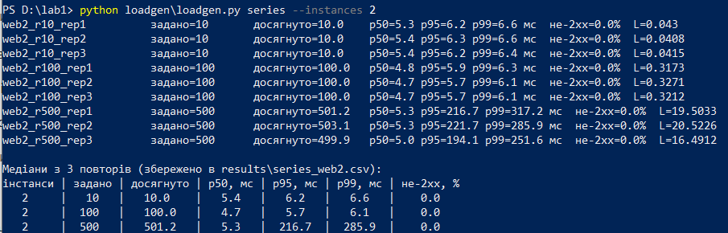

Рисунок 44 – Серія з двома вебінстансами: 9 прогонів і медіани

Таблиця 5 – Серія з двома вебінстансами (медіана з 3 повторів)

| **Інстанси** | **Задано** | **Досягнуто** | **p50, мс** | **p95, мс** | **p99, мс** | **Не-2xx, %** |
|--------------|------------|---------------|-------------|-------------|-------------|---------------|
| 2            | 10         | 10.0          | 5.4         | 6.2         | 6.6         | 0             |
| 2            | 100        | 100.0         | 4.7         | 5.7         | 6.1         | 0             |
| 2            | 500        | 501.2         | 5.3         | 217         | 286         | 0             |

На двох інстансах рівень 500 запитів/с сервіс тримає: досягнуто 501.2 при заданих 500, помилок немає, p95 близько 217 мс замість 20 с на одному інстансі; генератор у цьому прогоні мав не більше 119 одночасно відправлених запитів і не накопичував черги.

Розбір затримки для прогону web2_r500_rep1 це підтверджує: очікування в генераторі і час від відправки до відповіді в медіані менші за 0.01 с, а найбільша кількість одночасно відправлених запитів становить 119.

Команда розбору затримки:

```powershell
python scripts\breakdown.py results\raw\web2_r500_rep1.csv
```

Результат команди:

```text
web2_r500_rep1.csv: очікування в генераторі p50 = 0.00 с, від відправки до відповіді p50 = 0.00 с, макс. одночасно відправлених = 119, код 0: 0
```

Розподіл запитів між інстансами перевірено за логами Nginx, де для кожного запиту записано адресу інстансу (upstream). Кількість запитів за адресами і відповідність адрес інстансам:

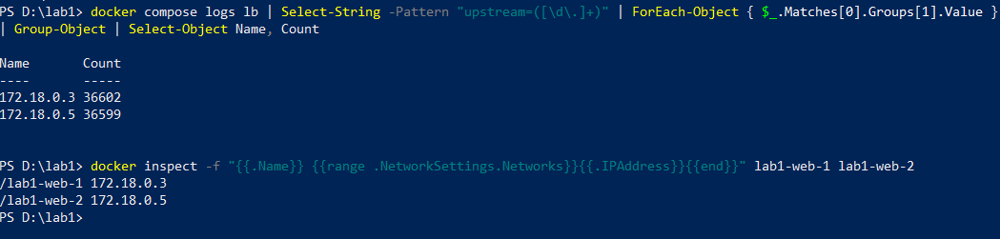

Рисунок 45 – Розподіл запитів між інстансами за логом балансувальника і відповідність адрес інстансам

web-1 (172.18.0.3) обробив 36 602 запити, web-2 (172.18.0.5) 36 599 запитів. Разом 73 201 запит, що відповідає кількості запитів усієї серії (73 200), а розподіл між інстансами майже рівний.

Висновок. На рівнях 10 і 100 запитів/с другий інстанс не вплинув на результати, оскільки одного було достатньо. За навантаження 500 запитів/с один інстанс обробляє лише 337,7 запиту/с, а p95 зростає до 20,2 с. Два інстанси дають 501,2 запиту/с і знижують p95 до 217 мс. Помилок немає в обох випадках. Максимальну пропускну здатність двох інстансів не визначено, але зростання p95 з 5,7 до 217 мс свідчить про появу черги. Спільними обмеженнями залишаються PostgreSQL, nginx і процесор ноутбука, на якому працює генератор.

## Етап 7. Розрахунки

### 1. Прискорення і метрика Карпа-Флатта

Прискорення визначається як S = X₂ / X₁, де X - досягнута інтенсивність. Для двох інстансів частка нерозпаралеленої роботи за формулою Карпа—Флатта: e = (1/S − 0.5) / 0.5.

На рівні 500 запитів/с: S = 501.2 / 337.7 = 1.48; e = (1/1.48 − 0.5) / 0.5 ≈ 0.35.

Значення e = 0.35 означає, що за цією оцінкою близько 35% роботи не отримало виграшу від другого інстансу, тому прискорення S = 1.48 помітно менше за ідеальне S = 2. Оцінка має обмеження: на двох інстансах досягнуто 501.2 при заданих 500, тобто другий варіант упирався в задану інтенсивність, а не у власну межу пропускної здатності. Справжня пропускна здатність двох інстансів вища, тому S = 1.48 є оцінкою знизу, а e = 0.35 оцінкою зверху.

На рівнях 10 і 100 запитів/с: S = 10.0 / 10.0 = 1.00 та S = 100.0 / 100.0 = 1.00. На цих рівнях один інстанс справлявся із заданим навантаженням, тому другий не збільшив пропускну здатність.

Отже, на рівні 500 запитів/с інтенсивність зросла з 337.7 до 501.2 запиту/с (S = 1.48), а p95 зменшився з 20 180 до 217 мс; помилок не було в обох конфігураціях. Спільними для обох інстансів лишились база PostgreSQL, балансувальник nginx і процесор ноутбука, на якому працював і генератор навантаження. Перерахунок досягнутої інтенсивності із сирих CSV (лише відповіді 2xx) і розрахунок S та e виконує скрипт:

```powershell
python scripts\recompute_achieved.py
```

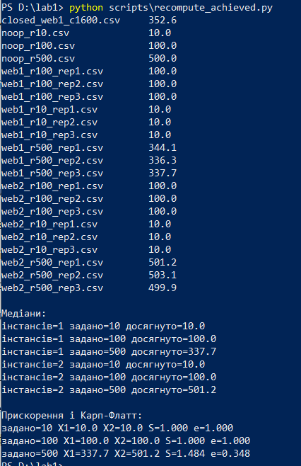

Рисунок 46 – Перерахунок досягнутої інтенсивності із сирих CSV і розрахунок S та e (scripts/recompute_achieved.py)

### 2. Перевірка закону Літтла

Закон Літтла: L = λ · W, де L середня кількість запитів у системі, λ інтенсивність, W середній час перебування. Система тут це інтервал від фактичної відправки запиту до відповіді, тому λ і W рахуються за моментом відправки. L вимірюється окремо, вибіркою: кожен процес генератора записує різницю між кількістю відправлених і завершених запитів у випадкові моменти з інтервалом 5-15 мс (у середньому 10 мс), а L дорівнює сумі за процесами середнього цих значень за вікно вимірювання. Тому L не виводиться з λ і W, і розбіжність справді перевіряє закон. Для одного інстансу (прогін web1_r100_rep2): λ = 100.00 запитів/с; W = 0.00380 с;

λ · W = 100.00 · 0.00380 = 0.3800; виміряне L = 0.3426.

Розбіжність: \|0.3800 − 0.3426\| / 0.3426 · 100% = 10.9%.

Отже, закон Літтла виконується наближено: за навантаження 100 запитів/с розрахункове значення становить 0,38, а виміряне — близько 0,35 запиту. В інших повторах розбіжність становила 11,3% і 11,8%. Це може бути пов’язано з коротким часом обробки запитів і похибкою вимірювання з інтервалом близько 10 мс. За навантаження 500 запитів/с на двох інстансах розбіжність значно менша — 0,69–1,58% (рисунок 49).

Команда перерахунку із сирих даних прогону (вибірки L беруться з results/inflight):

```powershell
python loadgen\loadgen.py little results\raw\web1_r100_rep2.csv
```

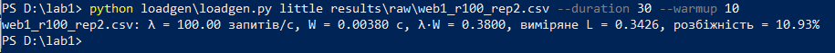

Рисунок 47 – Перевірка закону Літтла на рівні 100 запитів/с (прогін web1_r100_rep2)

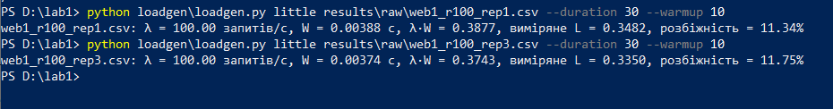

Рисунок 48 – Інші повтори рівня 100 запитів/с: web1_r100_rep1 і web1_r100_rep3

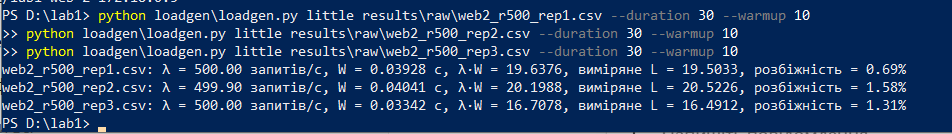

Рисунок 49 – Перевірка закону Літтла на рівні 500 запитів/с на двох інстансах (web2_r500_rep1-3)

### 3. Порівняння з закритим контуром

Рівень перевантаження: 500 запитів/с на одному інстансі. У відкритому контурі генератор упирався в ліміт 1600 одночасних запитів, тому закритий контур запущено з таким самим лімітом для порівняння.

```powershell
python loadgen\loadgen.py closed --instances 1 --rate 500 --concurrency 1600
```

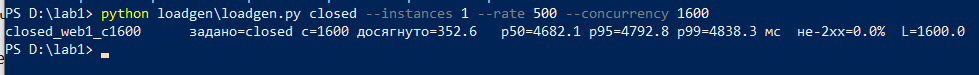

Рисунок 50 – Прогін у закритому контурі: 1600 одночасних запитів, один інстанс

Таблиця 6 – Відкритий і закритий контур, один інстанс

| **Контур**                 | **Досягнуто, запитів/с** | **p95, мс** |
|----------------------------|--------------------------|-------------|
| Відкритий (задано 500)     | 337.7                    | 20 180      |
| Закритий (1600 одночасних) | 352.6                    | 4 793       |

Закритий контур обробляє 352,6 запиту/с проти 337,7 у відкритому, а p95 зменшується з 20,2 до 4,79 с. Помилок немає.

В обох випадках пропускна здатність близька до межі одного інстансу. У відкритому контурі надходить 500 запитів/с, але сервіс обробляє лише близько 340, тому черга постійно зростає. Частина затримки припадає на очікування в черзі генератора (медіана 9,7 с). У закритому контурі кількість одночасних запитів обмежена 1600, а нові надсилаються після отримання відповіді, тому черга не зростає. Розрахунковий час становить близько 4,5 с, що близько до виміряної медіани 4,68 с. Отже, закритий контур зменшує затримку, обмежуючи чергу запитів.

## Етап 8. Додаткова вимога

Healthcheck сервісу працює без curl і wget: жодного з них в образі немає. Перевірку стану контейнера робить скрипт app/healthcheck.py. Він звертається до http://127.0.0.1:8000/healthz усередині контейнера і завершується з кодом 0, якщо відповідь 200, або з кодом 1 в іншому разі. Скрипт підключено в Dockerfile (HEALTHCHECK) і в docker-compose.yml (healthcheck сервісу web). Оскільки /healthz перевіряє саму базу, healthcheck показує готовність сервісу разом з базою, а не лише те, що процес живий.

**app/healthcheck.py**

```python
import sys
import urllib.request

try:
    with urllib.request.urlopen("http://127.0.0.1:8000/healthz", timeout=3) as resp:
        sys.exit(0 if resp.status == 200 else 1)
except Exception:
    sys.exit(1)
```

### 1. Healthcheck виконується скриптом Python

```powershell
docker inspect lab1-web-1 --format "{{json .Config.Healthcheck.Test}}"
```


Рисунок 51 – Команда healthcheck контейнера: python /srv/app/healthcheck.py

### 2. Healthcheck працює: контейнер healthy

```powershell
docker compose ps
docker inspect lab1-web-1 --format "{{.State.Health.Status}} {{range .State.Health.Log}}| exit={{.ExitCode}} {{end}}"
```


Рисунок 52 – docker compose ps: web-1 у стані healthy

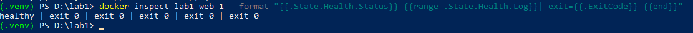

Рисунок 53 – Останні 5 перевірок healthcheck: exit=0, статус healthy

### 3. curl і wget в образі немає

```powershell
docker compose exec web curl --version
docker compose exec web wget --version
docker compose exec web python -c "import shutil; print(shutil.which('curl'), shutil.which('wget'))"
```


Рисунок 54 – Спроба запустити curl у контейнері: executable file not found


Рисунок 55 – Спроба запустити wget у контейнері: executable file not found

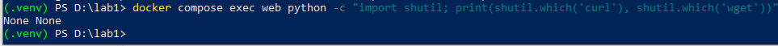

Рисунок 56 – Пошук curl і wget у контейнері: None None

### 4. Healthcheck реагує на недоступність бази

Щоб показати, що healthcheck не «завжди зелений», базу зупинено командою docker compose stop db. Сервіс продовжує працювати, але /healthz повертає 503, скрипт завершується з кодом 1, і після кількох невдалих перевірок поспіль Docker позначає контейнер unhealthy.

```powershell
docker compose stop db
docker compose ps -a
curl.exe -i http://127.0.0.1:8000/healthz
docker compose logs web --tail 5
docker inspect lab1-web-1 --format "{{.State.Health.Status}} {{range .State.Health.Log}}| exit={{.ExitCode}} {{end}}"
docker compose start db
```

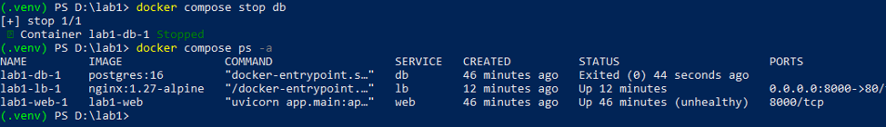

Рисунок 57 – База зупинена: web-1 у стані unhealthy


Рисунок 58 – GET /healthz при зупиненій базі: 503, db down


Рисунок 59 – Лог сервісу: запити healthcheck (127.0.0.1) отримують 503


Рисунок 60 – Останні 5 перевірок healthcheck: exit=1, статус unhealthy

Після запуску бази сервіс автоматично перепідключився, /healthz повернув 200, а контейнер знову став healthy. Отже, вимогу варіанта виконано: healthcheck реалізований на Python без сторонніх утиліт; відсутність curl і wget підтверджено. При недоступності бази контейнер переходить у стан unhealthy.

## Етап 9. Перевірка

Перевірка виконана на повному стенді через балансувальник (порт 8000), тобто так само, як сервісом користувався б зовнішній клієнт.

### 1. Повний цикл запитів

Цикл виконує скрипт scripts/cycle_check.py: він надсилає запити по черзі і друкує журнал «запит → код → відповідь». Для запису використано код показника CYCLE, щоб у переліку був лише він.

```powershell
python scripts\cycle_check.py
```


Рисунок 61 – Журнал повного циклу: створення, перелік, читання, заміна, видалення, повторне видалення

Таблиця 7 – Журнал перевірки повного циклу

| **№** | **Запит**                                         | **Код** | **Що повернув сервіс**                            |
|-------|---------------------------------------------------|---------|---------------------------------------------------|
| 1     | POST /lab-results (P-9001, CYCLE, value 4.8)      | 201     | створений запис, id = 101                         |
| 2     | GET /lab-results?test_code=CYCLE                  | 200     | items: \[запис 101\], total = 1                   |
| 3     | GET /lab-results/101                              | 200     | запис 101, value = 4.8                            |
| 4     | PUT /lab-results/101 (value 6.5, дата 2026-10-12) | 200     | запис 101 з value = 6.5, sample_date = 2026-10-12 |
| 5     | GET /lab-results/101                              | 200     | заміна збереглась: value = 6.5                    |
| 6     | DELETE /lab-results/101                           | 204     | без тіла                                          |
| 7     | DELETE /lab-results/101 (повторно)                | 404     | {"detail":"lab result 101 not found"}             |
| 8     | GET /lab-results/101                              | 404     | запису більше немає                               |

Усі коди збігаються зі спроєктованим API: створення 201, читання і заміна 200, видалення 204, а повторне видалення того самого id 404.

### 2. Дані після docker compose down

Перед зупинкою в базі 100 записів (занесені для вимірювань навантаження). docker compose down видаляє контейнери і мережу, але не том pgdata з даними. Після повторного up база підхоплює той самий том, і всі 100 записів на місці.

```powershell
curl.exe -s "http://127.0.0.1:8000/lab-results?limit=1"
docker compose down
docker compose up -d
curl.exe -s "http://127.0.0.1:8000/lab-results?limit=1"
```

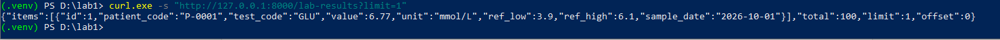

Рисунок 62 – До зупинки: total = 100


Рисунок 63 – docker compose down: видалено контейнери і мережу, том залишився


Рисунок 64 – Після повторного up: total = 100, записи на місці

### 3. Дані після docker compose down -v

docker compose down -v видаляє також том lab1_pgdata, тобто всі дані бази. Після up том створюється заново порожнім, схема накочується автоматично, стенд піднімається без помилок (db і web healthy), а в таблиці 0 записів.

```powershell
docker compose down -v
docker compose up -d
docker compose ps
curl.exe -s "http://127.0.0.1:8000/lab-results?limit=1"
```

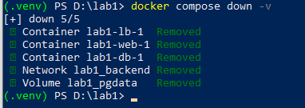

Рисунок 65 – docker compose down -v: видалено і том lab1_pgdata


Рисунок 66 – Повторний up: том створено заново, db і web healthy, стенд без помилок


Рисунок 67 – Після down -v база порожня: total = 0

Висновок. Повний цикл CRUD працює на зібраному стенді з очікуваними кодами відповідей. Дані зберігаються в томі і переживають down/up; down -v очищає базу, після чого стенд з нуля піднімається однією командою без ручних кроків.

## Вимірювання

Час від docker compose up до першої відповіді 200 на /healthz виміряно на машині, де образ уже зібраний; перед кожним повтором томи видалено (docker compose down -v), тобто база ініціалізується з нуля. Команда (PowerShell):

```powershell
docker compose down -v
$t = Get-Date
docker compose up -d
do { try { $c = (Invoke-WebRequest -UseBasicParsing -TimeoutSec 2 http://127.0.0.1:8000/healthz).StatusCode } catch { $c = 0; Start-Sleep -Milliseconds 200 } } until ($c -eq 200)
"Час до першої 200: {0:N1} с" -f ((Get-Date) - $t).TotalSeconds
```

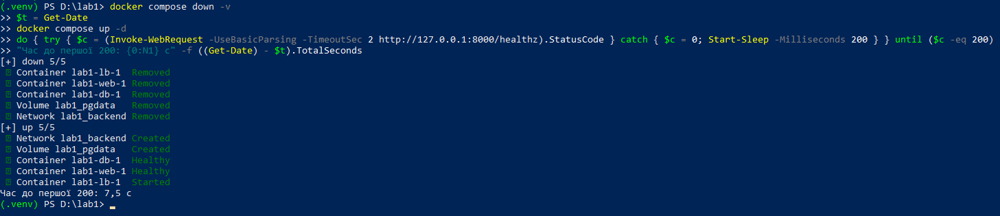

Рисунок 68 – Повтор 1: 7.5 с

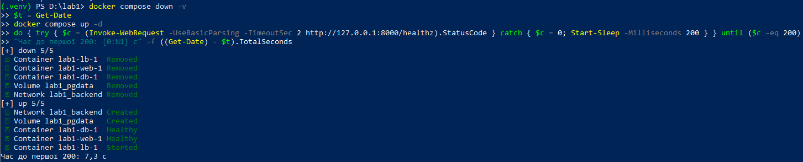

Рисунок 69 – Повтор 2: 7.3 с

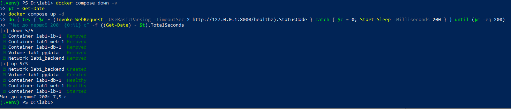

Рисунок 70 – Повтор 3: 7.5 с

Медіанний час до першої відповіді: 7.5 с. Більшу частину займає ініціалізація порожньої бази (initdb і накочування схеми), далі сервіс web стартує лише після того, як db стала healthy, а балансувальник після того, як web став healthy. Тому запит, що приходить одразу після завершення docker compose up, отримує відповідь, а не помилку підключення.

## Висновки

Реалізовано сервіс на FastAPI і PostgreSQL із шістьма ендпоінтами, перевіркою стану та валідацією запитів. Docker-образ зібрано багатоетапно.

Один інстанс стабільно обробляє 100 запитів/с, але за навантаження 500 запитів/с досягає лише 337,7 запиту/с (p95 — 20,2 с). Два інстанси обробляють 501,2 запиту/с із p95 217 мс. Помилок не було. Прискорення становить 1,48, а оцінка частки нерозпаралеленої роботи — 0,35.

Закон Літтла підтверджено наближено: розбіжність становить близько 11% за 100 запитів/с і 0,7–1,6% за 500 запитів/с на двох інстансах. Закритий контур зменшує p95 із 20,2 до 4,8 с, оскільки обмежує кількість запитів у черзі.

## Відкинуті рішення

- Стандартні налаштування Nginx. На 500 запитах/с виникали помилки через ліміт 512 з’єднань. Збільшено worker_connections до 4096 і встановлено worker_processes auto.

- Одноетапна збірка Docker. Відкинуто через наявність засобів встановлення пакетів у фінальному образі. Використано багатоетапну збірку.

- Референсний інтервал одним рядком і тип float. Не давали зручної перевірки меж і точності значень. Використано дві колонки NUMERIC(14,4).

- Стандартний код FastAPI 422. Замінено на 400 із поясненням помилки відповідно до вимог завдання.

- Тип float для value, ref_low і ref_high у схемі запиту. Відкинуто: значення з більшою за NUMERIC(14,4) кількістю знаків проходили валідацію, база округлювала їх, і відповідь була 500. Використано Decimal з max_digits=14 і decimal_places=4.

- Підрахунок досягнутої інтенсивності за всіма завершеними запитами. Відкинуто: у нього входили обриви з'єднання і тайм-аути (код 0), через що інтенсивність завищувалась (у попередній серії 157.6 замість 5.6 запитів/с). Тепер рахуються лише відповіді 2xx.

- L як сума інтервалів перебування запитів у вікні вимірювання. Відкинуто: така величина дорівнює λ · W за побудовою, тому розбіжність 0.01% не перевіряла закон. L вимірюється вибіркою кількості відправлених і завершених запитів.

- Вибірка L через time.sleep зі стандартним кроком таймера Windows. Відкинуто: на /noop виміряне L було 0.07 при λ · W = 0.40 (розбіжність 472%), бо потік вибірки прокидався лише на межах тіків і майже завжди бачив порожню систему. Додано timeBeginPeriod(1); розбіжність на /noop зменшилась до 6.9%.

## Використання генеративних моделей

Claude використовувався як допоміжний інструмент для написання та налагодження коду, налаштування Docker і Nginx, а також діагностики помилок. Запропоновані рішення перевірялися самостійно: протестовано валідацію на некоректних даних і коректного запиту, перевірено відсутність curl і wget в Docker-образі, перераховано досягнуту інтенсивність із сирих CSV та звірено результати з таблицями. Також перевірено вимірювання кількості запитів у системі за законом Літтла, розподіл навантаження між інстансами та роботу CRUD-операцій. Після змін код запускався в тестовому середовищі.

## Контрольні питання

**1. Чому PUT у цій роботі замінює запис повністю і чим би відрізнявся PATCH.**

PUT замінює всі поля запису, тому всі вони обов’язкові. Повторний однаковий запит не змінює результат. PATCH змінює лише передані поля, а решта залишаються без змін.

**2. Який код відповіді має повернути створення запису з ідентифікатором, який уже існує, і чому.**

409 Conflict, оскільки запис із таким ID вже існує. У нашій роботі ID генерує база, тому передавання id у POST призводить до 400 Bad Request.

**3. Що зберігається в шарі образу і чому порядок інструкцій у Dockerfile впливає на час перезбірки.**

Шар містить зміни файлової системи після виконання інструкції Dockerfile. Docker кешує незмінені шари, тому залежності встановлюються перед копіюванням коду. При зміні коду перевстановлювати залежності не потрібно.

**4. Що станеться з даними бази після docker compose down, після docker compose down -v і після видалення контейнера бази вручну.**

down видаляє контейнери, але зберігає том pgdata. down -v видаляє також том, тому дані втрачаються. Ручне видалення контейнера не видаляє дані з тому.

**5. Чому depends_on без умови за станом не гарантує, що база готова приймати підключення.**

Він чекає запуску контейнера, але не завершення ініціалізації PostgreSQL. Умова service_healthy запускає web лише після успішного healthcheck. Сервіс також уміє повторно підключатися до бази.

**6. Чим відрізняється EXPOSE від публікації порту і як сервіс дістається бази без публікації її порту на хост.**

EXPOSE лише вказує порт у конфігурації образу, а ports відкриває його на хості. Web підключається до БД через внутрішню мережу Compose за адресою db:5432, без публікації порту бази назовні.

**7. Чим відрізняється генератор із фіксованою швидкістю надходження від генератора з фіксованою кількістю віртуальних користувачів і чому другий приховує затримку під перевантаженням.**

Генератор із фіксованою швидкістю (відкритий контур) надсилає запити за розкладом незалежно від відповідей, тому під перевантаженням черга зростає, а затримка збільшується. Генератор із фіксованою кількістю віртуальних користувачів (закритий контур) надсилає наступний запит після відповіді на попередній, тому зі сповільненням сервісу зменшується і швидкість надходження запитів. Він приховує затримку, оскільки не враховує час очікування запитів до їх відправлення. У нашому тесті p95 становив 20,2 с у відкритому контурі та 4,8 с у закритому.

**8. Що змінилось у вашій серії після додавання другого вебінстансу і яка складова стенду лишилась спільною для обох.**

З навантаження 500 запитів/с інтенсивність зросла зі 337,7 до 501,2 запитів/с (S = 1,48), p95 зменшився з 20,2 с до 217 мс, помилок не було в обох конфігураціях. Спільними залишилися PostgreSQL, балансувальник і процесор ноутбука.

**9. Що означає отримане вами значення метрики Карпа-Флатта і як воно змінилось би, якби база була не одна на два інстанси.**

Отримано e = 0,35 за прискорення S = 1,48: за цією оцінкою близько 35% роботи не отримало виграшу від другого інстансу. Це оцінка зверху, бо на двох інстансах досягнуту інтенсивність обмежувала задана (501,2 при заданих 500). Якби база була не одна на два інстанси, послідовна складова зменшилась би і e було б меншим, але виграш залежав би від того, що спільними лишились би балансувальник і процесор ноутбука, а також від характеру запитів.

**10. Чому час відповіді зростає швидше за інтенсивність, коли сервіс наближається до межі пропускної здатності.**

Коли інтенсивність наближається до максимальної пропускної здатності, черга швидко зростає, тому затримка збільшується нелінійно. Якщо навантаження перевищує можливості сервісу, черга продовжує накопичуватися. У нашому тесті на одному інстансі p50 зріс з 4,7 мс за 100 запитів/с до 14,5 с за 500 запитів/с.
