# Лабораторна робота № 2

<p align="center">
  
</p>

МІНІСТЕРСТВО ОСВІТИ I НАУКИ УКРАЇНИ

НАЦІОНАЛЬНИЙ ТЕХНІЧНИЙ УНІВЕРСИТЕТ УКРАЇНИ

«КИЇВСЬКИЙ ПОЛІТЕХНІЧНИЙ ІНСТИТУТ  
ІМЕНІ ІГОРЯ СІКОРСЬКОГО»

ФАКУЛЬТЕТ БІОМЕДИЧНОЇ ІНЖЕНЕРІЇ

КАФЕДРА БІОМЕДИЧНОЇ КІБЕРНЕТИКИ

**Лабораторна робота № 2**

з дисципліни « **Високопродуктивні розподілені обчислювальні системи**»

на тему: «**Метрики сервісу і межа масштабованості**»

**Виконала:**

студентка гр. ЗК-61мп

Бойко Я. Л.

**Перевірив:**

Старший викладач БМК

Матвійчук О. В.

Зараховано від \_\_\_.\_\_\_.\_\_\_\_\_\_\_

\_\_\_\_\_\_\_\_\_\_\_\_\_\_\_\_\_\_\_\_\_\_\_\_\_

(підпис викладача)

Київ-2026

## Завдання для варіанта №4

<table>
<colgroup>
<col style="width: 45%" />
<col style="width: 54%" />
</colgroup>
<thead>
<tr class="header">
<th><strong>Параметр</strong></th>
<th><strong>Значення</strong></th>
</tr>
</thead>
<tbody>
<tr class="odd">
<td>Розмір пулу</td>
<td>15</td>
</tr>
<tr class="even">
<td>Набір бакетів Г3</td>
<td>1, 2, 4, 8, 16, 32, 64, 128, 256, 512, 1024</td>
</tr>
<tr class="odd">
<td>Додаткова метрика М4</td>
<td><p>частка запитів з тривалістю обробки, не більшою запоріг, обчислена за лічильником бакета гістограми.</p>
<p>Залежність цієї частки від заданої інтенсивності; поріг дорівнює межі бакета, найближчій до p99 сервера на першій сходинці прогону на одному екземплярі, за рівної відстані більшій межі</p></td>
</tr>
</tbody>
</table>

## Виконання завдання

### Етап 1. Метрики Prometheus у сервісі

До сервісу підключено бібліотеку prometheus_client. Три метрики (таблиця 1) створюються один раз під час запуску і оновлюються в проміжному обробнику (middleware), який обгортає кожен запит. Метрики віддає GET /metrics. Сервіс працює одним процесом uvicorn (без --workers).

**Таблиця 1 – Метрики сервісу**

| **Метрика**                   | **Тип**   | **Мітки**          | **Призначення**                                 |
|-------------------------------|-----------|--------------------|-------------------------------------------------|
| http_requests_total           | Counter   | method, path, code | кількість запитів                               |
| http_request_duration_seconds | Histogram | –                  | тривалість обробки, с; бакети Г3: 0.001 … 1.024 |
| http_requests_in_progress     | Gauge     | –                  | кількість запитів в обробці                     |

У мітці path записується шаблон маршруту (/lab-results/{item_id}), а не конкретний id. Бакети взято з набору Г3 і переведено в секунди (рисунок 1).

<p align="center">
  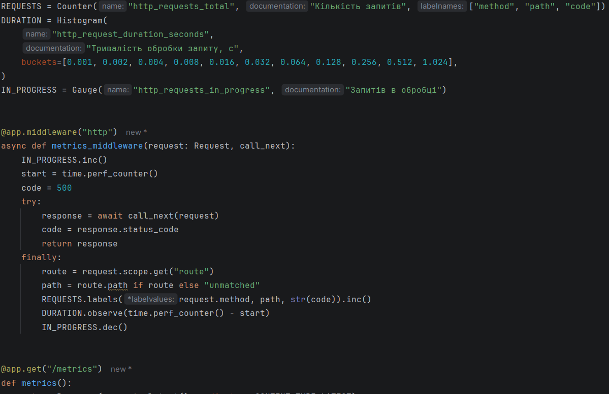
</p>

*Рисунок 1 – Код метрик і проміжного обробника в app/main.py*

<p align="center">
  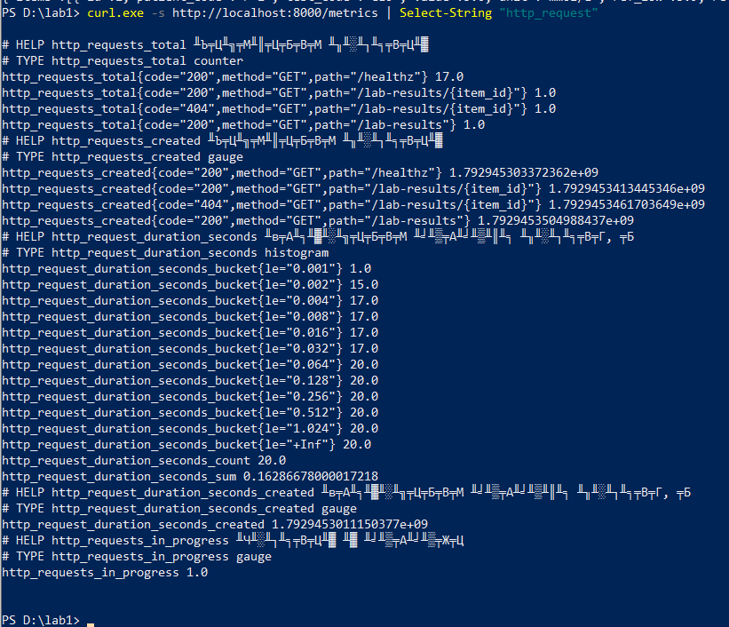
</p>

*Рисунок 2 – Вивід GET /metrics: лічильник із шаблоном шляху, гістограма з бакетами Г3, вимірювач запитів в обробці*

На рисунку 2 ряди лічильника розділені за шаблоном шляху і кодом (200 і 404), гістограма має бакети від 0.001 до 1.024 і +Inf, а http_requests_in_progress = 1 (це сам запит до /metrics). Рядки \# HELP нечитабельні через кодування консолі PowerShell.

### Етап 2. /livez, заголовок X-Pod і розмір пулу з'єднань

Додано: 1) GET /livez, який повертає 200 і не звертається до бази (на відміну від /healthz, що виконує SELECT 1); 2) заголовок X-Pod з іменем екземпляра: змінна POD_NAME, а якщо її не задано, ім'я хоста контейнера; 3) розмір пулу з DB_POOL_SIZE (15 за варіантом, задано в docker-compose.yml), який передається в ConnectionPool як max_size, тож з'єднань понад пул немає (рисунок 3).

<p align="center">
  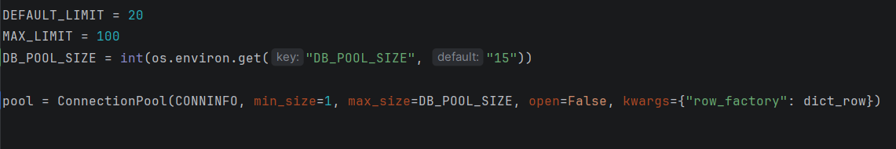
</p>

*Рисунок 3 – Розмір пулу з DB_POOL_SIZE: max_size = DB_POOL_SIZE*

Після зупинки бази (docker compose stop db) /livez повертає 200 із заголовком x-pod (рисунок 4), а /healthz повертає 503 (рисунок 5). У контейнері DB_POOL_SIZE = 15 (рисунок 6).

<p align="center">
  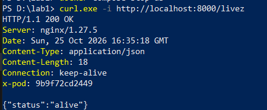
</p>

*Рисунок 4 – GET /livez за зупиненої бази: код 200 і заголовок x-pod*

<p align="center">
  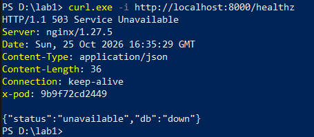
</p>

*Рисунок 5 – GET /healthz за зупиненої бази: код 503, db down*

<p align="center">
  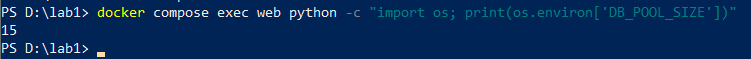
</p>

*Рисунок 6 – Значення DB_POOL_SIZE у контейнері web: 15*

### Етап 3. Коректна зупинка за SIGTERM

CMD у Dockerfile записано в exec-формі (рисунок 7), тому uvicorn сам обробляє SIGTERM: завершує активні запити, закриває пул і зупиняється з кодом 0. Додатковий код не потрібен. Перевірка: два вебінстанси, 100 запитів/с, прогрів 5 с і вимірювання 40 с. Через 15–20 с виконується docker stop lab1-web-2, після чого перевіряються код завершення та статуси відповідей у файлі прогону.

```bash
python loadgen\loadgen.py run --rate 100 --duration 40 --warmup 5 --instances 2 --label stop_test2
docker stop lab1-web-2
docker inspect lab1-web-2 --format "{{.State.ExitCode}}"
```

<p align="center">
  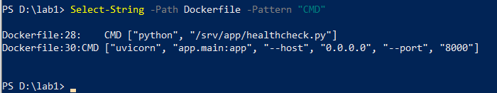
</p>

*Рисунок 7 – CMD у Dockerfile в exec-формі*

До виправлення 4,6 % запитів завершилися помилкою, p95 становив близько 10 с, p99 — 20 с (рисунок 8). У сирому файлі 184 із 4496 запитів мають статус 0 через помилку з'єднання або тайм-аут (рисунок 9). У лозі nginx зафіксовано відмову з'єднання зі зупиненим інстансом (рисунок 10). Причина в тому, що nginx продовжував надсилати запити на його адресу. Контрольний прогін без зупинки помилок не мав (рисунок 11).

<p align="center">
  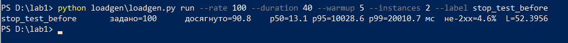
</p>

*Рисунок 8 – Прогін stop_test_before зі стандартними налаштуваннями nginx: не-2xx = 4,6 %*

<p align="center">
  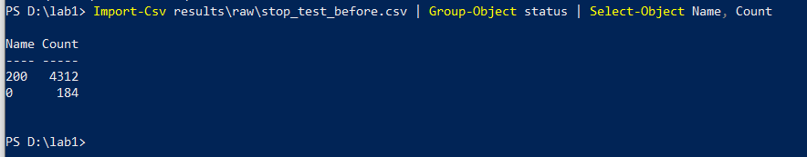
</p>

*Рисунок 9 – Статуси відповідей stop_test_before: 184 відповіді зі статусом 0*

<p align="center">
  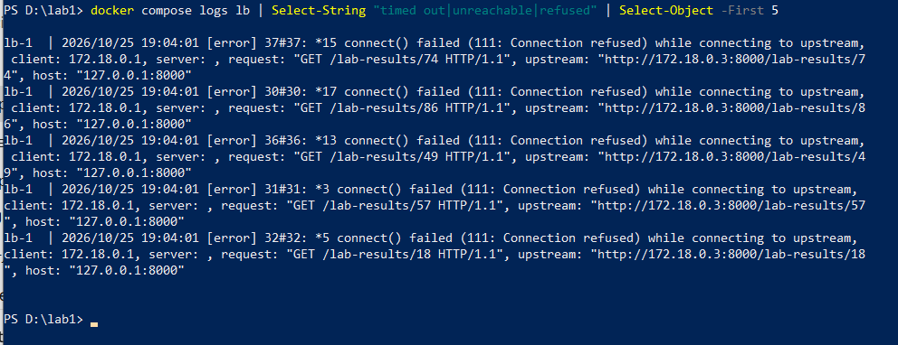
</p>

*Рисунок 10 – Лог nginx: connect() failed (111: Connection refused) до зупиненого інстансу*

<p align="center">
  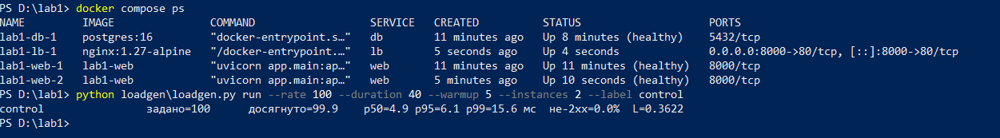
</p>

*Рисунок 11 – Контрольний прогін control без зупинки: не-2xx = 0,0 %, p95 = 6,1 мс*

Виправлення: у блок location / файлу lb/nginx.conf додано три директиви (рисунок 12). Якщо інстанс не відповідає за 1 с, nginx повторює запит на інший (до двох спроб).

```bash
proxy_connect_timeout 1s;
proxy_next_upstream error timeout;
proxy_next_upstream_tries 2;
```

<p align="center">
  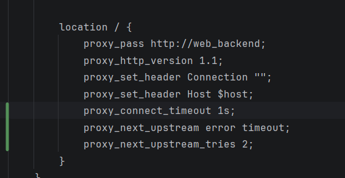
</p>

*Рисунок 12 – Виправлення в lb/nginx.conf*

Після виправлення docker stop займає 0,7 с і завершується з кодом 0 (рисунок 13). У прогоні stop_test2 усі 4496 відповідей мають статус 200, помилок 502 немає (рисунки 14, 15). Значення p99 = 1004 мс пояснюється очікуванням до 1 с під час спроби nginx підключитися до зупиненого інстансу.

<p align="center">
  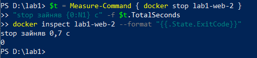
</p>

*Рисунок 13 – docker stop після виправлення: 0,7 с, код завершення 0*

<p align="center">
  
</p>

*Рисунок 14 – Прогін stop_test2 після виправлення: не-2xx = 0,0 %*

<p align="center">
  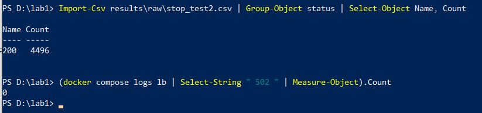
</p>

*Рисунок 15 – Статуси stop_test2 (лише 200) і кількість відповідей 502 у логу nginx: 0*

Висновок: код завершення 0, відповідей не 2xx і помилок з'єднання немає. Прогін stop_test_before залишено як доказ проблеми (відкинуте рішення: стандартні налаштування nginx).

### Етап 4. Prometheus у docker-compose

До docker-compose.yml додано Prometheus із портом 9090 і томом для збереження даних, а також конфігурацію збору метрик (рисунки 16, 17). Метрики збираються кожні 5 с, а екземпляри web виявляються через DNS. Метрика М4 обчислюється з гістограми, тому окремий експортер не потрібен. Після зміни кількості екземплярів балансувальник перестворюється командою docker compose up -d --force-recreate --no-deps lb.

<p align="center">
  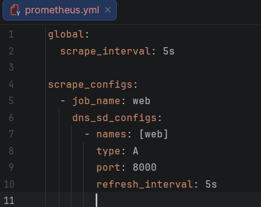
</p>

*Рисунок 16 – Конфігурація prometheus/prometheus.yml*

<p align="center">
  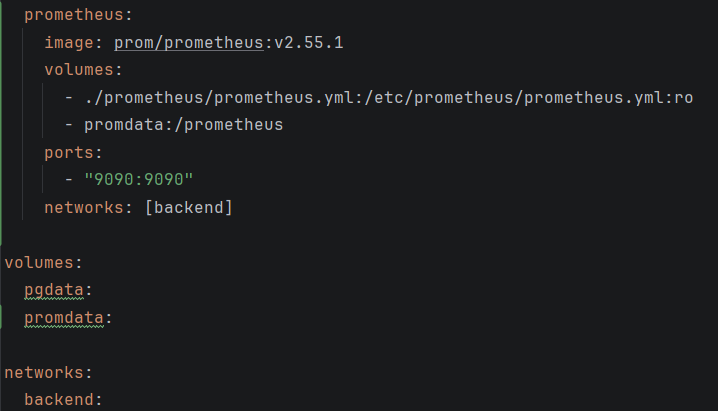
</p>

*Рисунок 17 – Сервіс prometheus і том promdata у docker-compose.yml*

Після запуску з --scale web=4 усі чотири екземпляри web мають стан UP (рисунок 18).

<p align="center">
  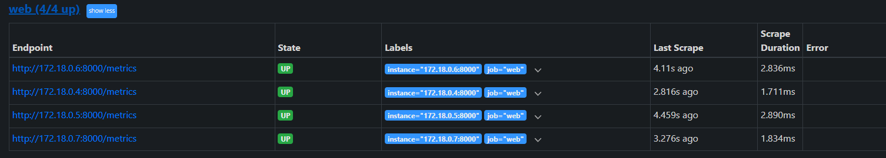
</p>

*Рисунок 18 – Сторінка Targets: усі чотири екземпляри web у стані UP*

### Етап 5. Ступінчастий генератор навантаження

Генератор loadgen/stepload.py працює у відкритому контурі: прогрів 10 с при 200 запитах/с, далі сходинки по 20 с із кроком 200. Запити надсилаються потоками, інтенсивність розподіляється між процесами за кількістю ядер. Тайм-аут становить 5 с, затримка рахується від запланованого часу, помилки з'єднання обліковуються окремо. Сценарій: читання одного запису зі 100. Щосекунди записуються інтенсивність, кількість успішних відповідей і помилок, а також p50, p95 і p99. Результат сходинки визначається за останні 15 с. Прогін завершується, якщо на двох сходинках поспіль досягнуто менше 90 % заданої інтенсивності, або після досягнення межі G (--g).

```bash
python loadgen\stepload.py --instances 1
```

При 256 потоках на процес (до 2048 запитів у польоті) на сходинці 400 досягнуто лише 91 запит/с при 71 % не-2xx (рисунок 19). Імовірна причина: черга запитів стає довшою за тайм-аут 5 с, клієнти здаються, а сервіс продовжує обробляти запити, на які вже ніхто не чекає. Щоб уникнути такого обвалу, для подальших прогонів використано 64 потоки на процес. Однак це обмежило одночасні запити до 512, і фактичне надсилання відстає від заданого: на сходинці 400 надіслано 320 запитів/с (рисунок 20). Отже, плато близько 320 запитів/с відображає обмеження генератора, а не потужність сервісу. Тому для коректних результатів генератор переведено на відкритий режим, у якому надсилання не залежить від кількості потоків. Результати, отримані з 64 потоками, не використовуються для висновків про пропускну здатність.

<p align="center">
  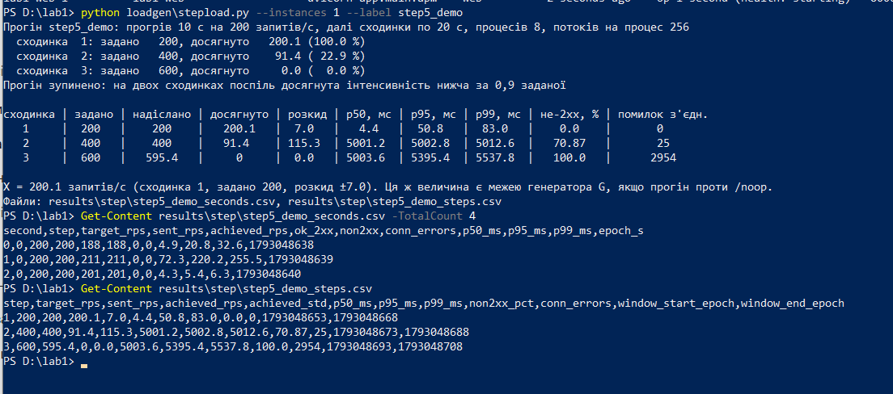
</p>

*Рисунок 19 – Прогін на одному інстансі з 256 потоками на процес: обвал на сходинці 400*

<p align="center">
  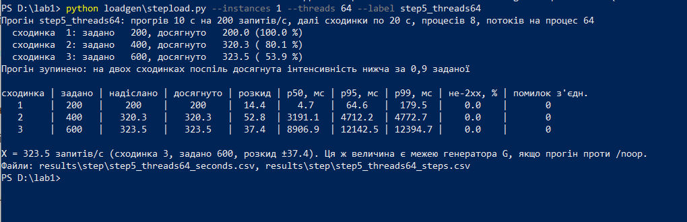
</p>

*Рисунок 20 – Прогін на одному інстансі з 64 потоками на процес: плато близько 320 запитів/с*

### Етап 6. Межа генератора G

Ендпоінт /noop у конфігурації балансувальника відповідає без звернення до web (рисунок 21):

<p align="center">
  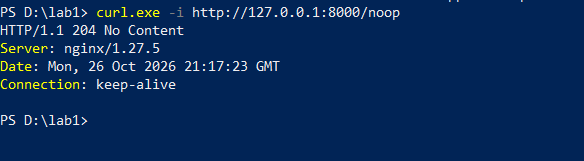
</p>

*Рисунок 21 – GET /noop: код 204*

Прогін /noop без обмеження G виконав усі 15 сходинок (рисунок 22). До 2200 запитів/с навантаження досягало заданого, p99 не перевищував 5,1 мс, помилок не було. Максимальна середня інтенсивність становила 2975,8 запитів/с (G), але це нижня оцінка через обмеження у 15 сходинок. Від 2400 запитів/с генератор ставав нестабільним, тому надійний діапазон становить приблизно до 2200 запитів/с.

<p align="center">
  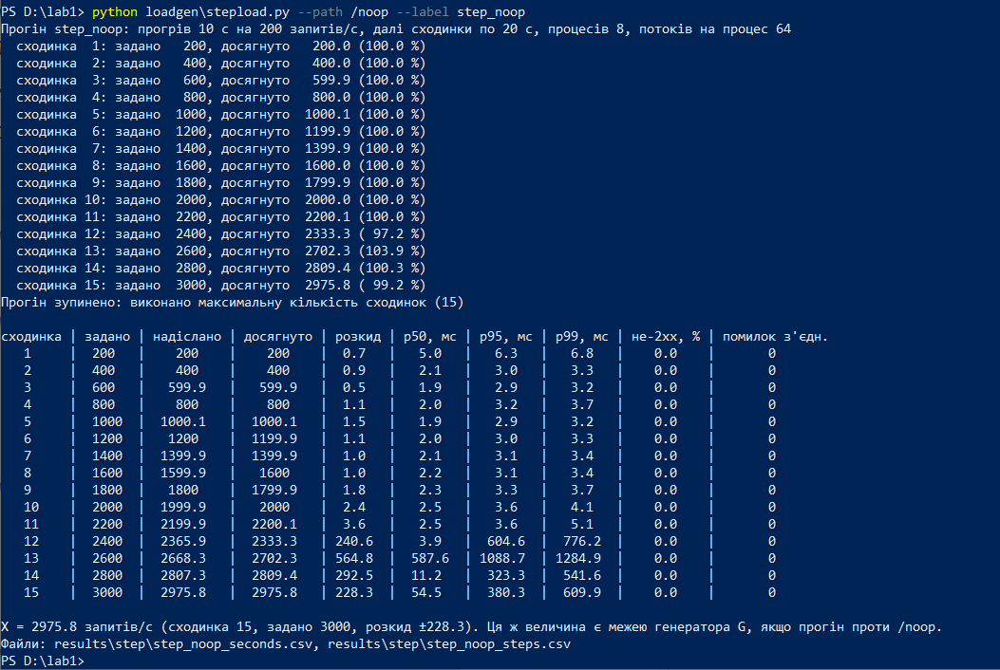
</p>

*Рисунок 22 – Ступінчастий прогін проти /noop: усі 15 сходинок, G = 2975,8 запитів/с*

### Етап 7. Ступінчасті прогони на 1, 2, 3 і 4 екземплярах

Для кожної кількості екземплярів N = 1, 2, 3, 4 виконано один ступінчастий прогін за профілем з етапу 5: прогрів 10 с на 200 запитів/с, далі сходинки по 20 с від 200 із кроком 200. Параметр --g задає межу генератора G = 2975,8 запитів/с з етапу 6. Перед кожним прогоном кількість екземплярів змінювалась параметром --scale web=N, балансувальник перестворювався, ліміти контейнера web (1 CPU, 768 МБ) не змінювались.

```bash
python loadgen\stepload.py --instances N --g 2975.8
```

Прогін зупиняється, коли на двох сходинках поспіль досягнута інтенсивність нижча за 0,9 заданої (рисунки 23, 25, 27, 29). X(N) це найбільша середня досягнута інтенсивність за останні 15 с сходинки, розкид це стандартне відхилення посекундної досягнутої інтенсивності за ті самі 15 с. Показники сходинки, на якій досягнуто X(N): p99 сервера, використання CPU одним екземпляром і середня кількість запитів в обробці на екземпляр беруться з Prometheus (рисунки 24, 26, 28, 30).

<p align="center">
  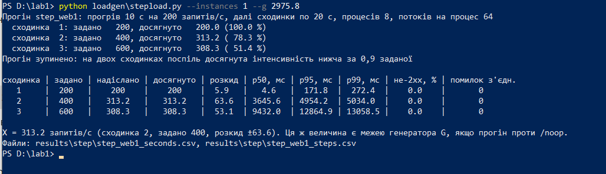
</p>

*Рисунок 23 – Прогін step_web1 на одному екземплярі: X(1) = 313,2 запиту/с на сходинці 2*

<p align="center">
  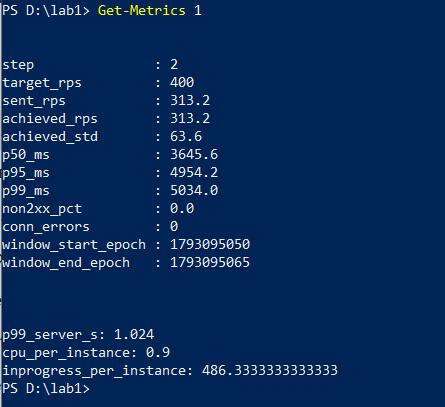
</p>

*Рисунок 24 – Показники сходинки 2 прогону на одному екземплярі*

<p align="center">
  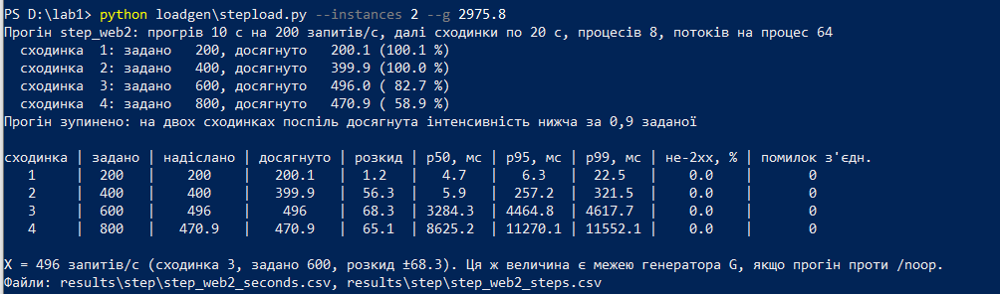
</p>

*Рисунок 25 – Прогін step_web2 на двох екземплярах: X(2) = 496,0 запиту/с на сходинці 3*

<p align="center">
  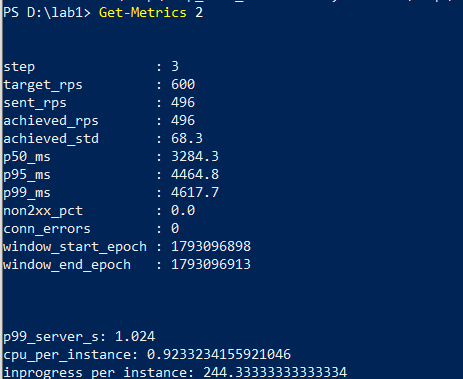
</p>

*Рисунок 26 – Показники сходинки 3 прогону на двох екземплярах*

<p align="center">
  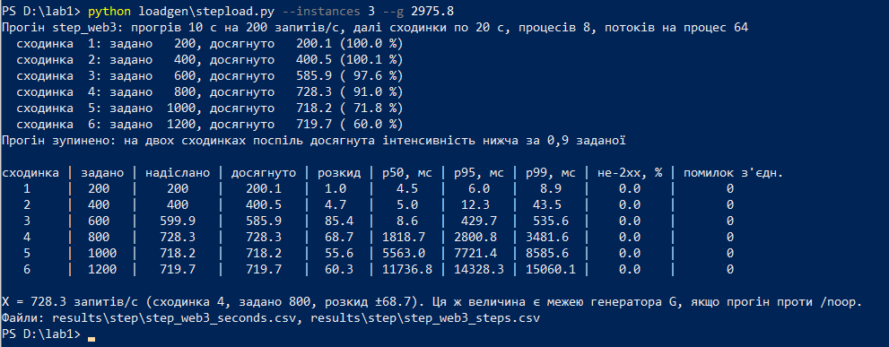
</p>

*Рисунок 27 – Прогін step_web3 на трьох екземплярах: X(3) = 728,3 запиту/с на сходинці 4*

<p align="center">
  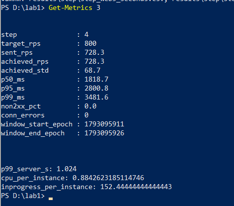
</p>

*Рисунок 28 – Показники сходинки 4 прогону на трьох екземплярах*

<p align="center">
  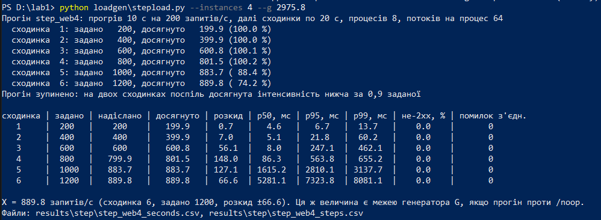
</p>

*Рисунок 29 – Прогін step_web4 на чотирьох екземплярах: X(4) = 889,8 запиту/с на сходинці 6*

<p align="center">
  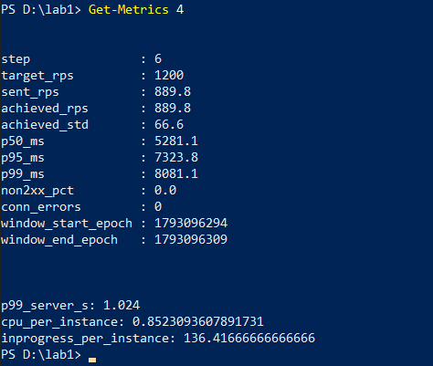
</p>

*Рисунок 30 – Показники сходинки 6 прогону на чотирьох екземплярах*

Ресурси, виділені Docker: віртуальній машині Docker Desktop доступні 8 CPU і 8 241 475 584 байти памʼяті, тобто 7,68 ГіБ (рисунок 31). Хост це ноутбук із 4 ядрами і 8 потоками, на ньому ж працює генератор навантаження.

<p align="center">
  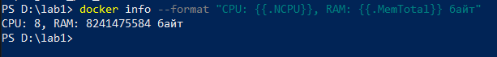
</p>

*Рисунок 31 – Ресурси Docker: 8 CPU, 7,68 ГіБ памʼяті*

**Таблиця 2 – Пропускна здатність X(N) і показники сходинки, на якій вона досягнута**

| **N** | **X(N), зап./с** | **Розкид, зап./с** | **Сходинка (задано)** | **p99 клієнта, мс** | **p99 сервера, мс** | **Не-2xx, %** | **CPU екз., ядер** | **В обробці на екз.** |
|-------|------------------|--------------------|-----------------------|---------------------|---------------------|---------------|--------------------|-----------------------|
| 1     | 313.2            | ±63.6              | 2 (400)               | 5034.0              | \> 1024             | 0.0           | 0.90               | 486                   |
| 2     | 496.0            | ±68.3              | 3 (600)               | 4617.7              | \> 1024             | 0.0           | 0.92               | 244                   |
| 3     | 728.3            | ±68.7              | 4 (800)               | 3481.6              | \> 1024             | 0.0           | 0.88               | 152                   |
| 4     | 889.8            | ±66.6              | 6 (1200)              | 8081.1              | \> 1024             | 0.0           | 0.85               | 136                   |

p99 сервера «\> 1024» означає, що затримка перевищує останню межу гістограми Г3 (1024 мс). Пропускна здатність зростає повільніше за кількість екземплярів: для чотирьох отримано 889,8 запиту/с замість 1252,8 за лінійного зростання. Помилок не було.

Жоден прогін не обмежений генератором: максимальна інтенсивність 889,8 запиту/с значно нижча за 0,9 · G = 2678 запитів/с. На останніх сходинках досягнуто 51,4 %, 58,9 %, 60,0 % і 74,2 % заданої інтенсивності для N = 1–4 відповідно.

Тому для підбору параметрів закону використовуються всі три точки з N \> 1, повторювати прогони зі зменшеним лімітом CPU не потрібно. Кількість запитів в обробці (457–546) близька до межі пулу генератора — 512 потоків. Це означає, що частина запитів очікує в черзі генератора.

### Етап 8. Діаграми прогонів на 1 і 4 екземплярах

Для прогонів на 1 і 4 екземплярах побудовано діаграми на спільній осі часу за даними Prometheus і генератора (рисунки 32, 33). На кожній діаграмі п'ять панелей: задана і досягнута інтенсивність; p99 клієнта і p99 сервера; кількість запитів за секунду, використання CPU і кількість запитів в обробці для кожного екземпляра. Діаграми побудовано до видалення томів Compose.

<p align="center">
  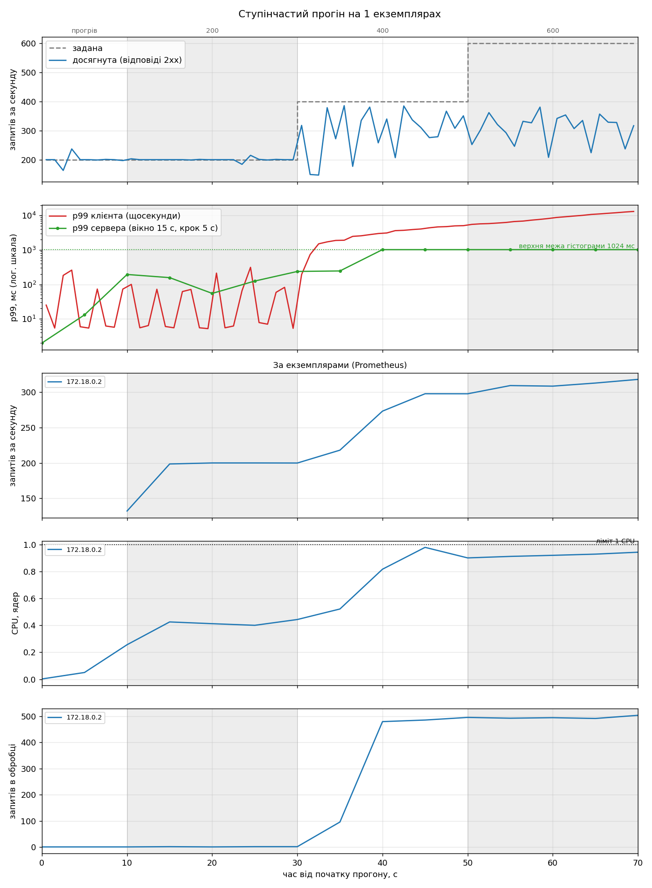
</p>

*Рисунок 32 – Ступінчастий прогін на одному екземплярі*

На одному екземплярі (рисунок 32) задана інтенсивність досягається лише при 200 запитах/с. Від 400 запитів/с фактична інтенсивність тримається близько 310 запитів/с, а p99 клієнта зростає до понад 10 с через накопичення запитів у черзі. p99 сервера досягає межі гістограми 1024 мс. CPU завантажений майже повністю (0,98 ядра), а кількість запитів в обробці зростає

<p align="center">
  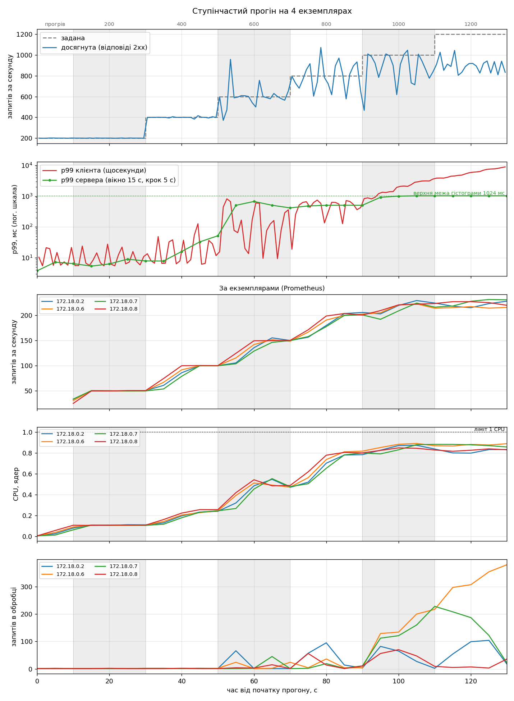
</p>

*Рисунок 33 – Ступінчастий прогін на чотирьох екземплярах*

На чотирьох екземплярах (рисунок 33) задана інтенсивність досягається до 800 запитів/с, а далі виходить на плато 880–890 запитів/с. Від 1000 запитів/с p99 клієнта зростає до кількох секунд, а p99 сервера досягає межі гістограми 1024 мс. Балансувальник рівномірно розподіляє запити (по 215–230 на екземпляр). CPU завантажений на 0,85–0,9 ядра, але не досягає ліміту. Кількість запитів в обробці розподілена нерівномірно — від кількох до приблизно 380 на екземпляр.

### Етап 9. Порівняння p99 клієнта і p99 сервера

Для кожної сходинки прогону на одному екземплярі порівняно p99 клієнта і p99 сервера. p99 сервера оцінюється за приростами лічильників бакетів гістограми за останні 15 с сходинки, просумованими по екземплярах, за формулою лінійної інтерполяції всередині бакета:

Q(q) = b(i−1) + (b(i) − b(i−1)) · (r − c(i−1)) / (c(i) − c(i−1)), r = q · n

Обчислення виконує скрипт scripts/p99_compare.py. Для кожної сходинки він визначає бакет, у який потрапило значення, і максимальну похибку оцінки, що дорівнює ширині цього бакета. Якщо ранг лежить за останньою скінченною межею, у таблиці записано «\> 1024 мс». Перевірено на тестових даних: для відомого розподілу скрипт дав очікувані 29,2 мс у бакеті (16; 32\], а для значень за останньою межею вивів «\> 1024 мс».

<p align="center">
  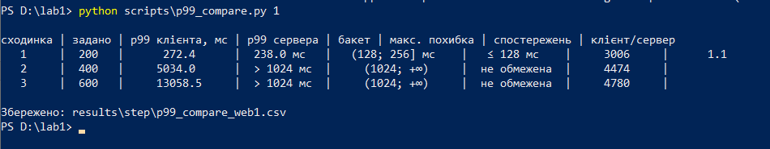
</p>

*Рисунок 34 – Порівняння p99 клієнта і p99 сервера за сходинками прогону на одному екземплярі*

**Таблиця 3 – p99 клієнта і p99 сервера за сходинками прогону на одному екземплярі**

| **Сходинка** | **Задано, зап./с** | **p99 клієнта, мс** | **p99 сервера** | **Бакет, мс** | **Макс. похибка** | **Запитів, n** | **Клієнт / сервер**   |
|--------------|--------------------|---------------------|-----------------|---------------|-------------------|----------------|-----------------------|
| 1            | 200                | 272.4               | 238.0 мс        | (128; 256\]   | ≤ 128 мс          | 3006           | 1.1 (від 1.06 до 2.1) |
| 2            | 400                | 5034.0              | \> 1024 мс      | (1024; +∞)    | не обмежена       | 4474           | \> 4.9                |
| 3            | 600                | 13058.5             | \> 1024 мс      | (1024; +∞)    | не обмежена       | 4780           | \> 12.8               |

На сходинці 200 p99 сервера = 238 мс із похибкою до 128 мс. Відношення 1,1 є приблизним. На сходинках 400 і 600 p99 перевищує межу гістограми 1024 мс, тому відношення становить щонайменше 4,9 і 12,8 відповідно. За низького навантаження затримки клієнта й сервера близькі. При перевантаженні серверна гістограма не враховує черги в генераторі, Docker і nginx. Тому p99 клієнта зростає до 5–13 с, тоді як серверна метрика обмежена значенням 1024 мс.

### Етап 10. Параметри універсального закону масштабованості

Відносна пропускна здатність C(N) = X(N) / X(1), де λ = X(1) = 313,2 запиту/с. Закон після перетворення стає лінійним відносно σ і κ:

N / C(N) − 1 = σ(N − 1) + κN(N − 1)

Для точок N \> 1 введено y(N) = N / C(N) − 1, u(N) = N − 1, v(N) = N(N − 1). Оцінки σ і κ методом найменших квадратів без вільного члена:

σ = (Σv² · Σuy − Σuv · Σvy) / (Σu² · Σv² − (Σuv)²)

κ = (Σu² · Σvy − Σuv · Σuy) / (Σu² · Σv² − (Σuv)²)

<p align="center">
  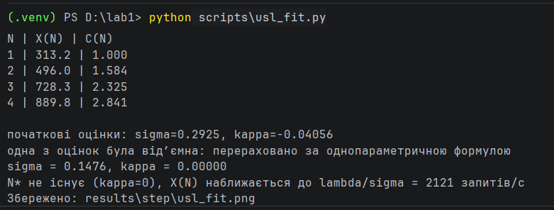
</p>

*Рисунок 35 – Підбір σ і κ: вивід scripts/usl_fit.py*

**Таблиця 4 – Дані для підбору параметрів закону**

| **N** | **X(N), зап./с** | **C(N)** | **y(N)** | **u** | **v** | **X за законом, зап./с (відхилення від виміряного)** |
|-------|------------------|----------|----------|-------|-------|------------------------------------------------------|
| 1     | 313.2            | 1.000    | –        | –     | –     | 313.2 (0 %)                                          |
| 2     | 496.0            | 1.584    | 0.2629   | 1     | 2     | 545.8 (+10.0 %)                                      |
| 3     | 728.3            | 2.325    | 0.2901   | 2     | 6     | 725.4 (−0.4 %)                                       |
| 4     | 889.8            | 2.841    | 0.4080   | 3     | 12    | 868.2 (−2.4 %)                                       |

Суми за N = 2, 3, 4: Σu² = 14, Σv² = 184, Σuv = 50, Σuy = 2,067, Σvy = 7,162. Знаменник Σu² · Σv² − (Σuv)² = 14 · 184 − 50² = 76.

Підстановка дає

σ = (184 · 2,067 − 50 · 7,162) / 76 = 0,2925

κ = (14 · 7,162 − 50 · 2,067) / 76 = −0,0406.

Оцінка κ відʼємна, тому за правилом з умови її прирівняно до нуля, а σ обчислено за однопараметричною формулою:

σ = Σuy / Σu² = 2,067 / 14 = 0,1476.

Отже, σ = 0,148, κ = 0. Оскільки κ дорівнює нулю, модель не має максимуму пропускної здатності для скінченного N. Теоретична межа становить λ / σ = 313,2 / 0,1476 ≈ 2121 запит/с (рисунок 36). Це розрахункова оцінка, яка не враховує можливих обмежень системи за більшої кількості екземплярів.

<p align="center">
  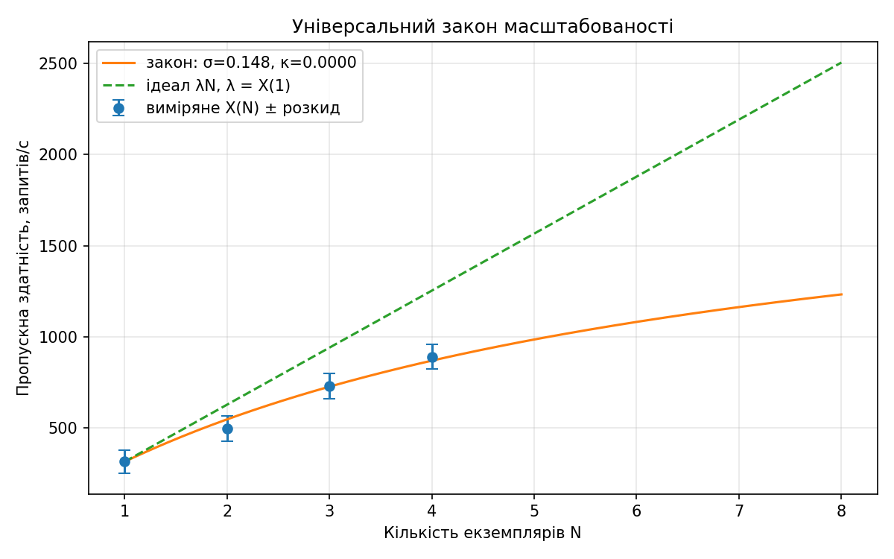
</p>

*Рисунок 36 – Виміряне X(N) з розкидом, крива закону з σ = 0,148 і κ = 0 та пряма λN*

За результатами підбору витрат на узгодження між екземплярами κ не виявлено. Зростання пропускної здатності обмежує спільний ресурс, на який припадає близько 15 % роботи. Модель добре відповідає точкам N = 3 і N = 4, але для N = 2 похибка

### Етап 11. Спільний ресурс і додаткова метрика М4

Метрика М4 показує, яка частка запитів обробляється не довше ніж за 256 мс. Цей поріг вибрано за результатами першого прогону: p99 сервера становив 238 мс, тому найближча межа гістограми — 256 мс. Для обчислення кількість запитів із затримкою до 256 мс ділять на загальну кількість запитів за останні 15 с сходинки. Дані всіх екземплярів підсумовуються. Діаграму для 1 і 4 екземплярів будує скрипт scripts/m4_plot.py, використовуючи дані Prometheus.

<p align="center">
  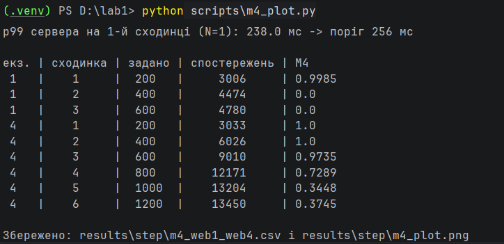
</p>

*Рисунок 37 – Вивід scripts/m4_plot.py: поріг 256 мс і значення М4 за сходинками*

<p align="center">
  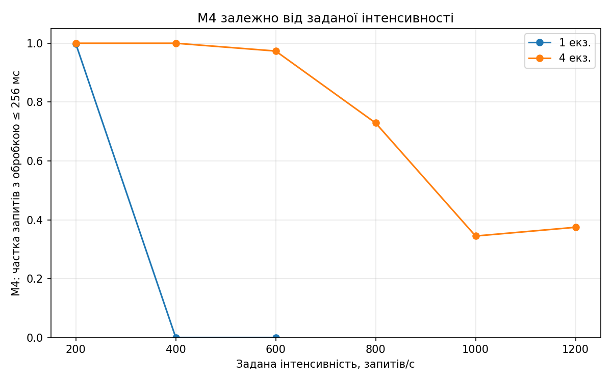
</p>

*Рисунок 38 – М4 залежно від заданої інтенсивності для 1 і 4 екземплярів*

**Таблиця 5 – Метрика М4 (частка запитів з обробкою не довше за 256 мс)**

| **Задано, зап./с** | **М4, 1 екземпляр** | **М4, 4 екземпляри** |
|--------------------|---------------------|----------------------|
| 200                | 0.9985              | 1.0000               |
| 400                | 0.0000              | 1.0000               |
| 600                | 0.0000              | 0.9735               |
| 800                | – (прогін зупинено) | 0.7289               |
| 1000               | – (прогін зупинено) | 0.3448               |
| 1200               | – (прогін зупинено) | 0.3745               |

На одному екземплярі М4 падає майже до нуля вже при 400 запитах/с, тобто запити обробляються довше за 256 мс. На чотирьох екземплярах метрика залишається близькою до 1 до 600 запитів/с, а потім знижується до 0,34–0,37. Ресурси вимірювали на сходинці 1200 запитів/с для чотирьох екземплярів. Скрипт scripts/sample_stats.ps1 тричі з інтервалом близько 5 с збирав дані про використання CPU генератором, хостом і кожним вебекземпляром через Docker та Prometheus.

```bash
powershell -ExecutionPolicy Bypass -File scripts\sample_stats.ps1 -Delay 108
```

<p align="center">
  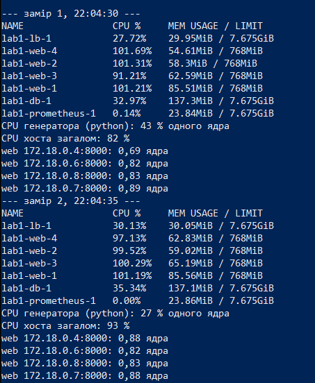
</p>

*Рисунок 39 – Заміри 1 і 2 на сходинці 1200 (чотири екземпляри)*

<p align="center">
  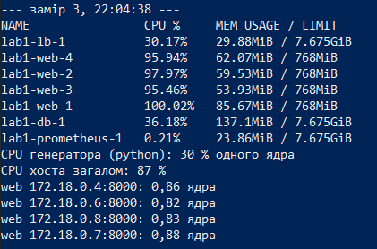
</p>

*Рисунок 40 – Замір 3 на сходинці 1200 (чотири екземпляри)*

**Таблиця 6 – Використання ресурсів на сходинці 1200 (середнє з трьох замірів)**

| **Компонент**              | **CPU, % одного ядра** | **Памʼять, МіБ** |
|----------------------------|------------------------|------------------|
| web-1                      | 100.8                  | 85.6             |
| web-2                      | 99.6                   | 59.0             |
| web-3                      | 95.7                   | 60.6             |
| web-4                      | 98.3                   | 59.8             |
| db (PostgreSQL)            | 34.8                   | 137.2            |
| lb (nginx)                 | 29.3                   | 30.0             |
| prometheus                 | 0.1                    | 23.9             |
| генератор (процеси python) | 33                     | –                |
| CPU хоста загалом          | 87                     | –                |

Основним обмеженням системи є процесор хоста, на якому одночасно працюють усі контейнери та генератор навантаження.

- База даних не є головним обмеженням: використовує близько 0,35 ядра. Балансувальник — 0,29 ядра, генератор — 0,33 ядра.

- Пам’яті достатньо: кожен web займає не більше 86 МіБ із доступних 768 МіБ.

- Вебекземпляри навантажені: кожен наближається до ліміту в одне ядро. Але цього недостатньо, щоб пояснити повільніше зростання продуктивності зі збільшенням кількості екземплярів.

- Процесор хоста майже повністю зайнятий: завантаження становить у середньому 87 %. При цьому чотири екземпляри, база, nginx, генератор та Docker ділять ресурси ноутбука з чотирма фізичними ядрами.

Це підтверджують додаткові спостереження. Зі збільшенням кількості екземплярів на один запит витрачається більше процесорного часу: з 2,9 мс для одного до 3,8 мс для чотирьох. Також знижується частка запитів, оброблених за 256 мс. Водночас балансувальник розподіляє запити рівномірно, тому причина не в ньому. Отже, продуктивність обмежує спільний процесор хоста, за який конкурують усі контейнери та генератор. Частка (σ=0,148) у моделі відображає цей вплив.

**Висновки**

Сервіс доповнено метриками Prometheus, перевіркою /livez, заголовком X-Pod, пулом із 15 з’єднань і коректним завершенням за SIGTERM. Додано Prometheus і генератор навантаження з межею G = 2975,8 запиту/с, яка перевищує всі виміряні значення.

Пропускна здатність для 1–4 екземплярів становить 313,2; 496,0; 728,3 і 889,8 запиту/с. Параметри моделі: σ = 0,148, κ = 0. Це означає, що масштабування сповільнюється через спільний ресурс, а не через узгодження між екземплярами.

p99 клієнта перевищує p99 сервера, оскільки серверна гістограма не враховує всі черги та шлях через Docker і nginx. Після межі 1024 мс вона показує лише нижню оцінку затримки.

Основним обмеженням виявився процесор хоста, за який конкурують усі контейнери та генератор. Це підтверджують вимірювання використання ресурсів і метрика М4.
