# Лабораторна робота № 3

Дисципліна: «Високопродуктивні розподілені обчислювальні системи»
Тема: «Сервіс у Kubernetus з автомаштабуванням та без нього»

КПІ ім. Ігоря Сікорського, факультет біомедичної інженерії, кафедра біомедичної кібернетики

Виконала: студентка гр. ЗК-61мп Бойко Я. Л.
Перевірив: старший викладач БМК Матвійчук О. В.

Київ, 2026

Завдання

## Завдання для варіанта №4

<table>
<colgroup>
<col style="width: 45%" />
<col style="width: 54%" />
</colgroup>
<thead>
<tr class="header">
<th><strong>Параметр</strong></th>
<th><strong>Значення</strong></th>
</tr>
</thead>
<tbody>
<tr class="odd">
<td>R</td>
<td>4</td>
</tr>
<tr class="even">
<td>Кластер</td>
<td>kind</td>
</tr>
<tr class="odd">
<td>requests / limits CPU</td>
<td>500m / 1</td>
</tr>
<tr class="even">
<td>Цільове використання CPU</td>
<td>70 %</td>
</tr>
<tr class="odd">
<td>Рівень стрибка</td>
<td>2,5 · X(1)</td>
</tr>
<tr class="even">
<td>Додаткова вимога - Д3</td>
<td><p>додати Ingress-контролер Traefik перед web: Helm-чарт у kind, вбудований контролер у k3d</p>
<p>коефіцієнт дисбалансу на R репліках через NodePort і через Ingress за однакової заданої інтенсивності</p></td>
</tr>
</tbody>
</table>

## Хід роботи

### Крок 1. Кластер kind

Кластер lab3 створено командою kind create cluster --config kind/kind-config.yaml. Він містить один вузол control-plane і два вузли worker. У конфігурації налаштовано прокидання трьох портів із хоста на NodePort вузла control-plane: 8080 → 30080 для web, 8081 → 30081 для Traefik (варіант Д3) і 9090 → 30090 для Prometheus.

<p align="center">
  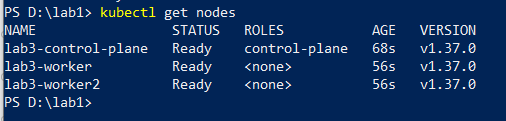
</p>

*Рисунок 1 – Вузли кластера: control-plane і два worker у стані Ready*

<p align="center">
  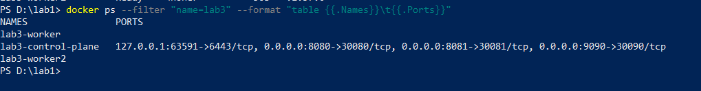
</p>

*Рисунок 2 – Прокинуті порти вузла control-plane*

### Крок 2. Команда розгортання і видалення кластера

Розгортання виконує скрипт scripts\deploy.ps1: він створює кластер, позначає вузол control-plane міткою role=infra, збирає образ lab3-web, завантажує його у вузли через kind load docker-image і застосовує маніфести. Для видалення кластера використовують команду kind delete cluster --name lab3.

<p align="center">
  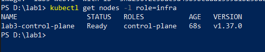
</p>

*Рисунок 3 – Мітка role=infra на вузлі control-plane*

<p align="center">
  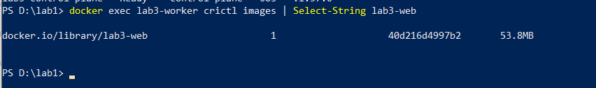
</p>

*Рисунок 4 – Образ lab3-web завантажено у вузол кластера*

<p align="center">
  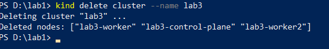
</p>

*Рисунок 5 – Команда повного видалення кластера*

Перевірка підтвердила наявність мітки role=infra на вузлі control-plane (рисунок 3) і образу lab3-web у вузлі (рисунок 4). Образ завантажується безпосередньо у вузли, без використання реєстру, тому контейнери запускаються з локального образу.

### Крок 3. PostgreSQL у кластері

Базу розгорнуто як StatefulSet postgres-0 із томом PersistentVolumeClaim на 1 Gi та headless Service postgres (clusterIP: None), що дає стале DNS-ім’я. Пароль зберігається в Secret, створеному з файла .env, і не потрапляє в образ, ConfigMap чи репозиторій. Параметр max_connections = 100 задано в конфігурації PostgreSQL, а таблицю lab_results створює Job db-migrate.

StatefulSet дає сталість імені пода та збереження даних у разі його перезапуску. Job виконує міграцію до успішного завершення, а headless Service дає змогу web звертатися до бази за іменем postgres.

<p align="center">
  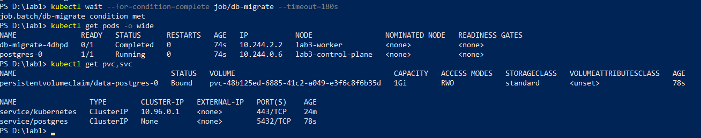
</p>

*Рисунок 6 – Job міграції виконано, под бази на вузлі control-plane, PVC у стані Bound, headless Service*

<p align="center">
  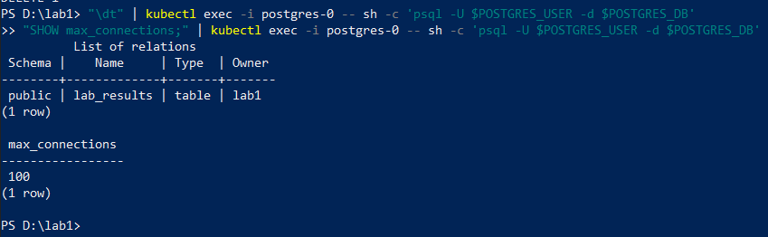
</p>

*Рисунок 7 – Таблиця lab_results створена, max_connections = 100*

<p align="center">
  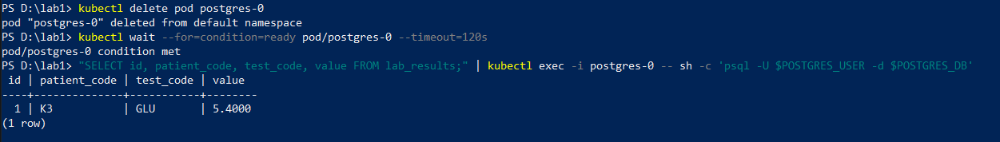
</p>

*Рисунок 8 – Після видалення пода postgres-0 дані на місці*

Перевірка підтвердила статус Completed для db-migrate, стан Bound для PVC і роботу postgres-0 на вузлі control-plane (рисунок 6). У базі наявна таблиця lab_results, а max_connections = 100 (рисунок 7). Після видалення пода postgres-0 його було створено повторно з тим самим томом, а раніше записаний рядок зберігся (рисунок 8).

### Крок 4. Сервіс web

Сервіс розгорнуто як Deployment без заданого replicas, щоб кількість реплік можна було змінювати через kubectl scale або HPA без скидання під час застосування маніфесту. NodePort відкриває порт 30080 і розподіляє з’єднання між подами. Адреса бази та DB_POOL_SIZE = 15 зберігаються в ConfigMap web-config, пароль передається через secretKeyRef, а ім’я пода POD_NAME отримує через Downward API. Для контейнера задано requests.cpu: 500m, limits.cpu: 1 і limits.memory: 512Mi. Також налаштовано readinessProbe на /healthz, livenessProbe на /livez, затримку preStop на 5 секунд і terminationGracePeriodSeconds: 15.

readinessProbe перевіряє доступність бази, тому под без з’єднання з нею не отримує запитів. livenessProbe не перевіряє базу, щоб її тимчасова недоступність не спричиняла перезапуск сервісу. Затримка preStop дає час на вилучення пода з маршрутизації перед завершенням процесу.

<p align="center">
  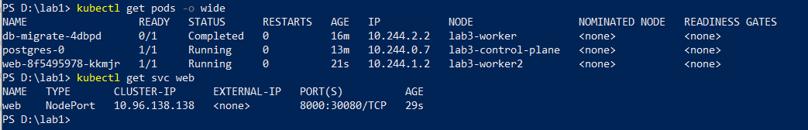
</p>

*Рисунок 9 – Под web і Service типу NodePort*

<p align="center">
  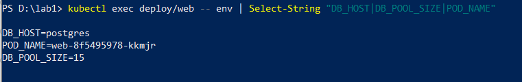
</p>

*Рисунок 10 – Змінні середовища пода: адреса бази, DB_POOL_SIZE, POD_NAME*

<p align="center">
  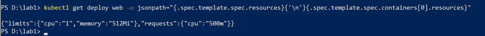
</p>

*Рисунок 11 – Ресурси контейнера web*

<p align="center">
  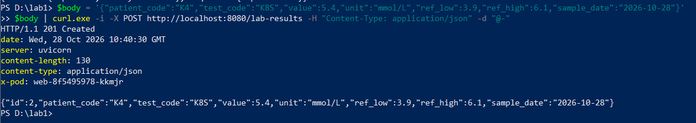
</p>

*Рисунок 12 – POST: 201, запис створено*

<p align="center">
  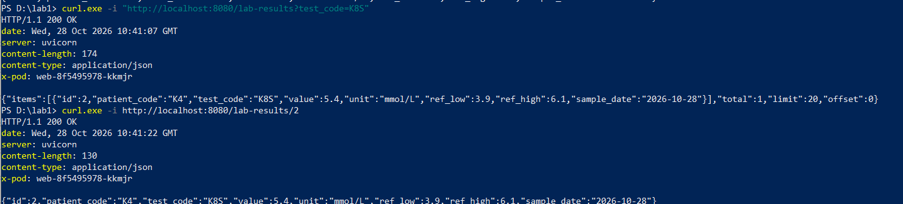
</p>

*Рисунок 13 – GET: перелік із фільтром і один запис, 200*

<p align="center">
  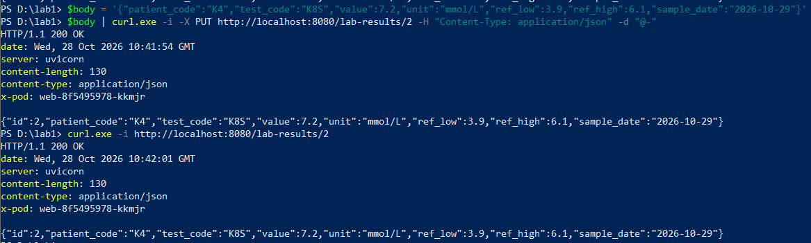
</p>

*Рисунок 14 – PUT: 200, заміна збереглась*

<p align="center">
  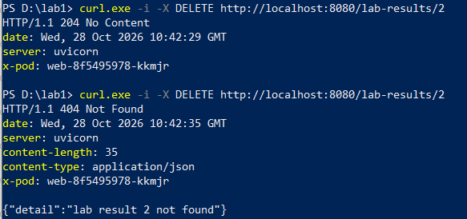
</p>

*Рисунок 15 – DELETE: 204, повторний DELETE: 404*

Через localhost:8080 перевірено повний цикл роботи API. Заголовок X-Pod показує, який под обробив запит. Оскільки на цьому етапі репліка одна, значення заголовка однакове. Повторний DELETE повертає 404, як передбачено API.

### Крок 5. Моніторинг

На вузлі control-plane встановлено Prometheus, kube-state-metrics, оператор і postgres-exporter через Helm-чарти. Для kubectl top і HPA встановлено metrics-server. Prometheus збирає метрики подів web через PodMonitor, а метрики контейнерів — через kubelet. Інтервал збору становить 5 секунд (scrape_interval: 5s).

Лічильник запитів за подами дає змогу визначити кількість запитів за секунду.

Лічильники container_cpu_cfs_periods_total і container_cpu_cfs_throttled_periods_total використовуються для розрахунку частки обмеження CPU. Метрика kube_deployment_status_replicas_ready показує кількість готових реплік для оцінки еластичності. Оскільки лічильники CPU оновлюються приблизно раз на 10–15 секунд, частку обмеження обчислюють за вікном у 20 секунд.

<p align="center">
  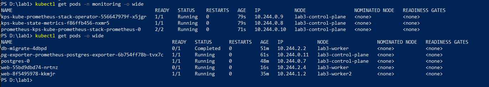
</p>

*Рисунок 16 – Поди моніторингу на вузлі control-plane*

<p align="center">
  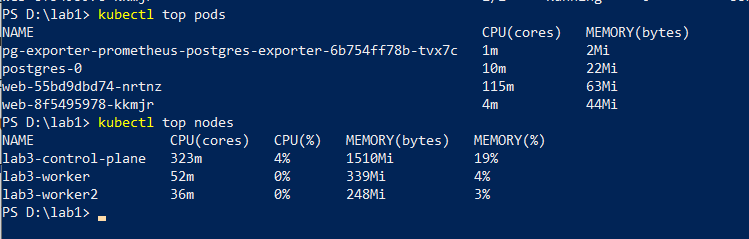
</p>

*Рисунок 17 – kubectl top повертає дані про поди і вузли*

<p align="center">
  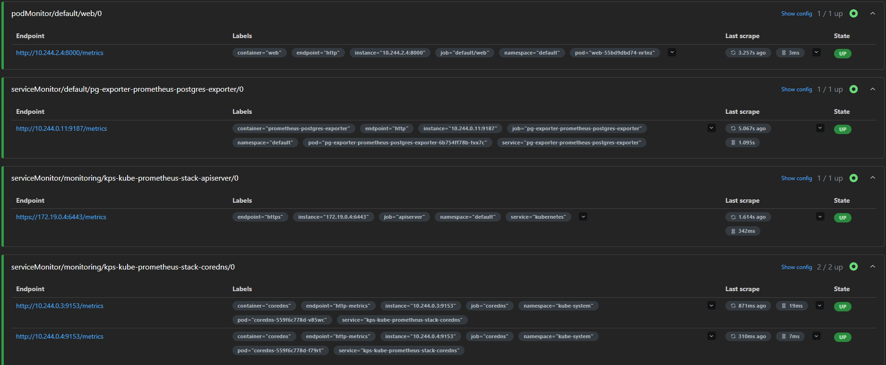
</p>

*Рисунок 18 – Цілі Prometheus: под web і postgres-exporter у стані UP*

<p align="center">
  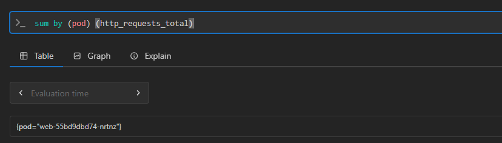
</p>

*Рисунок 19 – Ряд запитів для пода web*

<p align="center">
  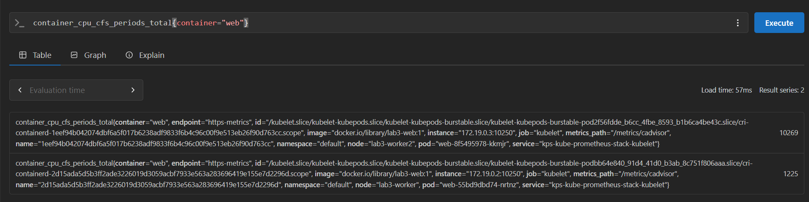
</p>

*Рисунок 20 – Лічильник CFS-періодів контейнера web*

<p align="center">
  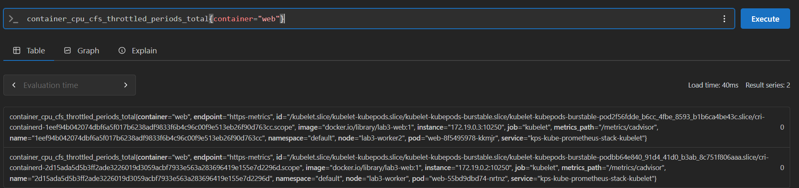
</p>

*Рисунок 21 – Лічильник періодів дроселювання CFS контейнера web*

<p align="center">
  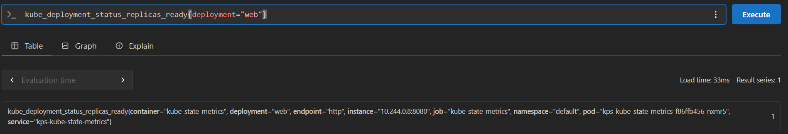
</p>

*Рисунок 22 – Ряд kube_deployment_status_replicas_ready*

### Крок 6. Модель зʼєднань генератора

Генератор loadgen/stepload.py налаштовано на 32 постійні з’єднання (8 · R). Кожне з’єднання закривається після 100 запитів і замінюється новим. Це правило діє в усіх прогонах. Тривалість кожної сходинки збільшено до 30 секунд, а середні значення обчислюються за останні 20 секунд.

Це важливо, оскільки kube-proxy обирає под під час встановлення TCP-з’єднання, і запити одного keep-alive з’єднання надходять на той самий под. Нові з’єднання дають змогу перерозподіляти запити між подами, зокрема після додавання реплік. Обмеження у 32 з’єднання також впливає на кількість запитів у роботі: якщо сервіс не встигає їх обробляти, запити чекають у черзі генератора, що збільшує клієнтський p99.

<p align="center">
  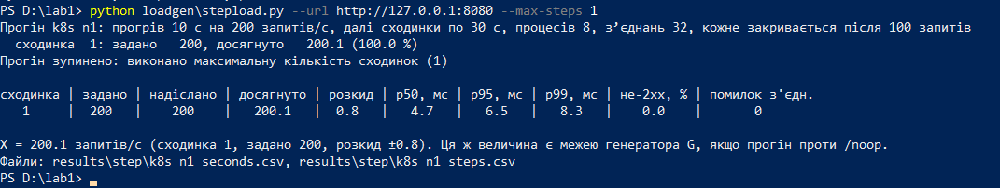
</p>

*Рисунок 23 – Генератор: 32 зʼєднання, закриття після 100 запитів*

### Крок 7. Ступінчасті прогони на N = 1, 2, 3 і 4 репліках

Для кожної кількості реплік N виконано окремий прогін через kubectl scale, з паузою 60 с між прогонами. Після прогріву 10 с на 200 запитах/с навантаження збільшувалося кожні 30 с на 200 запитів/с. Прогін зупинявся, якщо на двох сходинках поспіль досягнута інтенсивність була меншою за 90% заданої.

Пропускну здатність X(N) визначено за найбільшою середньою інтенсивністю за останні 20 с сходинки, а розкид — за стандартним відхиленням посекундних значень. Оскільки кластер і генератор працюють на одному ноутбуці (8 CPU, 7,7 ГіБ RAM у Docker), вони конкурують за ресурси. На останній сходинці кожного прогону досягнуто менше 90% заданого навантаження, тому всі чотири точки використано для підбору параметрів закону масштабованості.

<p align="center">
  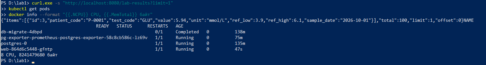
</p>

*Рисунок 24 – Ресурси Docker (8 CPU, 7,7 ГіБ) і 100 записів у базі*

<p align="center">
  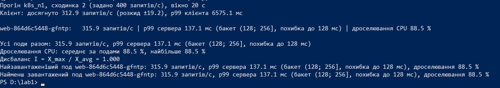
</p>

*Рисунок 25 – N = 1: сходинка 2 (задано 400)*

<p align="center">
  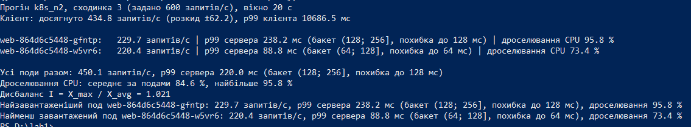
</p>

*Рисунок 26 – N = 2: сходинка 3 (задано 600)*

<p align="center">
  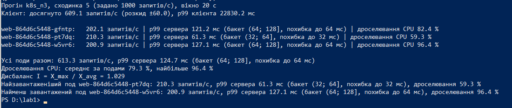
</p>

*Рисунок 27 – N = 3: сходинка 5 (задано 1000)*

<p align="center">
  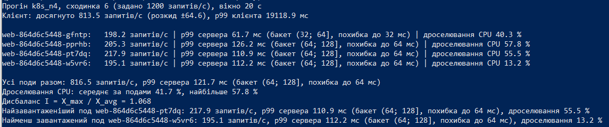
</p>

*Рисунок 28 – N = 4: сходинка 6 (задано 1200)*

**Таблиця 1 – Результати ступінчастих прогонів**

| **N** | **X(N), запитів/с** | **Розкид** | **Сходинка (задано)** | **p99 клієнта, мс** | **p99 сервера, мс** | **Дроселювання CPU, сер. / макс., %** | **Остання сходинка, % від заданої** |
|-------|---------------------|------------|-----------------------|---------------------|---------------------|---------------------------------------|-------------------------------------|
| 1     | 312.9               | ±19.2      | 400                   | 6575                | 137.1               | 88.5 / 88.5                           | 49.3                                |
| 2     | 434.8               | ±62.2      | 600                   | 10687               | 220.0               | 84.6 / 95.8                           | 53.3                                |
| 3     | 609.1               | ±60.0      | 1000                  | 22830               | 124.7               | 79.3 / 96.4                           | 60.9                                |
| 4     | 813.5               | ±64.6      | 1200                  | 19119               | 121.7               | 41.7 / 57.8                           | 67.8                                |

**Таблиця 2 – Пропускна здатність у розрахунку на одну репліку**

| **N** | **X(N), запитів/с** | **X(N) / N, запитів/с на репліку** | **C(N) = X(N) / X(1)** | **Ефективність C(N) / N** |
|-------|---------------------|------------------------------------|------------------------|---------------------------|
| 1     | 312.9               | 312.9                              | 1.000                  | 100 %                     |
| 2     | 434.8               | 217.4                              | 1.390                  | 69.5 %                    |
| 3     | 609.1               | 203.0                              | 1.947                  | 64.9 %                    |
| 4     | 813.5               | 203.4                              | 2.600                  | 65.0 %                    |

Пропускна здатність зростає від 312,9 запитів/с на одній репліці до 813,5 на чотирьох. Проте це у 2,6 раза більше замість очікуваних 4 разів. Ефективність падає до 69,5 % при переході від однієї репліки до двох, а далі тримається на рівні близько 65 %. На одну репліку припадає в середньому 203–217 запитів/с. Для N = 1 і N = 2 остання сходинка не збігається зі сходинкою максимальної пропускної здатності, тому задану інтенсивність потрібно уточнити за журналами прогонів.

Дроселювання CPU становить 88,5 % на одній репліці та в середньому 41,7 % на чотирьох. Отже, спочатку обмеженням є ліміт CPU одного пода, а зі збільшенням кількості реплік вплив цього обмеження зменшується. Подальше зростання може обмежувати спільний процесор ноутбука, генератор навантаження або база даних. Оскільки ці чинники окремо не перевірялися, це лише припущення.

За чотирьох реплік клієнтський p99 сягає 19119 мс, тоді як серверний — 121,7 мс. Така різниця свідчить про накопичення запитів у черзі генератора. Серверний p99 обчислюється за гістограмою, тому його точність обмежена шириною бакетів. Наприклад, значення 137,1 мс для однієї репліки належить бакету (128; 256\] мс.

### Крок 8. Коефіцієнт дисбалансу

Для кожної кількості реплік N \> 1 на сходинці, де досягнуто пропускної здатності X(N), обчислено індекс дисбалансу I = X_max / X_avg, де X_max- пропускна здатність найбільш завантаженого пода, а X_avg - середня пропускна здатність усіх подів. За рівномірного розподілу I = 1, а максимальне значення дорівнює N. Для однієї репліки I = 1,000. Також для найбільш і найменш завантажених подів зафіксовано p99 сервера та частку дроселювання CPU.

Приклад розрахунку для N = 4:

Середня пропускна здатність чотирьох подів:

X_avg = (198,2 + 205,3 + 217,9 + 195,1) / 4 = 204,1 запитів/с.

Індекс дисбалансу:

I = 217,9 / 204,1 = 1,068.

**Таблиця 3 – Коефіцієнт дисбалансу і крайні поди**

| **N** | **I** | **Под** | **Роль**             | **Запитів/с** | **p99 сервера, мс** | **Дроселювання, %** |
|-------|-------|---------|----------------------|---------------|---------------------|---------------------|
| 2     | 1.021 | gfntp   | найзавантаженіший    | 229.7         | 238.2               | 95.8                |
| 2     | 1.021 | w5vr6   | найменш завантажений | 220.4         | 88.8                | 73.4                |
| 3     | 1.029 | pt7dq   | найзавантаженіший    | 210.3         | 61.3                | 59.3                |
| 3     | 1.029 | w5vr6   | найменш завантажений | 200.9         | 127.1               | 96.4                |
| 4     | 1.068 | pt7dq   | найзавантаженіший    | 217.9         | 110.9               | 55.5                |
| 4     | 1.068 | w5vr6   | найменш завантажений | 195.1         | 112.2               | 13.2                |

Розподіл навантаження між подами майже рівномірний: коефіцієнт дисбалансу становить 1,02–1,07, а різниця між найбільш і найменш завантаженим подом не перевищує 12 %. Цьому сприяє повторне відкриття з’єднань, завдяки якому запити розподіляються між подами. Суми запитів за подами не завжди збігаються із загальною пропускною здатністю. Наприклад, для двох реплік сума становить 450,1 запиту/с, а X(2) = 434,8. Це потрібно перевірити за сирими даними. Дроселювання CPU відрізняється навіть за схожого навантаження, а його причини окремо не досліджувалися. Значення p99 сервера також слід порівнювати обережно через похибку гістограм.

<p align="center">
  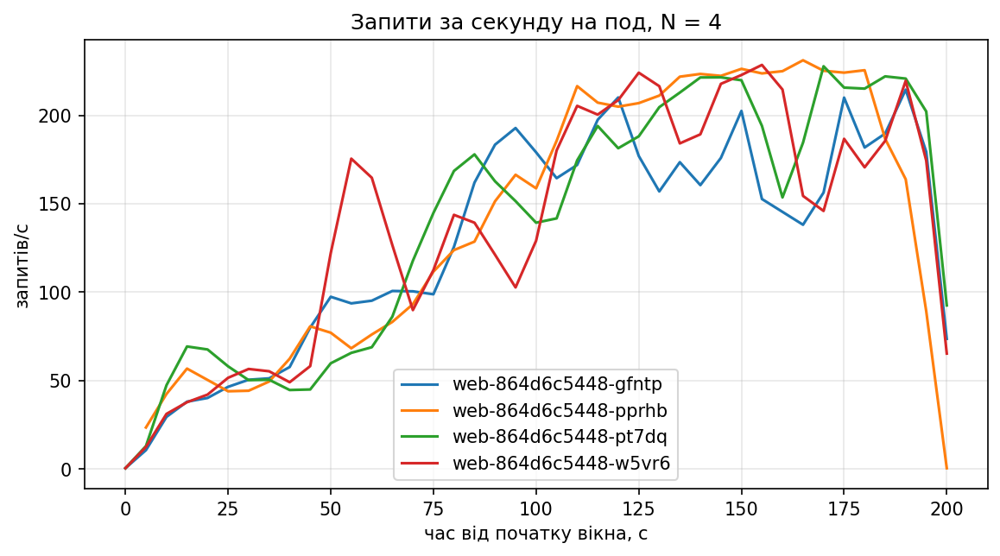
</p>

*Рисунок 29 – Запити за секунду на кожен под при N = 4 протягом усього прогону*

На діаграмі лінії всіх чотирьох подів зростають разом зі сходинками заданої інтенсивності і перетинаються: жоден под не є стабільно найзавантаженішим. На останніх сходинках лінії лежать приблизно в діапазоні 140–230 запитів/с на под, що узгоджується з пропускною здатністю на репліку (≈ 200 запитів/с) з таблиці кроку 7.

### Крок 9. Параметри закону масштабованості

Універсальний закон масштабованості описується формулою X(N) = λN / (1 + σ(N − 1) + κN(N − 1)). Параметри σ і κ визначено методом найменших квадратів за результатами для N = 2, 3, 4. Якщо один із параметрів від’ємний, його прирівнюють до нуля, а інший перераховують за спрощеною формулою. Метод відповідає розділу «Універсальний закон масштабованості» ЛР2.

**Таблиця 4 – Вихідні дані для підбору (N \> 1)**

| **N** | **u = N − 1** | **v = N(N − 1)** | **C(N) Kubernetes** | **y(N) Kubernetes** | **y(N) Compose** |
|-------|---------------|------------------|---------------------|---------------------|------------------|
| 2     | 1             | 2                | 1.390               | 0.439               | 0.263            |
| 3     | 2             | 6                | 1.947               | 0.541               | 0.290            |
| 4     | 3             | 12               | 2.600               | 0.539               | 0.408            |

Для Kubernetes отримано: Σu² = 14, Σv² = 184, Σuv = 50, Σuy = 3,137, Σvy = 10,588. Знаменник дорівнює 14 · 184 − 50² = 76. Початкові оцінки: σ = 0,630, κ = −0,114. Оскільки κ від’ємний, його прирівняно до нуля, а σ перераховано: σ = 3,137 / 14 = 0,224.

Для Compose початкові оцінки σ = 0,2925 і κ = −0,0406. Після прирівнювання κ до нуля отримано σ = 0,148.

**Таблиця 5 – Параметри закону для Compose і Kubernetes**

| **Показник**          | **Compose (ЛР2)** | **Kubernetes**  |
|-----------------------|-------------------|-----------------|
| X(1), запитів/с       | 313.2             | 312.9           |
| X(4), запитів/с       | 889.8             | 813.5           |
| C(4) = X(4) / X(1)    | 2.84              | 2.60            |
| σ, κ (сирі оцінки)    | 0.2925, −0.0406   | 0.6296, −0.1135 |
| σ, κ (після правила)  | 0.1476, 0         | 0.2241, 0       |
| N\*                   | немає             | немає           |
| Межа λ / σ, запитів/с | ≈ 2121            | ≈ 1396          |

В обох стендах κ = 0, тобто помітного зростання витрат зі збільшенням кількості реплік не виявлено. Падіння ефективності описує параметр σ: для Kubernetes він ь 0,224, а для Compose — 0,148.

Для Kubernetes теоретичне максимальне прискорення дорівнює 1 / σ ≈ 4,5 раза, а гранична пропускна здатність — λ / σ ≈ 1396 запитів/с. Оскільки κ = 0, скінченного максимуму пропускної здатності немає, тому N\* не існує.

**Таблиця 6 – Порівняння виміряної пропускної здатності з кривою закону (Kubernetes)**

| **N** | **Виміряно, запитів/с** | **За законом, запитів/с** | **Відхилення від закону** |
|-------|-------------------------|---------------------------|---------------------------|
| 1     | 312.9                   | 312.9                     | 0 %                       |
| 2     | 434.8                   | 511.2                     | −14.9 %                   |
| 3     | 609.1                   | 648.2                     | −6.0 %                    |
| 4     | 813.5                   | 748.4                     | +8.7 %                    |

Крива моделі не збігається з вимірюваннями: прирости C(N) збільшуються (0,39; 0,56; 0,65), тоді як при κ = 0 вони мають зменшуватися. Тому модель завищує X(2) і занижує X(4). Відхилення можна порівняти з розкидом вимірювань, який для N = 2 становить ±62 запити/с, або 14 % від X(2). Через це форму кривої не варто вважати точною характеристикою системи. Три точки для двох параметрів дають лише приблизну оцінку, тому прогнози для N \> 4 ненадійні.

У Kubernetes σ = 0,224, а в Compose — 0,148. Значення C(4) становлять відповідно 2,60 і 2,84. Різниця між стендами порівнянна з розкидом вимірювань, але в усіх точках Kubernetes масштабується не краще за Compose. Можлива причина — додатковий шлях запиту через перенаправлення порту Docker, вузол kind і kube-proxy, однак окремо це не перевіряли.

<p align="center">
  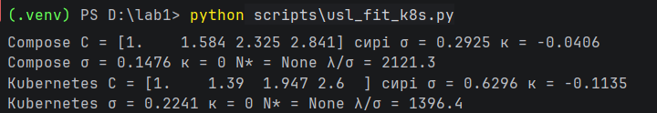
</p>

*Рисунок 30 – Обчислення σ, κ і N\**

<p align="center">
  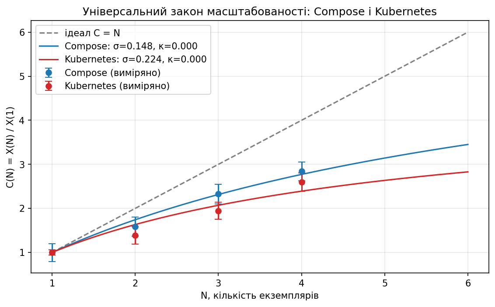
</p>

*Рисунок 31 – C(N) з розкидом і криві закону для Compose і Kubernetes*

### Крок 10. Профіль навантаження без автомасштабування

До генератора додано режим --profile, який задає тривалість та інтенсивність навантаження. Результати зберігаються у CSV-файлах.

Профіль навантаження: 30 с на рівні 94 запити/с, 60 с на рівні 732 запити/с і 90 с на рівні 94 запити/с. Рівень стрибка обмежено 90 % від X(4), щоб навантаження залишалося досяжним. Прогін виконано на чотирьох фіксованих репліках без HPA.

<p align="center">
  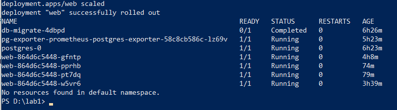
</p>

*Рисунок 32 – Чотири репліки web, HPA відсутній*

<p align="center">
  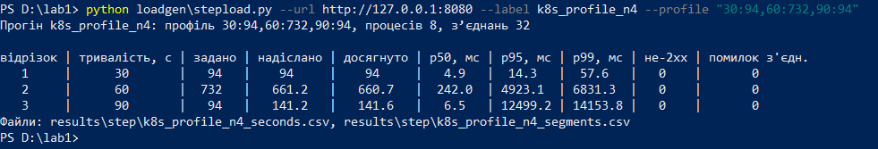
</p>

*Рисунок 33 – Перший прогін профілю на 4 репліках*

Перший прогін відкинуто через нетипові значення p99: 57,6 мс на першому відрізку та 6831 мс під час стрибка. Причину не встановлено. Оскільки рішення ухвалено після перегляду результатів, пороги еластичності можуть бути неточними. Якщо врахувати цей прогін, результати можуть змінитися. Для кроків 11 і 12 використано повторний прогін із p99₀ = 6,5 мс і p99 = 160,9 мс під час стрибка.

### Крок 11. Прогін із HPA

Створено HPA з цільовим завантаженням CPU 70 %, кількістю реплік від 1 до 4 та вікном зменшення 30 с. Перед прогоном кількість реплік зменшено до однієї, після чого витримано паузу 60 с. Використано той самий профіль навантаження, що й у кроці 10.

```yaml
# k8s-extra/hpa.yaml
apiVersion: autoscaling/v2
kind: HorizontalPodAutoscaler
metadata:
name: web
spec:
scaleTargetRef: {apiVersion: apps/v1, kind: Deployment, name: web}
minReplicas: 1
maxReplicas: 4
metrics:
- type: Resource
resource: {name: cpu, target: {type: Utilization, averageUtilization: 70}}
behavior:
scaleDown:
stabilizationWindowSeconds: 30
```

<p align="center">
  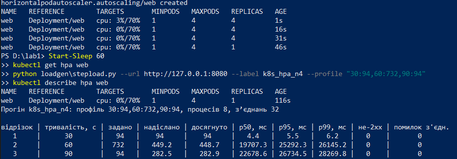
</p>

*Рисунок 34 – Створення HPA, одна репліка перед прогоном і результат прогону з HPA*

<p align="center">
  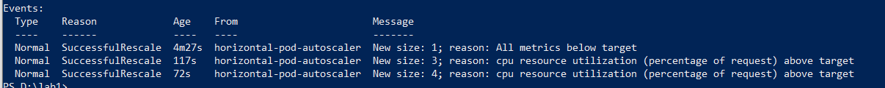
</p>

*Рисунок 35 – Події HPA: зміна кількості реплік*

HPA кожні 15 с отримує дані про використання CPU і визначає потрібну кількість реплік. Цільове значення — 70 % від requests.cpu (500m). Під час стрибка завантаження CPU зросло до 185–200 %, тому HPA збільшив кількість реплік спочатку з 1 до 3, а потім до 4. Час зміни кількості реплік визначено за подіями HPA.

**Таблиця 7 – Часові показники прогону з HPA (початок стрибка на 30-й секунді)**

| **Подія**                                                                                         | **Час**                                                             |
|---------------------------------------------------------------------------------------------------|---------------------------------------------------------------------|
| Стрибок → перша зміна бажаної кількості реплік                                                    | 38 с                                                                |
| Стрибок → готовність найбільшої кількості реплік (4)                                              | не досягнуто (4 репліки готові через 88 с, вже після кінця стрибка) |
| Стрибок → p99 клієнта 10 с поспіль нижчий за поріг 193,1 мс (1,2 · p99 кроку 10 = 1,2 · 160,9 мс) | не досягнуто                                                        |
| Кінець стрибка → перше зменшення готових реплік                                                   | не досягнуто                                                        |

**Таблиця 8– Хронологія реакції HPA (час від початку стрибка, наближено)**

| **Час** | **Подія**                                                                                         |
|---------|---------------------------------------------------------------------------------------------------|
| ≈ 12 с  | використання CPU у даних Prometheus стає помітним: лічильники cAdvisor оновлюються раз на 10–15 с |
| 38 с    | HPA змінює бажану кількість реплік з 1 до 3                                                       |
| ≈ 43 с  | три репліки готові (старт контейнера і readinessProbe займають близько 5 с)                       |
| ≈ 83 с  | друге рішення HPA: бажана кількість 4 (через 45 с після першого)                                  |
| 88 с    | четверта репліка готова; стрибок закінчився на 60-й секунді                                       |

Реакція HPA залежить від оновлення метрик, циклу перевірки (15 с), запуску контейнера та проходження readinessProbe. Перше рішення про збільшення кількості реплік ухвалено через 38 с. Перехід від 3 до 4 реплік зайняв ще 45 с, тому четверта репліка стала готовою на 88-й секунді, вже після завершення стрибка навантаження на 60-й секунді. Затримка пов’язана, зокрема, з тим, що поди без готовності або метрик впливають на розрахунок HPA.

Умова зниження p99 клієнта протягом 10 с не виконалася: через чергу під час стрибка затримка зросла до десятків секунд і нормалізувалася лише після її обробки. Кількість реплік також не зменшилася до кінця прогону, оскільки після зниження навантаження HPA потрібен час на обробку метрик, цикл перевірки та вікно стабілізації 30 с.

### Крок 12. Метрики еластичності

Потрібна кількість реплік d(t) - це найменша кількість реплік, за якої пропускна здатність X(N) не менша за задане навантаження z(t). Для 94 запитів/с достатньо однієї репліки, а для 732 запитів/с потрібні чотири, оскільки X(3) = 609,1, а X(4) = 813,5 запитів/с.

Фактична кількість готових реплік s(t) визначається за показником kube_deployment_status_replicas_ready. Між вимірюваннями значення вважається незмінним. Поріг затримки становить 13 мс — це подвоєне початкове значення p99 клієнта (6,5 мс).

**Таблиця 10 – Метрики еластичності**

| **Показник**                          | **Без автомасштабування (4 репліки)** | **З HPA** |
|---------------------------------------|---------------------------------------|-----------|
| θ_U, частка часу нестачі реплік       | 0.000                                 | 0.333     |
| θ_O, частка часу надлишку реплік      | 0.667                                 | 0.500     |
| a_U, середня нестача реплік           | 0.000                                 | 0.811     |
| a_O, середній надлишок реплік         | 2.000                                 | 1.344     |
| W, репліко-секунд                     | 720                                   | 456       |
| Секунд порушення порогу               | 65                                    | 90        |
| Відповідей не 2xx / помилок зʼєднання | 0 / 0                                 | 0 / 0     |

Прогін з HPA. До 73-ї секунди працювала 1 репліка, до 118-ї — 3, далі — 4. Під час стрибка навантаження потрібні були 4 репліки, але їх не вистачало протягом усіх 60 с. Частка часу з нестачею реплік θ_U = 0,333, середня нестача a_U = 0,811. Надлишок реплік: θ_O = 0,500, a_O = 1,344. Сумарна кількість репліко-секунд W = 456.

Прогін без HPA. Постійно працювали 4 репліки, хоча потрібні вони були лише 60 с. Нестачі реплік не було, але надлишок тривав 120 с. θ_U = 0, a_U = 0, θ_O = 0,667, a_O = 2,0. Сумарно W = 720 репліко-секунд.

<p align="center">
  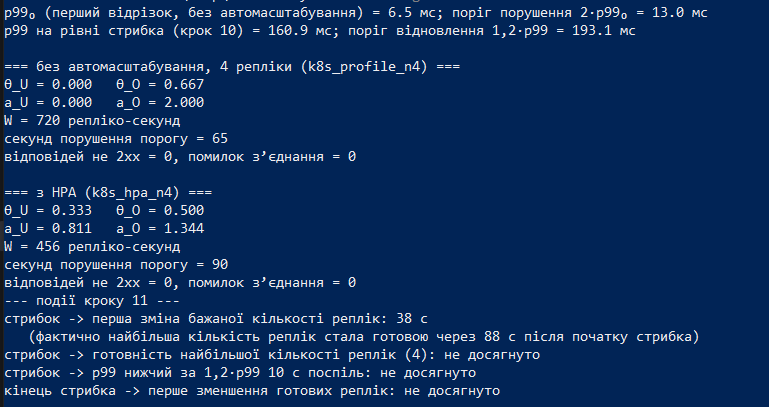
</p>

*Рисунок 36 – Вивід розрахунку метрик еластичності*

<p align="center">
  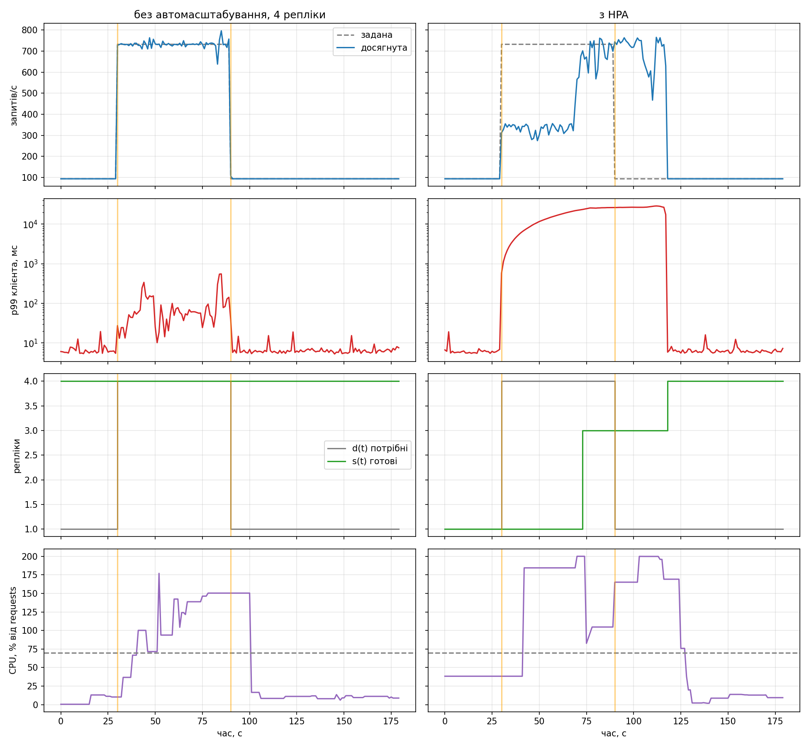
</p>

*Рисунок 37 – Діаграми прогонів без автомасштабування (ліворуч) і з HPA (праворуч)*

Без автомасштабування. Чотири репліки забезпечують задане навантаження близько 730 запитів/с без черги. Однак три репліки зайві протягом 120 із 180 секунд. Загалом використано 720 репліко-секунд.

З HPA. Під час стрибка реплік не вистачає. Спочатку одна репліка обробляє 300–350 запитів/с, а після масштабування швидкість зростає. Через чергу p99 клієнта сягає приблизно 26 с і повертається до норми лише після її обробки. Помилок немає, але запити затримуються. Використано 456 репліко-секунд.

Порівняння. HPA зменшив витрати реплік на 37 %, але погіршив час відповіді: поріг затримки порушувався 90 секунд проти 65 без автомасштабування. Реакція HPA повільніша за сам стрибок тривалістю 60 с. Для коротких піків потрібен запас реплік, а HPA краще підходить для повільніших змін навантаження.

### Крок 13. Додаткова вимога Д3: Traefik Ingress

Traefik встановлено через Helm у просторі імен traefik і закріплено за вузлом control-plane. Його NodePort 30081 доступний через localhost:8081. Ingress спрямовує запити з адреси localhost:8081 на Service web (порт 8000). Сервіс доступний двома способами: через NodePort на localhost:8080 і через Ingress на localhost:8081

```yaml
# k8s-extra/traefik-values.yaml
service:
type: NodePort
ports:
web:
nodePort: 30081
nodeSelector:
role: infra
tolerations:
- key: node-role.kubernetes.io/control-plane
operator: Exists
effect: NoSchedule
```

```bash
helm install traefik traefik/traefik -n traefik --create-namespace -f k8s-extra\traefik-values.yaml --wait
```

```yaml
# k8s-extra/ingress.yaml
apiVersion: networking.k8s.io/v1
kind: Ingress
metadata:
name: web
spec:
ingressClassName: traefik
rules:
- http:
paths:
- path: /
pathType: Prefix
backend:
service:
name: web
port:
number: 8000
```

Для порівняння HPA видалено, а кількість реплік зафіксовано на 4. Кожен шлях перевірено окремим прогоном із навантаженням 600 запитів/с, яке сервіс витримує без перевантаження. Між прогонами витримано паузу 60 с. Дисбаланс обчислено за лічильниками запитів на подах незалежно від шляху запиту.

<p align="center">
  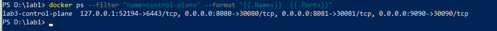
</p>

*Рисунок 38 – Порт 8081 вузла control-plane прокинуто на NodePort 30081*

<p align="center">
  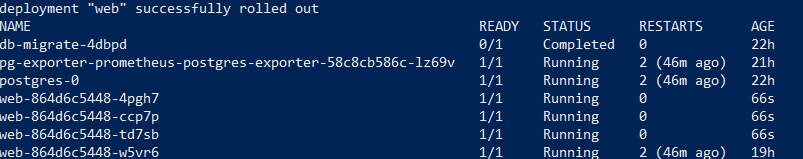
</p>

*Рисунок 39 – Чотири репліки web перед вимірюванням*

**Таблиця 11 – Дисбаланс на 4 репліках за заданої інтенсивності 600 запитів/с**

| **Шлях**        | **Досягнуто, запитів/с** | **I** | **Запитів/с на кожен под**    | **p99 клієнта, мс** | **p99 сервера, мс** |
|-----------------|--------------------------|-------|-------------------------------|---------------------|---------------------|
| NodePort (8080) | 608.0                    | 1.095 | 148.8 / 151.6 / 171.2 / 153.6 | 694.3               | 72.6                |
| Ingress (8081)  | 599.9                    | 1.000 | 150.5 / 150.5 / 150.5 / 150.5 | 22.5                | 15.7                |

<p align="center">
  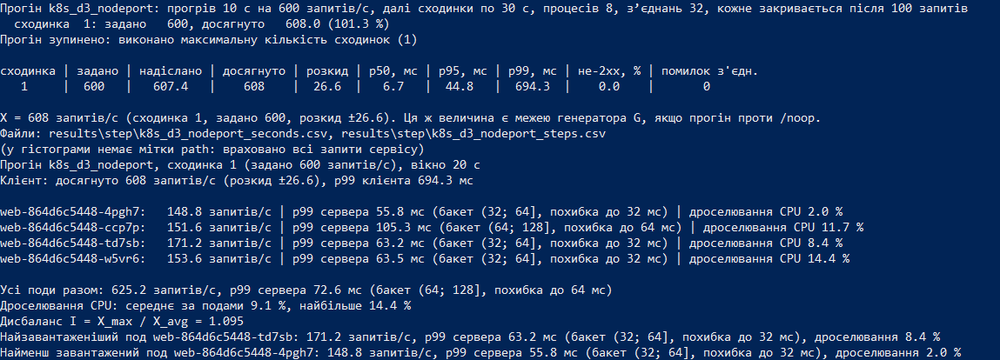
</p>

*Рисунок 40 – Розподіл запитів між подами через NodePort*

<p align="center">
  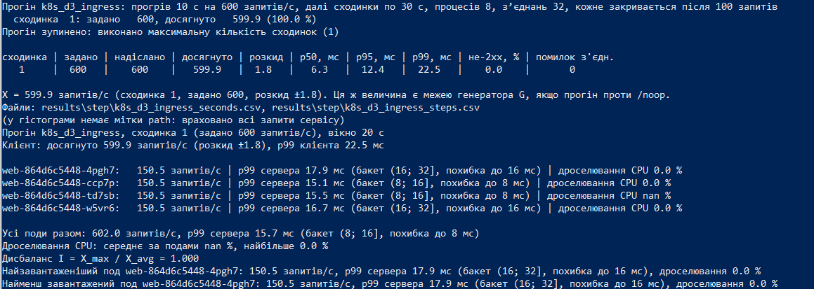
</p>

*Рисунок 41 – Розподіл запитів між подами через Ingress*

Обидва шляхи витримують задане навантаження: через NodePort досягнуто 608 запитів/с, через Ingress — 599,9 запитів/с. Через Ingress навантаження розподілилося рівномірно між усіма подами (I = 1,000). Через NodePort дисбаланс більший: найзавантаженіший под отримав на 9,5 % більше запитів за середнє (I = 1,095). Сума запитів на подах через NodePort становить 625,2 запиту/с, що на 2,8 % більше за загальну інтенсивність.

Затримки. p99 клієнта через Ingress значно нижчий: 22,5 мс проти 694,3 мс через NodePort. p99 сервера також менший: 15,7 проти 72,6 мс. Таку різницю не можна пояснити лише нерівномірним розподілом навантаження. Можливі фактори — порядок прогонів (NodePort перевіряли першим, без прогріву), стан пулів з’єднань і шлях через kube-proxy. Даних про дроселювання для цього прогону немає.

## Обмеження вимірювань

Усі висновки потрібно розглядати з урахуванням обмежень експерименту.

1\. Генератор і кластер працюють на одній машині з 8 CPU та конкурують за процесор. Тому абсолютні значення X(N) залежать від потужності ноутбука.

2\. Кожну точку виміряно одним прогоном. За N ≥ 2 розкид X(N) становить близько ±60 запитів/с, або 10–14 %. Тому невеликі відмінності між точками та стендами не варто вважати значущими.

3\. p99 сервера визначено за гістограмою з бакетами за ступенями двійки. На верхніх рівнях похибка може сягати 128 мс. p99 клієнта не має такого обмеження, але враховує чергу генератора та затримки на шляху через порт Docker.

4\. Закон масштабованості підібрано за трьома точками для двох параметрів. Він показує загальну тенденцію, але прогноз для N \> 4 ненадійний.

5\. Крок 10 вимірювали двічі, оскільки перший прогін відкинули через нетиповий p99. Це свідчить про обмежену відтворюваність вимірювань на цьому ноутбуці. Тому результати кроків 11–12 варто розглядати як якісне порівняння режимів.

## Висновки

Сервіс із ЛР2, базу PostgreSQL і моніторинг перенесено в кластер kind. База зберігає дані після видалення пода, схема створюється через Job, пароль зберігається в Secret, а Prometheus збирає метрики подів і стану Deployment.

У Kubernetes пропускна здатність зростає зі збільшенням кількості реплік, але прискорення нижче за ідеальне. На одній репліці основним обмеженням є ліміт CPU, а на чотирьох зростання, ймовірно, обмежують спільні ресурси. Закон масштабованості показав, що Kubernetes масштабується не краще за Compose. Можливо, на результат впливає додатковий мережевий шлях.

Через NodePort запити розподіляються між подами майже рівномірно, а через Traefik Ingress у цьому прогоні розподіл був ще рівномірнішим. Однак причину різниці не встановлено, тому це потребує додаткової перевірки.

HPA використовує менше ресурсів, ніж чотири постійні репліки, але повільно реагує на короткий стрибок навантаження. Реплік не вистачає протягом усього стрибка, через що накопичується черга й суттєво зростає затримка. Чотири постійні репліки витримують таке навантаження, але значну частину часу використовуються не повністю.

Оскільки вимірювання виконано на одному ноутбуці й без повторних прогонів для кожної точки, точні числові відмінності не варто переоцінювати. Надійніше орієнтуватися на загальні тенденції масштабування, розподілу запитів і реакції HPA.
